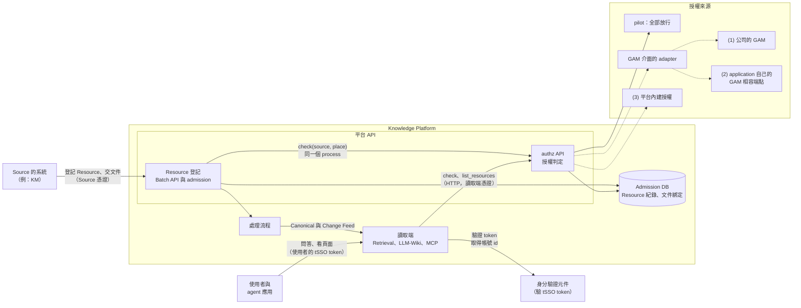
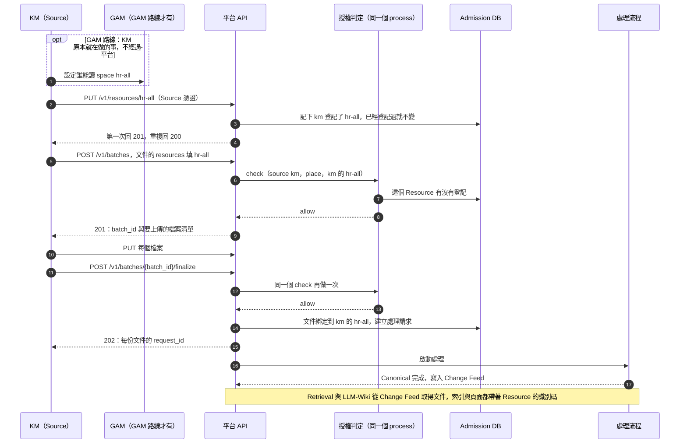
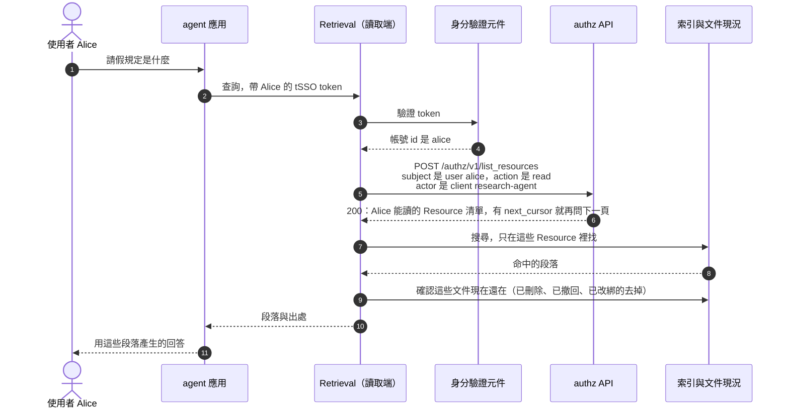
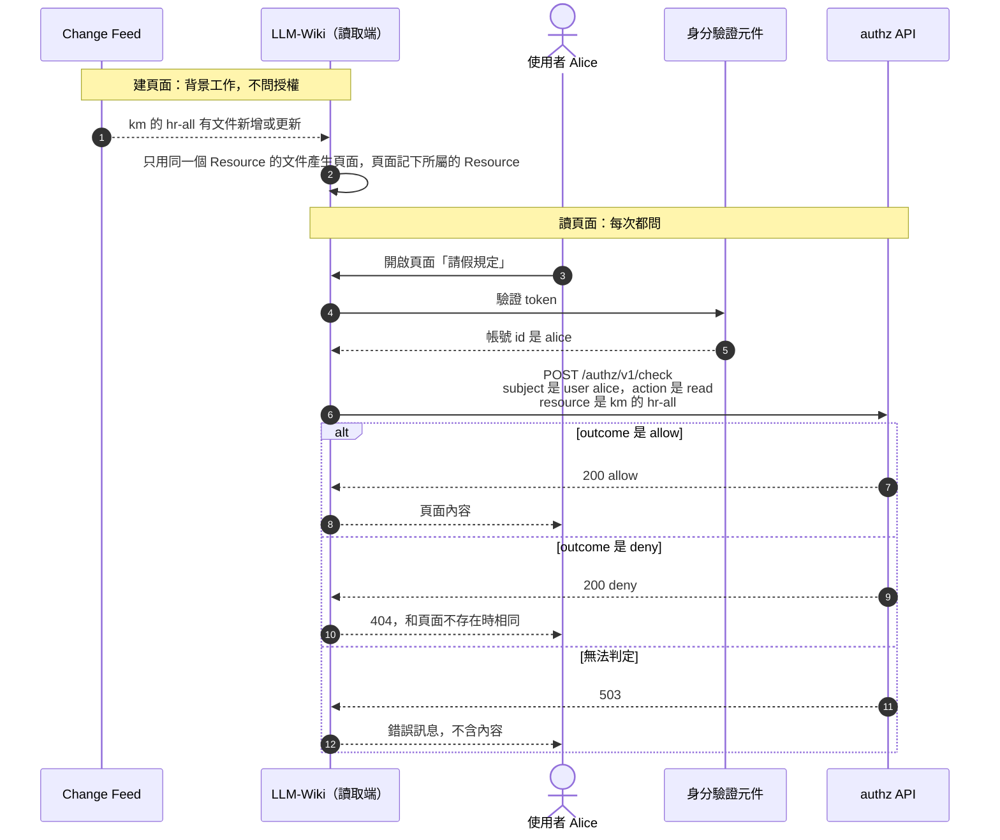
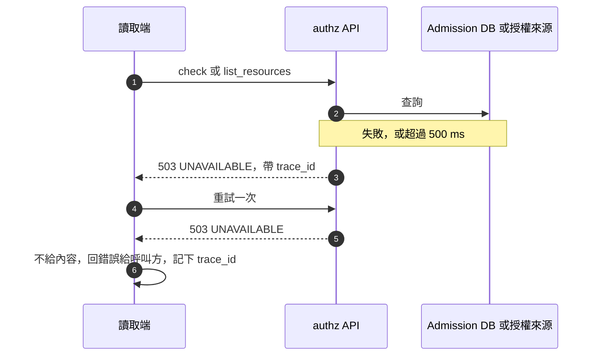
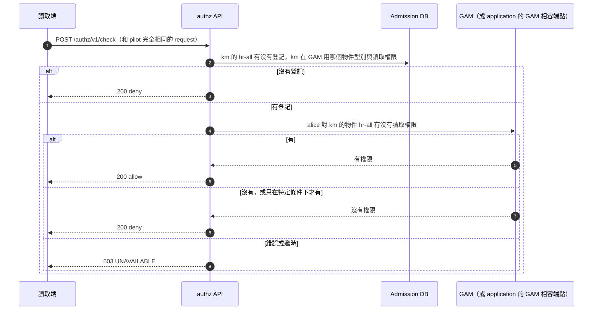

# Knowledge Platform 授權指南：架構、情境流程與 authz API

**狀態：** 2026-11-14 起是 authz API 的現行契約，決策改變時更新本文。決策的經過與理由在[授權設計](knowledge-platform-authorization.md)，本文只寫現在的結果。實作票：[#204](https://github.com/davidlinnnn/data-ingestion/issues/204)（平台 API 補強）、[#114](https://github.com/davidlinnnn/data-ingestion/issues/114)（Resource 登記）、[#205](https://github.com/davidlinnnn/data-ingestion/issues/205)（改綁）、[#127](https://github.com/davidlinnnn/data-ingestion/issues/127)（讀取端 SDK）、[#86](https://github.com/davidlinnnn/data-ingestion/issues/86)（GAM）、[#115](https://github.com/davidlinnnn/data-ingestion/issues/115)（平台內建授權）。

本文說明三件事：平台怎麼決定「誰能放文件、誰能讀文件」；交文件、問答、看 Wiki 頁面時，各方各自要做什麼；authz API 的規格。

| 你是 | 先讀 |
|---|---|
| 主管 | §1、§2 |
| Source 的開發者（把文件交給平台的系統，例如 KM） | §2、§3.1、§3.2、§4.7 |
| 讀取端的開發與維運（Retrieval、LLM-Wiki、MCP） | §2、§3.3 到 §3.7、§4、§5、§6 |
| 平台維運 | §6、§7 |

本文用到的名詞（完整定義在 `CONTEXT.md`）：

| 名詞 | 意思 |
|---|---|
| Source | 把文件交給平台的系統，例如公司的 KM。每個 Source 有自己的憑證 |
| Resource | 權限的單位。每份文件屬於一個 Resource，例如 KM 的一個 space |
| 讀取端 | 把內容給使用者的服務：Retrieval、LLM-Wiki、MCP。它負責照判定結果給或不給 |
| authz API | 平台內唯一做授權判定的 API |
| 授權來源（provider） | authz API 後面實際算出答案的地方，可以更換 |

## 1. 摘要

**平台的授權只回答三個問題。**

| 動作 | 問題 | 誰是主體 | 誰來問 |
|---|---|---|---|
| `place` | 這個 Source 能不能把文件放進這個 Resource？ | Source | admission，在宣告與 finalize 時 |
| `manage` | 這個 Source 能不能管理這個 Resource？ | Source | 平台的 Resource API |
| `read` | 這個使用者能不能讀這個 Resource 的內容？ | 使用者 | 讀取端，在每次查詢或開頁面時 |

**權限的單位是 Resource，不是單份文件。** 能讀一個 Resource 的人，就能讀裡面所有文件，以及由這些文件產生的內容（搜尋片段、Wiki 頁面）。第一版沒有單份文件的例外（[ADR-0008](../adr/0008-resource-level-authorization-relations.md)、[ADR-0007](../adr/0007-derived-product-readers-within-input-intersection.md)）。

**Resource 用 Source 自己的 key 命名。** KM 的 space `hr-all` 在平台上就叫 `hr-all`，平台不另外產生 id（[ADR-0013](../adr/0013-resource-identified-by-source-key.md)）。

**判定集中在一處，執行分散在各讀取端。** 所有讀取端都問同一支 authz API，自己不保存權限。更換授權來源時，讀取端與 Source 都不用改。

**pilot 現況：全部放行。** pilot 不做存取控制，後果是每個通過身分驗證的使用者都讀得到這套部署裡的所有文件。這是 2026-11-13 接受的後果。全放行只能在 pilot 設定下啟動，正式環境用這個設定會拒絕啟動。

**正式環境之前要換成真正的授權來源。** 選項見 §2.4：公司的 GAM、application 自己提供的 GAM 相容端點、平台內建授權。

各項目做到哪裡，見 §7。

## 2. 系統架構

### 2.1 系統圖

實線是已經存在或已排入實作的路徑，虛線是還沒實作的授權來源。一套部署只選一種授權來源。



圖上要注意兩件事：

- **Source 與使用者都不呼叫 authz API。** Source 只呼叫平台 API 登記 Resource 和交文件；使用者只接觸讀取端。authz API 只在內部網路，只接受登錄過的讀取端。
- **讀取端不知道後面接的是哪一種授權來源。** request 與 response 的格式不因授權來源而變。

### 2.2 元件與職責

| 元件 | 職責 | 在授權裡的角色 |
|---|---|---|
| Source 的 client | 登記 Resource、交文件。走 GAM 路線時，在 GAM 設定誰能讀 | 不呼叫 authz API |
| Resource 登記 | 記下每個 Source 登記過哪些 key | 「Resource 存不存在、是誰登記的」的來源 |
| admission | 宣告與 finalize 時檢查 Source 能不能放進該 Resource | 執行點，在同一個 process 內呼叫 |
| authz API | 回答 `check` 與 `list_resources` | 判定點，全平台只有這一個 |
| 授權來源 | 算出答案 | 在 authz API 後面，可以更換 |
| 讀取端 | 驗證使用者身分，問 authz API，照結果給或不給內容 | 執行點，經 HTTP 呼叫 |
| 身分驗證元件 | 驗證 tSSO token，解出使用者的帳號 id | 授權的主體從這裡來 |
| Admission DB | Resource 紀錄、文件屬於哪個 Resource | authz API 的依賴 |

### 2.3 誰呼叫誰

| 呼叫方 | 呼叫什麼 | 用什麼憑證 | 目的 |
|---|---|---|---|
| Source | `PUT`、`GET`、`DELETE /v1/resources/{key}` | Source 憑證 | 登記、查詢、刪除自己的 Resource |
| Source | `/v1/batches` 的宣告、上傳、finalize | Source 憑證 | 交文件 |
| admission | process 內的授權介面 | 不需要 | 放置檢查 |
| 讀取端 | `POST /authz/v1/check`、`POST /authz/v1/list_resources` | 讀取端憑證 | 讀取判定 |
| 使用者、agent 應用 | 讀取端自己的 API | 使用者的 tSSO token | 問答、看頁面 |

### 2.4 授權來源的選項

| 選項 | 權限資料放在哪裡 | 誰設定「誰能讀」 | 平台怎麼判定 `read` | 適合誰 | 狀態 |
|---|---|---|---|---|---|
| pilot：全部放行 | 沒有權限資料。PostgreSQL 只記登記過哪些 Resource | 沒有人 | Resource 有登記就放行 | 只限 pilot | 已完成（#113） |
| (1) 公司的 GAM | GAM | Source 自己，用它自己的 key | 問 GAM：這個使用者對這個 Source 的這個物件有沒有讀取權限 | 已經用 GAM 管權限的系統，例如 KM | 已規劃（#86） |
| (2) application 自己的 GAM 相容端點 | application 自己的權限表 | application 自己 | 和 (1) 用同一個 adapter，位址指到 application 的端點 | 覺得接 GAM 太重的小型 application | 方向，未排入實作 |
| (3) 平台內建授權 | 平台（SpiceDB） | application 呼叫平台 API 設定 | 平台自己判定 | 不接 GAM、也不想自己維護端點的 application | 已規劃（#115），MVP 之後 |

`place` 與 `manage` 在 (1) 與 (2) 都不問外部：平台看自己的 Resource 紀錄，登記這個 key 的 Source 才有權限。所以交文件的流程不依賴 GAM 的可用性。

選項 (2) 的條件：

- **相容的範圍是平台會呼叫的讀取操作**：「這個使用者能不能讀這個物件」與「這個使用者能讀哪些物件」。application 不需要實作 GAM 的寫入與 schema 管理。
- **介面細節要等 #86**：GAM 實際的 API 確認後，才寫得出相容的規格。
- **行為也要一樣，不只是格式**：出錯不能被當成拒絕；列表必須等於逐一檢查會放行的全部；使用者 id 用同一個帳號 id。啟用前由平台對這個端點跑一致性測試，通過才接。
- **可用性由 application 負責**：端點無法回應時，這套部署的文件讀不到。
- **公司規定**：application 自己維護的權限表算不算「GAM 相容機制」，要先確認。

一套部署只接一種授權來源。同一套部署裡不同 Source 用不同的授權來源時，`list_resources` 要跨來源合併結果，這部分還沒有設計。

## 3. 情境流程

以下情境用同一組例子：

- Source 是 KM，在平台登錄的 id 是 `km`。
- KM 有一個 space，它自己的 key 是 `hr-all`。
- 使用者 Alice，帳號 id 是 `alice`。
- agent 應用在平台登錄的 id 是 `research-agent`。

每個情境先畫流程，再列出各方要做的事。Retrieval 與 LLM-Wiki 的產品還沒實作，§3.3 與 §3.4 畫的是設計規定讀取端必須做到的事。

### 3.1 一次性的準備

| 誰 | 做什麼 | 備註 |
|---|---|---|
| 平台維運 | 登錄 Source（`km`）與它的憑證，交給 KM 的開發者 | 設定格式由 #78 定 |
| 平台維運 | 登錄每個讀取端的憑證與名稱，交給讀取端的維運 | 設定裡只放憑證的 SHA-256，不放憑證本身 |
| 平台維運 | 登錄 agent 應用（`research-agent`） | 供稽核紀錄使用 |
| 平台維運（GAM 路線） | 在 Source 的設定寫明：它在 GAM 用的物件型別，以及代表「讀」的權限名稱 | #86 確認 |
| KM 的開發者 | 保管 Source 憑證，在呼叫平台 API 時帶上 | |
| 讀取端的維運 | 保管讀取端憑證，設定 authz API 的位址 | |

### 3.2 交文件：KM 開一個新 space，把文件交給平台



| 步驟 | KM（Source）要做的 | 平台做的 |
|---|---|---|
| 設定讀者（GAM 路線） | 照原本的做法，在 GAM 設定誰能讀這個 space | 不參與。pilot 沒有這一步 |
| 登記 Resource | 呼叫 `PUT /v1/resources/hr-all`。可以重複呼叫，不用記自己登記過什麼 | 記下這個 key 屬於 `km`。重複登記不產生任何變更 |
| 宣告 | 在每份文件的 `resources` 填 `hr-all` | 把憑證的 Source 與 key 組成完整識別碼，做放置檢查。key 沒登記時，這份文件回 `RESOURCE_NOT_FOUND` |
| 上傳 | 逐檔 `PUT` | 驗證大小與 SHA-256 |
| finalize | 呼叫 finalize，記下回傳的 `request_id` | 再做一次放置檢查，受理後啟動處理 |
| 查進度 | 用 `request_id` 或 `document_id` 查詢 | 回報處理狀態，以及各讀取端是否已經可以提供這份文件 |

要點：

- **Source 只碰得到自己的 key。** request 裡只寫 key，Source 由憑證決定。兩個 Source 可以有相同的 key，平台視為兩個不同的 Resource。
- **誰按下上傳不影響權限。** 交文件用的是 Source 憑證，不是使用者的身分。
- **授權判定無法完成時**，整個宣告或 finalize 回 `503 AUTHZ_UNAVAILABLE` 並帶 `Retry-After`，Source 稍後重試即可。
- 上傳本身的細節在[檔案上傳](knowledge-platform-file-upload.md)，規則在 [admission 規格](knowledge-platform-admission-spec.md) §5、§6。

### 3.3 RAG：使用者透過 agent 應用問問題（Retrieval）



| 步驟 | agent 應用要做的 | Retrieval（讀取端）要做的 | 平台（authz API）做的 |
|---|---|---|---|
| 發出查詢 | 帶上使用者自己的 tSSO token，不要用一個共用帳號替所有人查 | | |
| 確認身分 | | 把 token 交給身分驗證元件，用解出的帳號 id 當主體。不接受呼叫方自己宣稱的使用者 id | |
| 取得可讀範圍 | | 呼叫 `list_resources`，跟著 `next_cursor` 讀到最後一頁 | 回傳這個使用者能讀的 Resource。pilot 回傳所有登記過的 Resource |
| 搜尋 | | 只在清單內的 Resource 裡搜尋。清單是空的就直接回「沒有結果」 | |
| 揭露前確認 | | 去掉已刪除、已撤回、已改綁到別的 Resource 的文件。依據是平台提供的文件現況，不是索引裡的舊副本 | 提供文件現況（#126） |
| 回傳 | 只用拿到的段落產生回答。結果不跨使用者快取 | 回傳段落與出處。結果不跨使用者快取 | |

要點：

- **authz API 回 `200` 以外的任何結果，Retrieval 都不給內容**，見 §3.5。
- **`actor` 目前只記錄，不影響結果。** 它讓稽核紀錄看得出這次查詢是經由哪個 agent 應用。
- **回答由 agent 應用產生時**，權限已經在取得段落的那一步把關：使用者讀不到的文件不會進入 LLM 的輸入。

### 3.4 LLM-Wiki：建頁面與讀頁面



| 階段 | LLM-Wiki 要做的 | 平台做的 |
|---|---|---|
| 建頁面 | 一個 Resource 的文件只用來產生這個 Resource 的頁面，不跨 Resource 合成。每個頁面記下它所屬 Resource 的識別碼 | 經 Change Feed 提供文件與它所屬的 Resource |
| 讀單一頁面 | 驗證使用者身分，對頁面所屬的 Resource 呼叫 `check`，`allow` 才給內容 | 回傳判定 |
| 列出或搜尋頁面 | 做法和 §3.3 相同：先呼叫 `list_resources`，只列出清單內 Resource 的頁面 | 回傳可讀範圍 |
| 文件被刪除或改綁 | 從 Change Feed 收到事件後，重建或移除受影響的頁面 | 送出事件 |

要點：

- **為什麼不跨 Resource 合成**：一個頁面如果用了兩個 Resource 的文件，只能讀其中一個的人就會透過頁面看到另一個的內容（ADR-0007）。需要跨讀者群的主題時，由 Source 建一個涵蓋目標讀者的 Resource。
- **拒絕與不存在要長得一樣。** 回 `404`，不要讓使用者從回應分辨「沒有這一頁」和「你沒有權限」。
- **建頁面時不問授權**，因為頁面的讀者就是它所屬 Resource 的讀者，在讀取時才判定。

### 3.5 無法判定時



| 情況 | authz API 的回應 | 讀取端要做的 | 使用者看到的 |
|---|---|---|---|
| 主體有權限 | `200`，`outcome` 是 `allow` | 給內容 | 內容 |
| 主體沒有權限 | `200`，`outcome` 是 `deny` | 不給 | 和「不存在」相同 |
| Resource 沒有登記 | `200`，`outcome` 是 `deny` | 不給 | 和「不存在」相同 |
| 授權來源或資料庫失敗、逾時 | `503` | 可以重試一次，仍失敗就不給 | 錯誤訊息，不含內容 |
| 連不上 authz API，例如部署替換中 | 沒有回應 | 和 `503` 相同 | 錯誤訊息，不含內容 |
| 讀取端憑證沒登錄 | `401` | 不給，這是設定問題，要告警 | 錯誤訊息，不含內容 |

規則只有一條：**只有 `200` 而且 `outcome` 是 `allow` 才給內容**；列表則是只有 `200` 才使用清單。其他一律不給。

### 3.6 權限與文件變動之後

| 事件 | 誰做什麼 | 讀取端要做的 | 多久生效 |
|---|---|---|---|
| 使用者被移出 space（GAM 路線） | KM 在 GAM 移除，不用通知平台 | 不用做事，下一次判定就會反映 | GAM 的延遲上限以內，數值待 #86 確認、#56 接受 |
| 文件改綁到另一個 Resource | Source 呼叫改綁（#205） | 從 Change Feed 收到事件後，更新索引、重建頁面 | 先封鎖再移除：目標分別是 1 分鐘與 10 分鐘，由 #56 定案 |
| 文件被刪除 | Source 呼叫刪除（規格 §8） | 同上 | 同上 |
| 刪除 Resource | Source 先刪除或搬走裡面的文件，再呼叫 `DELETE /v1/resources/{key}`。還有文件時回 `409` | 無 | 立即 |

pilot 沒有權限資料，所以第一列不適用。

### 3.7 換成 GAM 之後

讀取端與 Source 的流程都不變，只有 authz API 後面多一段。以 §3.4 的 `check` 為例：



| 對象 | 換成 GAM 之後的差別 |
|---|---|
| Source | 沒有差別。讀者關係本來就由它寫在 GAM，平台不複製 |
| admission | 沒有差別。放置檢查看平台自己的 Resource 紀錄，不問 GAM |
| 讀取端 | 程式不用改。結果從「一律放行」變成依 GAM 的權限 |
| 時效 | 權限變更在 GAM 的延遲上限以內生效，不再是下一次判定就保證反映 |
| 可用性 | 讀取多依賴一個服務：GAM 無法回應時，讀取端拿到 `503` |

## 4. API 規格

本節是 authz API 的契約。服務啟動後，機器可讀的版本在 `/openapi.json`。

**目前 `dev` 上的程式（#113）和本節有三處不同，由 #204 改成本節的形式：**

| 項目 | 目前的程式 | 本節（#204 之後） |
|---|---|---|
| 無法判定 | `200`，`outcome` 是 `unavailable` | `503` |
| `list_resources` 的回應 | 帶 `outcome: "allow"` | 不帶 `outcome` |
| `trace_id` | request body 的必填欄位 | 取自 `traceparent` header，body 不帶 |

目前還沒有讀取端接上，所以這三處改動不影響任何呼叫方。

### 4.1 通則

| 項目 | 規定 |
|---|---|
| 路徑 | `/authz/v1`，只在內部網路 |
| 驗證 | `Authorization: Bearer` 加讀取端憑證。沒帶或沒登錄回 `401`，在讀取 body 之前就判斷 |
| 格式 | `Content-Type: application/json`，欄位用 snake_case，時間用 RFC 3339 UTC |
| 追蹤 | request 可以帶 `traceparent`（W3C Trace Context），不強制。每個回應都帶 `X-Trace-Id` |
| 錯誤 | AIP-193 格式，見 §4.4 |
| 不認得的欄位 | 忽略。回應會原樣帶回主體、動作等欄位，可以用來確認欄位沒有拼錯 |
| 安全重試 | 兩個操作都不改變任何狀態，可以重複呼叫 |

### 4.2 `POST /authz/v1/check`

問一個主體能不能對一個 Resource 做一個動作。

Request：

| 欄位 | 必填 | 值 | 說明 |
|---|---|---|---|
| `subject.type` | 是 | `user`、`client`、`source` | 誰要做這個動作。讀取端替使用者查詢時用 `user` |
| `subject.id` | 是 | 字串 | `user`：身分驗證元件從 tSSO token 解出的帳號 id。`client`、`source`：平台登錄的 id |
| `actor` | 否 | `{"type": "client", "id": …}` | 代替使用者發出請求的 agent 應用。目前只記錄，不影響結果 |
| `action` | 是 | `read`、`place`、`manage` | 讀取端用 `read` |
| `resource.type` | 是 | `resource` | 固定值 |
| `resource.id` | 是 | 字串 | Resource 的完整識別碼，見 §4.6 |

Response `200`：

| 欄位 | 說明 | 讀取端怎麼用 |
|---|---|---|
| `outcome` | `allow` 或 `deny` | 唯一用來決定給不給的欄位：等於 `allow` 才給 |
| `decision_id` | 這次判定的編號，`dec_…` | 記進自己的紀錄，回報問題時引用 |
| `evaluated_at`、`valid_until` | 判定的時間與有效期限。目前兩者相等 | 相等代表不能重用，每次都要重新問 |
| `decided_by` | 做出判定的授權來源與版本 | 只記錄，不解析內容 |
| `subject`、`actor`、`action`、`resource` | 原樣帶回 request | 確認送出的欄位都被認得 |
| `actor_verified` | `actor` 的身分有沒有經過驗證。目前一律是 `false` | 只記錄 |
| `trace_id` | 和 `X-Trace-Id` 相同 | 寫進 log |
| `reason` | 只在 `deny` 時出現：`resource_not_found` 或 `no_relation` | 只給維運看，絕對不要回給使用者 |

不適用的欄位不會出現，不會是 `null`。

```http
POST /authz/v1/check
Authorization: Bearer <讀取端憑證>
Content-Type: application/json
traceparent: 00-4bf92f3577b34da6a3ce929d0e0e4736-00f067aa0ba902b7-01

{ "subject":  {"type": "user", "id": "alice"},
  "actor":    {"type": "client", "id": "research-agent"},
  "action":   "read",
  "resource": {"type": "resource", "id": "km/hr-all"} }
```

```http
HTTP/1.1 200 OK
X-Trace-Id: 4bf92f3577b34da6a3ce929d0e0e4736

{ "decision_id": "dec_7f3a…", "outcome": "allow",
  "evaluated_at": "2026-11-14T10:02:00.120Z",
  "valid_until":  "2026-11-14T10:02:00.120Z",
  "decided_by": "allow-all/model-1",
  "subject":  {"type": "user", "id": "alice"},
  "actor":    {"type": "client", "id": "research-agent"},
  "actor_verified": false,
  "action":   "read",
  "resource": {"type": "resource", "id": "km/hr-all"},
  "trace_id": "4bf92f3577b34da6a3ce929d0e0e4736" }
```

### 4.3 `POST /authz/v1/list_resources`

問一個主體能對哪些 Resource 做一個動作。搜尋與列表用它來限定範圍。

Request：`subject`、`actor`、`action` 和 `check` 相同，另有：

| 欄位 | 必填 | 說明 |
|---|---|---|
| `cursor` | 否 | 上一頁回應的 `next_cursor`。第一頁不帶 |

Response `200`：

| 欄位 | 說明 |
|---|---|
| `resource_ids` | 這一頁的 Resource 完整識別碼。空清單是正常結果，代表一個都不能讀 |
| `next_cursor` | 還有下一頁時才出現 |
| `decision_id`、`evaluated_at`、`valid_until`、`decided_by`、`subject`、`actor`、`actor_verified`、`action`、`trace_id` | 意義和 `check` 相同 |

回應沒有 `outcome`：清單本身就是答案。

分頁規則：

- **一頁可以少於上限，甚至是空的。** 只有回應裡沒有 `next_cursor` 才代表結束。
- **cursor 不透明。** 不要自己組，不要解析。它只在主體、動作、`actor` 都和上一次相同時有效，而且可能過期。
- **授權來源無法使用某個 cursor 時回 `400`**，呼叫方從第一頁重新開始。全放行不會拒絕 cursor。
- **所有頁合起來，就是 `check` 會放行的全部 Resource**，包含經由授權來源內部的群組或階層得到的權限。
- **各頁之間不保證是同一個時間點的結果。** 分頁期間新增或移除的權限，可能出現也可能不出現。

```http
POST /authz/v1/list_resources
Authorization: Bearer <讀取端憑證>
Content-Type: application/json

{ "subject": {"type": "user", "id": "alice"},
  "actor":   {"type": "client", "id": "research-agent"},
  "action":  "read" }
```

```http
HTTP/1.1 200 OK
X-Trace-Id: 7d3c1e0a9b2f4c5d8e6f7a1b2c3d4e5f

{ "resource_ids": ["km/hr-all", "km/eng-handbook"],
  "decision_id": "dec_81c0…",
  "evaluated_at": "2026-11-14T10:02:00.130Z",
  "valid_until":  "2026-11-14T10:02:00.130Z",
  "decided_by": "allow-all/model-1",
  "subject": {"type": "user", "id": "alice"},
  "actor":   {"type": "client", "id": "research-agent"},
  "actor_verified": false,
  "action":  "read",
  "trace_id": "7d3c1e0a9b2f4c5d8e6f7a1b2c3d4e5f" }
```

### 4.4 狀態碼與錯誤

| 狀態碼 | 意思 | 呼叫方要做的 |
|---|---|---|
| `200` | 有判定結果 | `check` 看 `outcome`；`list_resources` 使用清單 |
| `400 INVALID_ARGUMENT` | body 不是這個操作的 JSON，或 cursor 無法使用 | 修正 request。cursor 的情況從第一頁重來 |
| `401 UNAUTHENTICATED` | 沒帶讀取端憑證，或憑證沒登錄 | 檢查設定 |
| `503 UNAVAILABLE` | 無法做出判定：授權來源或資料庫失敗、逾時 | 不給內容。可以重試一次 |

錯誤的格式：

```json
{
  "error": {
    "code": 503,
    "status": "UNAVAILABLE",
    "message": "No decision could be made.",
    "details": [
      { "@type": "type.googleapis.com/google.rpc.ErrorInfo",
        "reason": "UNAVAILABLE", "domain": "authz.knowledge-platform" }
    ]
  },
  "trace_id": "4bf92f3577b34da6a3ce929d0e0e4736"
}
```

`404`、`405`、`500` 目前不是這個格式。呼叫方不需要分辨：`200` 以外一律當成沒有判定。

### 4.5 判定的語意

| 情況 | 結果 |
|---|---|
| Resource 有登記，主體有權限（pilot：任何主體） | `allow` |
| Resource 有登記，主體沒有權限 | `deny`，`reason` 是 `no_relation` |
| Resource 沒有登記 | `deny`，`reason` 是 `resource_not_found` |
| 授權來源回報「只在某個條件下才有權限」，而平台無法評估該條件 | `check` 是 `deny`；`list_resources` 不列入 |
| 查詢失敗，或超過 500 ms | 無法判定，`503` |

| 項目 | 數值或規則 |
|---|---|
| 判定的時間上限 | 500 ms，超過就是無法判定 |
| `list_resources` 每頁上限 | 1000 筆 |
| 判定的重用 | 不可重用（`valid_until` 等於 `evaluated_at`） |
| 時效，pilot 與平台內建 | 判定反映呼叫之前已經完成的所有權限變更 |
| 時效，GAM | 判定反映「延遲上限」之前完成的權限變更。上限待 #86 確認、#56 接受 |
| tenant | 一套部署就是一個 tenant，判定不看 tenant |

### 4.6 Resource 的識別碼

- Source 在自己的呼叫裡只寫 key（`hr-all`），因為 Source 由憑證決定。
- 其他地方用完整識別碼，它同時帶 Source 與 key：authz API 的 `resource.id`、`list_resources` 的結果、文件的綁定、讀取端索引裡的副本。
- 完整識別碼的編碼由 #114 定。本文範例寫成 `km/hr-all` 只是示意。讀取端一律把它當成不透明字串：原樣保存、原樣比對，不要拆解。

### 4.7 Source 這一側的 API（#114，摘要）

| 操作 | 端點 | 結果 |
|---|---|---|
| 登記 | `PUT /v1/resources/{key}`，body 可帶顯示用的 `name` | 第一次 `201`，重複 `200`，不產生變更 |
| 列出 | `GET /v1/resources` | 呼叫方 Source 登記過的 key |
| 取得 | `GET /v1/resources/{key}` | 沒登記回 `404` |
| 刪除 | `DELETE /v1/resources/{key}` | `204`；還有文件時回 `409 RESOURCE_NOT_EMPTY` |
| 交文件時指定 | 宣告的 `resources` 填 key | 見 admission 規格 §5.1 |

key 是 1 到 200 個字元，放在路徑時做 URL 編碼。平台不解析 key 的內容，比對時逐字相符。細節以 #114 完成後的內容為準。

### 4.8 process 內的介面

admission 和 authz API 在同一個 process，直接呼叫[授權介面](../../src/kp_admission/authz.py)，不經 HTTP。介面回傳三種結果：`allow`、`deny`、`unavailable`，不丟例外。admission 把 `unavailable` 轉成 `503 AUTHZ_UNAVAILABLE`。authz API 是同一個介面的 HTTP 包裝，把 `unavailable` 轉成 `503`。

## 5. 讀取端接入指南

讀取端必須做到下列各項。SDK（#127）會把它們包起來；不用 SDK 的讀取端照 HTTP 契約自己實作。

1. **驗證使用者。** 把 tSSO token 交給身分驗證元件，用解出的帳號 id 當 `subject.id`。不接受呼叫方在參數裡宣稱的使用者 id。
2. **單一文件或頁面，照這個順序判斷：**
   1. 文件已刪除、已撤回，或現在不屬於任何 Resource：不給，不必問 authz API。
   2. 從平台提供的文件現況取得它現在屬於哪個 Resource。不要用索引裡建立時留下的副本。
   3. 對這個 Resource 呼叫 `check`，`outcome` 等於 `allow` 才給。
3. **搜尋與列表：** 呼叫 `list_resources` 讀完所有頁，只在清單內搜尋，揭露前再做第 2 點的第 1、2 步。
4. **`200` 以外一律不給內容。** 包含 `503`、其他狀態碼、連線錯誤、逾時。可以重試一次；列表的重試從第一頁重來。
5. **拒絕和不存在要長得一樣。** `reason` 只寫進自己的 log，不回給使用者。
6. **不重用判定，結果不跨使用者快取。**
7. **留下紀錄。** 每次判定記下 `decision_id` 與 `trace_id`。平台不保存判定紀錄，查問題時靠讀取端的紀錄和平台的 log 對照。
8. **轉發追蹤用的 header。** 把收到的 `traceparent` 與 `x-request-id` 帶到對 authz API 的呼叫上。
9. **逾時設定。** 建議讀取端對 authz API 的逾時設為 1 秒左右，比平台的 500 ms 長，這樣收到的會是平台的 `503`，而不是自己先逾時。這是建議值，不是契約。
10. **測試。** 至少涵蓋：`deny`、`503`、空清單、多頁清單。測試用的 fake 能分頁（#204），用它證明只讀第一頁會漏資料。

讀完所有頁的寫法：

```python
ids, cursor = [], None
while True:
    body = {"subject": user, "actor": client, "action": "read"}
    if cursor:
        body["cursor"] = cursor
    response = post("/authz/v1/list_resources", json=body)
    if response.status_code != 200:
        raise NoDecision  # 不給內容
    page = response.json()
    ids += page["resource_ids"]
    cursor = page.get("next_cursor")
    if cursor is None:
        break
```

## 6. 部署與維運

### 6.1 部署形態與依賴

- authz API 在平台 API 的 `api` 角色裡，和 Resource 登記、Batch API 同一個 process。固定 2 個 pod，每個 pod 一個 uvicorn worker。
- 依賴 Admission DB。所以讀取的可用性不會高於平台 API 與 Admission DB 的可用性；走 GAM 路線時再加上 GAM。
- 資料庫連不上時 `api` 仍然能啟動，判定一律回無法判定，資料庫恢復後自動回復。

### 6.2 設定

名稱是暫定的，由 #78 定案。

| 設定 | 內容 |
|---|---|
| `KP_AUTHZ_PROVIDER` | 授權來源。目前只有 `allow-all` |
| `KP_DEPLOYMENT` | 必須是 `pilot`，`allow-all` 才能啟動 |
| `KP_AUTHZ_PEP_CREDENTIALS` | JSON：讀取端憑證的 SHA-256 對應到讀取端的名稱。只放 digest，不放憑證本身。一個讀取端放兩筆就能重疊輪替。改了之後要重啟 pod |
| `KP_ADMISSION_API_PORT` | 預設 8080 |

### 6.3 健康檢查、metrics 與 log（#204）

| 項目 | 內容 |
|---|---|
| 健康檢查 | `GET /healthz`，不需憑證、不碰資料庫。liveness 與 readiness 都用 HTTP probe 打它。pod 帶 sidecar 時，TCP probe 只要 sidecar 活著就會通過，不能用 |
| metrics | 判定次數，依操作、結果（`allow`、`deny`、`unavailable`）、讀取端區分；判定耗時的 histogram。用 `--metrics-port` 開啟 |
| log | JSON，寫到 stderr。每一行帶 `trace_id`。無法判定時另外記 `decision_id`、操作、讀取端名稱、例外的型別。log 不含憑證，也不含使用者帳號 |

### 6.4 要看什麼

| 訊號 | 代表什麼 |
|---|---|
| `503` 或 `unavailable` 的比例上升 | 資料庫或授權來源有問題。這時所有讀取端都不給內容 |
| `401` 出現 | 某個讀取端的憑證設定錯誤 |
| `deny` 的比例突然改變 | 權限被大量調整，或 Resource 沒有登記 |
| 判定耗時接近 500 ms | 快要開始出現無法判定。量測值：全放行在單機、32 個同時呼叫下，最慢的 p99 是 22 ms（[量測紀錄](../validation/113/README.md)） |

### 6.5 部署替換（交給 #78）

- `api` 加 `preStop` 延遲，rollout 用 surge 1、unavailable 0。pod 收到停止訊號和它從 Service 移除是同時發生的，沒有延遲時，每次部署都有一小段時間請求會打到已關閉的 pod，讀取端會把它當成無法判定。
- mesh 對 `503` 的重試與 outlier 設定要一起決定：資料庫故障時兩個 pod 都回 `503`，如果兩個都被移出，呼叫方收到的是 mesh 的 `503`。讀取端的處理相同，但告警要分得出這兩種情況。

### 6.6 追查一次請求

1. 使用者或讀取端回報問題時，取得那次回應的 `X-Trace-Id`。
2. 用它在平台的 log 找到那次呼叫；無法判定的那一行有 `decision_id` 與讀取端名稱。
3. 用 `decision_id` 在讀取端自己的紀錄找到對應的使用者與內容。

`trace_id` 和 `request_id`（`req_…`）不同：前者識別一次呼叫鏈，後者是平台受理的一件文件處理工作。定義在 admission 規格 §4。

## 7. 實作狀態（2026-11-14）

| 項目 | 狀態 | 票 |
|---|---|---|
| `check`、`list_resources`、全放行、authz API | 已完成，在 `dev` | #113 |
| `503`、列表回應、`trace_id` 取自 header、健康檢查、metrics、log、能分頁的 fake | 未實作，下一個做 | #204 |
| Resource 登記（Source 的 key）、憑證登錄 | 未實作，在 #204 之後 | #114 |
| 宣告與 finalize 的放置檢查 | 未實作，在 #114 之後 | #96 |
| 改綁 | 未實作 | #205 |
| 讀取端 SDK 與第一個讀取端（reference projection） | 未實作 | #127 |
| Retrieval 與 LLM-Wiki 對外的契約 | 設計中 | #76 |
| 封鎖與移除的時限、判定可重用的上限 | 設計中 | #56 |
| (1) GAM adapter | 等 GAM 的 API 資訊 | #86 |
| (2) application 的 GAM 相容端點 | 方向，未排入；介面等 #86 | 無 |
| (3) 平台內建授權 | MVP 之後 | #115 |
| 部署設定、probe、告警 | 設計中 | #78 |
| 限制每個 agent 應用能讀的 Resource | 方向，未採納（[授權設計 §12](knowledge-platform-authorization.md#12-application-scope-a-direction-not-adopted)） | 無 |

## 8. 還沒確定的事

| 問題 | 影響 | 在哪裡處理 |
|---|---|---|
| GAM 實際的 API：查詢方式、分頁、一致性、使用者的物件型別 | §2.4 的 (1) 與 (2)、§3.7、時效 | #86 |
| GAM 的延遲上限是多少 | §3.6 第一列 | #86、#56 |
| KM 的 space 裡有沒有單頁的權限 | 有的話，以 space 為單位會讓部分使用者多看到內容 | 待向 KM 確認 |
| KM 的 space key 的格式 | §4.7 的長度上限 | #114 |
| 公司的 gateway 是否保留 `traceparent` 與 `x-request-id` | §6.6 能不能從使用者一路對到平台 | #78 |

## 參考

- [授權設計](knowledge-platform-authorization.md)：決策、理由與 GAM 需求清單。
- [ADR-0007](../adr/0007-derived-product-readers-within-input-intersection.md)、[ADR-0008](../adr/0008-resource-level-authorization-relations.md)、[ADR-0013](../adr/0013-resource-identified-by-source-key.md)。
- [admission 規格](knowledge-platform-admission-spec.md)：交文件的 API、`trace_id` 慣例。
- [檔案上傳](knowledge-platform-file-upload.md)：上傳的流程與 Source 開發者指南。
- [authz API review](../research/knowledge-platform-authz-api-review-2026-11-14.md)：獨立 review 與它引用的官方文件。
- [授權範圍的外部做法](../research/knowledge-platform-application-scope-csp-practices-2026-11-14.md)：agent 應用可讀範圍的調查。
