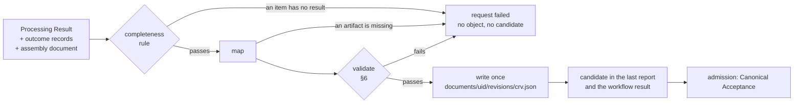

# Canonical content specification

Status: **Contract** (#81). The content object of a Canonical Revision of a paper PDF: what
it holds, how it names the artifacts it uses, how it is validated before a candidate is
handed over, and how its schema and its mapper are versioned. Built by #81; read by the
Canonical content read (#268) and by every Projection.

Sources: the [Canonical contract](knowledge-platform-canonical-contract-draft.md) §2 (the six
groups) and §5 (the mapping validation procedure), the
[Canonical persistence](knowledge-platform-canonical-persistence.md) design result (#57 A2,
B2–B9, scopes 3 and 4), the [admission specification](knowledge-platform-admission-spec.md)
§3 and §7.3 (the candidate), the [processing workflow v2](knowledge-platform-processing-workflow-v2.md)
§7–§8 (the Processing Result) and the #84 decisions U1, U2 and D4
([closure](../research/issue84-closure-decision-2026-10-20.md)).

## 1. Where it is made

`finalize`, the last registered stage, maps the Processing Result to the content, validates
it, writes it once and hands its candidate over (#57 B2: no fifth stage; processing never
touches the database). The platform's acceptance transaction decides whether it becomes the
Document's current revision (admission spec §3; #57 B5).



Order inside `finalize`, each step only when the one before passed: the completeness rule
(#57 B7, B9; #276), mapping, validation, the content object, the Processing Result
(`requests/{request_id}/result.json`), then the candidate. A request that fails any step before the content object leaves none; one
that fails after it (writing the Processing Result) leaves the object (§2). Either way it
leaves no candidate and no result with `"outcome": "complete"`.

## 2. The content object

- **Key:** `documents/{document_uid}/revisions/{canonical_revision_id}.json`, where
  `canonical_revision_id` is `crv_` and the request id's 32 hex digits (#57 B3). Known before
  processing starts.
- **Write once.** A retried or redispatched `finalize` that finds the object keeps it, and the
  candidate reports the stored object's sha256 and size, not those of the bytes it computed
  this time (the two can differ when a later build ran, for example in `runtime_identity`).
- **Bytes:** compact JSON with sorted keys, UTF-8.
- The candidate (§5) names the object by this key. "Reference" in this document means only
  an artifact reference (§4), which never carries the `documents/` prefix.
- An object written for a request that then forms no acceptance stays; the Document's custody
  purge (#267) removes it with the rest of the Document.
- No artifact is moved or copied: the content names artifacts where processing registered
  them, under `documents/{document_uid}/items/` (#57 A2, scopes 3 and 4).

## 3. Fields

Every field below is present (no optional keys) unless the table says *only when*. A field
not listed is not in the content: the mapper adds nothing beyond this table.

### 3.1 Top level

| Field | Contract §2 group | Value |
|---|---|---|
| `schema` | identity | `"canonical-content/v1"` (§7) |
| `revision` | identity | `canonical_revision_id`, `document_uid`, `source_revision_id`, `request_id`, `adopted_version`, `adoption_sequence` |
| `source_files` | identity | `[{role, sha256, size, media_type}]`, the request's files. Their custody keys are not here (they carry the bucket); the Processing Result of `request_id` has them |
| `processing` | processing attribution | `profile` (the Processing Profile version, e.g. `"paper-pdf@1"`), `status_rule`, `methods` `[{id, version, components, module_digest}]` in profile order (the mapper is one of them, §8), `runtime_identity` `{python, docling_slim, build_id}` |
| `pages` | Source Evidence | `[{page, width, height, image}]` in page order: the physical page from 1, its size in PDF points, and the reference of its page image (§4) |
| `blocks` | content | The body in reading order (§3.2) |
| `enrichments` | Enrichment | One per Enrichment item (§3.3) |
| `limitations` | coverage and limitations | `[{code, scope, detail}]` (§3.5) |
| `omitted` | coverage and limitations | `[{ref, reason}]`: the native nodes not delivered, each with its rule (§3.4) |
| `artifacts` | Source Evidence | The manifest (§4) |

### 3.2 Blocks

`blocks` is the native document body in reading order: the docling document's body tree,
depth first, groups (lists, inline groups) entered but not delivered. The body Markdown is the
blocks' `markdown` joined by a blank line (`"\n\n"`).

| Field | Value |
|---|---|
| `ref` | The node's docling reference (`#/texts/3`, `#/tables/0`, `#/pictures/1`), unique in the revision. Enrichments, summary evidence and Projections name a block by it, together with the `canonical_revision_id` (Canonical contract Q25) |
| `kind` | The docling label: `title`, `section_header`, `text`, `list_item`, `caption`, `footnote`, `formula`, `code`, `table`, `picture`, `document_index`, … |
| `locators` | `[{page, bbox}]`, one per docling provenance: `page` is the physical page from 1; `bbox` is `{l, t, r, b, coord_origin, unit}` with `coord_origin` `BOTTOMLEFT` or `TOPLEFT` as docling gives it and `unit` `"pt"` (PDF points on that page) |
| `text` | *Text nodes (`#/texts/…`) only.* The native text layer's text: docling's `text`, or its `orig` when `text` is empty |
| `role_uncertain` | *Text nodes only.* `true` when `text` came from `orig` (#84: docling emptied `text`, so the role it gave the node is not trusted); otherwise `false` |
| `image` | *Picture nodes (`#/pictures/…`) only.* The reference of the picture image (§4) |
| `native_text` | *Pictures only.* `[{ref, text, role_uncertain, locators}]`: the text nodes docling placed inside the picture (text-dense figures), native text of the source, kept apart from the picture's generated supplement (§3.3) and not in `markdown` |
| `markdown` | The block's part of the body Markdown, by kind below |

Markdown by kind; a table or picture is told by docling's collection (`#/tables/…`,
`#/pictures/…`), whatever its label (docling may label a table `document_index`):

| Kind | `markdown` |
|---|---|
| `title` | `# ` + text |
| `section_header` | `#` × (docling `level` + 1, at most 6) + ` ` + text |
| `list_item` | `- ` + text |
| `formula` | `$$`, newline, the formula item's LaTeX (its enrichment's `content`), newline, `$$`; the native `text` stays in `text`. Without a formula enrichment, the native text in the same fence |
| `code` | ```` ``` ````, newline, the code item's `content`, newline, ```` ``` ````. The code method prefers the native text layer with indentation from coordinates and asks a model only where the box has no text layer (#84 F14) |
| a table | A simple table as a Markdown table; a complex table (any cell spans more than one row or column) as docling's HTML export, because the Markdown export repeats a spanning cell and drops a parent header out of the table (#84 F21). Either way a merged cell appears once |
| a picture | `` |
| any other | text |

Inline math and inline code inside a paragraph keep the text layer's characters; nothing
rebuilds them in v1 (profile limitations `INLINE_MATH_NOT_RECONSTRUCTED`,
`INLINE_CODE_NOT_RECONSTRUCTED`).

A caption or footnote that docling attaches to a table or picture is its own block right after
it, in reading order. A table's cells are in its table enrichment (§3.3), not in blocks.

### 3.3 Enrichments

One entry per Enrichment item of the Processing Result, in its order (a Picture Interpretation
is one entry per output field: `item_id` `<item>/caption`, `/description`, `/figure_type`,
`/chart_values`).

| Field | Value |
|---|---|
| `item_id` | As in the Processing Result, unique in the revision |
| `method_ref` | `{id, version, digest}` of the producing method |
| `scope` | `item` or `document` |
| `origin` | `reconstruction` or `interpretation` |
| `target_refs` | `[ref]` for an item: a block's ref, or the ref of a picture's `native_text` entry (a code or formula node docling placed inside a picture, such as a boxed prompt, stays the picture's native text and its reconstruction targets it there); `["#"]` (the whole document) for a document-scope result |
| `content` | The method's output, whole (never cut to a size, unlike the Processing Result's inline copy). An item whose method found no text to work on (outcome `no_text`, `status_reason` `NO_TEXT` under status rule `v1`), such as a Document Summary of a short document or Picture OCR of a picture without text, has `content` `""` |
| `evidence_refs` | References (§4) of the evidence files the method registered, such as a table or formula crop |
| `status` | `unverified` or `disputed`, unchanged from processing; v1 assigns no `verified` (#84 D4, ADR-0011), and an accepted revision has no `failed` item (#57 B7, B9) |
| `status_reason` | The status rule's reason code, or `""` |
| `signals` | The item's signals, unchanged, including the Quality Check's judgement. `table-status` emits none of its own, so a table's signals are the Quality Check's only |

**Supplement.** The enrichments whose target is a picture (Picture OCR and Picture
Interpretation) are that picture's supplement, keyed by `target_refs`. Generated content
(the description, chart values, OCR text inside a picture) is only there: no block's
`markdown` or `text` carries it.

**Tables.** The `table-status` entry of a table carries `content` `{html, grid}`: docling's HTML
export, and the native grid `{num_rows, num_cols, cells: [{row, col, row_span, col_span, text,
column_header, row_header}]}`, with `row` and `col` counted from 0 (docling's offsets). The
`html` includes the table's caption; the table block's `markdown` does not, since the caption
is its own block (§3.2). Its `status` and `signals` are the table's own state; every
table is delivered with it, whatever its accuracy (#84 U2). The mapper adds no field beyond
the grid, such as a model, metric or value association. A reader checks the status before
relying on a table; what it does then is #82's.

**Document Summary.** `content` is `{overview: [{text, evidence: [{section_id}]}], sections:
[{section_id, heading, sentences: [{text}]}]}`. A `section_id` is the block ref of the
section's heading, or `#/body` for the text before the first heading. An overview sentence's
evidence is the sections it names; a section sentence's evidence is its own section. This is
the method's own shape (`document-summary@2`), delivered unchanged: every sentence has its
evidence, though not in a per-sentence `evidence_refs` field as #81's scope table worded it.

Left in the Processing Result only (it is not in the content): each item's outcome record
key, its input keys, `provider_artifact_ref` (the raw provider output) and `reused`. They are full
object keys, and a reader of the content has no use for the raw output that the content's
own fields do not already give.

### 3.4 Omitted native nodes

Every native node of the docling document (texts, tables, pictures, key-value items and form
items) is delivered exactly once, as a block or as a picture's `native_text` (#84 U1: no native
text omitted, none delivered twice), except these, each listed in `omitted` with its reason:

| `reason` | Nodes | Why |
|---|---|---|
| `FURNITURE` | Nodes on docling's furniture layer: page headers, page footers, page numbers | Repeated page furniture, not body content |

Anything else fails the request `CANONICAL_INVALID` rather than be delivered short (§6), none
of it seen in the 21-paper corpus: a node on another docling layer (`background`,
`invisible`, `notes`) fails `COVERAGE`; a key-value or form item in the body, which v1 does not
map, fails `COVERAGE` while the mapper builds; an Enrichment item on a furniture node fails
`REFERENCE_UNRESOLVED`.

### 3.5 Limitations

Two kinds, told apart by `scope`:

- `profile`: what the Processing Profile version declares its methods can get wrong
  (`READING_ORDER_DEFECTS`, `CAPTION_INTERRUPTS_BODY`, `INLINE_MATH_NOT_RECONSTRUCTED`,
  `INLINE_CODE_NOT_RECONSTRUCTED` in `paper-pdf@1`). Method-level: not evidence that this
  document shows the defect.
- `document`: a fact of this document, such as `NO_TEXT_LAYER_PAGES` with the page list in
  `detail`.

## 4. References and the artifact manifest

A reference names an artifact inside the revision. The content is fixed once accepted, so
a reference holds nothing that a later bucket, tenant layout or copy would change (#57
scopes 3, 4 and 6):

- It is the artifact's object key without `documents/{document_uid}/items/`: the item's
  64-hex reuse key, then the file's path inside the item, e.g.
  `3a12…52bf/pages/382c…41ea4.png`.
- No bucket, no `documents/` prefix, no scheme or host. It matches
  `^[0-9a-f]{64}(/[A-Za-z0-9_-][A-Za-z0-9._-]*)+$`, so it fits one or more URL path segments
  without escaping and has no `.` or `..` segment.
- The platform resolves it from the revision record, the reference and the deployment's
  storage settings alone: `documents/{document_uid}/items/{reference}` in the bucket the
  deployment names, with `document_uid` the revision record's (`canonical_revision.document_uid`,
  the content's `revision.document_uid`).

`artifacts` is the manifest, one entry per referenced artifact, sorted by `ref`:

| Field | Value |
|---|---|
| `ref` | The reference |
| `kind` | `page_image`, `picture_image` or `evidence` |
| `media_type` | `image/png` for `.png`, `application/json` for `.json`, otherwise `application/octet-stream` |
| `sha256` | Lowercase hex of the stored object |
| `size` | Its size in bytes |

Everything a reader is to see is in the manifest: every page image, every picture image and
every evidence file an enrichment names. Elsewhere the content uses references only. The read
endpoint (#268, admission spec §5.9) serves exactly the manifest's artifacts of a revision.

## 5. The candidate

`{"ref", "sha256", "size"}` (admission spec §7.3): `ref` is the content object's key without
the bucket; `sha256` and `size` are the stored object's. It goes in the last successful report
(`finalize`, `succeeded`) as the thirteenth field `candidate`, and in the workflow result next
to `"outcome": "complete"`, where the reconciler reads it when a report was lost. Reports
other than that one leave the field out.

Deployment order: the `api` that takes `candidate` (#251) is deployed before a worker that
sends it; the other way round, the `api` answers every last report `400` and the reconciler
ends each request with no candidate (admission spec §13). The adoption gate's test workflow
passes only with a well-formed `candidate` in its result (admission spec §3, #261).

## 6. Validation

The whole candidate is validated, never a fragment (Canonical contract §5). Each check reads
the content, the docling document and the stored objects, not the mapper's own intermediate
values. The checks share with the mapper only the rules they hold it to (the `orig` rule and
the omission rules of §3.4), so a defect in one of those is not caught here.

| Check | Passes when | On failure |
|---|---|---|
| `SCHEMA` | The content has exactly the fields of §3 with their types and values: `schema` is `canonical-content/v1`, every `status` is `unverified` or `disputed`; a `table-status` and a Document Summary `content` has exactly its §3.3 fields, or is `""` (no text) (other methods' `content` is their own) | `CANONICAL_INVALID` |
| `REFERENCE_FORM` | Every reference (page `image`, picture `image`, `evidence_refs`, manifest `ref`) matches §4's pattern | `CANONICAL_INVALID` |
| `REFERENCE_UNLISTED` | Every reference used outside the manifest is in it, and every manifest entry is used | `CANONICAL_INVALID` |
| `REFERENCE_UNRESOLVED` | Every `target_refs` entry is a block ref, a picture's `native_text` ref or `#`; every summary `section_id` is a block ref or `#/body`; block refs are unique; every table and picture block is the target of at least one enrichment, so its status can be found | `CANONICAL_INVALID` |
| `COVERAGE` | Every text, table and picture node of the assembly document is delivered once or listed in `omitted` under a rule of §3.4, and not both; each delivered text equals the node's `text`, or its `orig` when `text` is empty (#84 U1) | `CANONICAL_INVALID` |
| `ARTIFACT` | Every manifest entry's object exists with that sha256 and size; for a page or picture image, that sha256 is also the one its group or the assembly declared | `ARTIFACT_MISMATCH` |

The mapper has no other output, so the Processing Result's own checks (outcome record digests,
the completeness rule) are not repeated here. An evidence file has no digest declared before
the content, so for it the `ARTIFACT` check shows that the object is still there unchanged.

A failure ends the request `failed`, with an error block of domain `kp-canonicalization`,
`metadata.cause` `platform`, `metadata.check` naming the check and `metadata.detail` the first
offending location or reference (at most 200 characters; it reaches the Source with the
error block, admission spec §5.5):

- `CANONICAL_INVALID`: category `method`, **not retryable**. The inputs are registered and
  reused, so a rerun of the same Processing Profile version fails the same way ([#57
  M3](https://github.com/davidlinnnn/data-ingestion/issues/81#issuecomment-7080528720)). The exit is a fixed mapper in a new version.
- `ARTIFACT_MISMATCH`: category `integrity`, **retryable**, like `OUTCOME_RECORD_MISSING`.
  #81's text and M3's table call every validation failure not retryable; M3 defines not
  retryable as "a rerun of the same version is sure to fail alike", which a missing or changed
  stored object is not, and the same correction made `integrity` failures retryable. A
  repaired store passes on a rerun. Until then the scan reruns the request with backoff and
  `kp_admission_reruns_retrying` counts it after five failures in a row (admission spec §9);
  the pilot keeps no second copy of an artifact (Canonical persistence §7.1), so what an
  operator does with one that cannot be restored is #78's.

Neither writes the content object, hands over a candidate or leaves a `complete` result. Both
count in `kp_canonicalization_document_outcomes{reason}`.

## 7. Schema version

`schema` is `canonical-content/v1`. A change that a reader of v1 cannot read (a field removed,
renamed or given another meaning) is a new schema version, rolled out by expand and contract
(#55 D3): readers learn v2 before any writer produces it, and v1 content stays readable. A
field added that a v1 reader may ignore is not a new version, so a reader ignores keys it does
not know (§6's `SCHEMA` holds the writer to §3, not the reader). A new value in a closed set
(`status`, an artifact `kind`, an `omitted` `reason`) is a new version. An enrichment's
`content` is its method's (`method_ref`), except the two shapes §3.3 fixes, which change only
with a new schema version.

Nothing checks today that the downstream readers support a schema before a version producing
it is adopted ([#57 L11](https://github.com/davidlinnnn/data-ingestion/issues/81#issuecomment-7080528720)). The rule binds from the first schema change; that change adds the
check.

## 8. The mapper's version

The mapper, the validation of §6 and the completeness rule (#57 B7, B9) are the method package
`canonical-mapping` (`src/kp_canonicalization/methods/canonical_mapping/`), listed by the
Processing Profile like any method (`canonical-mapping@1` in `paper-pdf@1`). It has no
inventory items, as `docling-parse` has none. Two files outside it also decide the content:
`stages/finalize.py` assembles the mapper's input and gathers what the completeness rule
judges, and `status_rules/` sets each item's status. `scripts/check-method-versions` counts
both as part of the package ([#57 M2](https://github.com/davidlinnnn/data-ingestion/issues/81#issuecomment-7080528720)), and holds the package as it holds every method
(ADR-0010): once a profile is released, a change to it without a higher `VERSION` fails CI, a
higher `VERSION` needs a new profile file (the released one cannot load it), and a release
branch takes no change to it. Its `module_digest` is in `processing.methods`.

So once a profile is released, two revisions mapped differently do not share its version,
with one residue that ADR-0010 keeps out of a method's identity: the installed docling-core,
whose Markdown and HTML export a table block uses. `runtime_identity` names the docling-slim
version, not docling-core's.

The rule binds from the release of `paper-pdf@1` (the merge of #186, after which the check
counts that profile as released); until then `@1` changes in place (the 2026-11-11 ruling).
