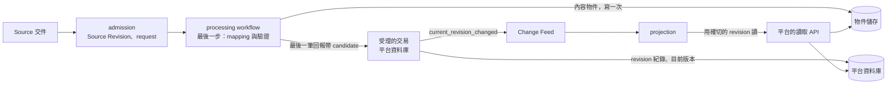

# Canonical persistence 與產物的保管

**Status:** design result of [#57](https://github.com/davidlinnnn/data-ingestion/issues/57)（2026-11-23）。這份文件不隨之後的決定修改，除非文中有加上日期的註記；決定以 [wayfinder map](https://github.com/davidlinnnn/data-ingestion/issues/52) 與它的票為準。

這份文件回答一個問題：被接受的 Canonical 資料存在哪裡、什麼時候算被接受、誰保管處理產物、什麼時候清除、壞掉之後怎麼回來。

- 實作者要照著做的契約在 [admission 規格](knowledge-platform-admission-spec.md)（§3 的 Canonical Acceptance、§7.3 的 candidate）與各實作票。這裡記的是決定、理由與沒有採用的做法。
- 逐情境的對照在[情境對照表](knowledge-platform-canonical-persistence-scenarios.md)。
- 名詞照 [CONTEXT.md](../../CONTEXT.md)：Document、Source Revision、Canonical Revision、Canonical Acceptance、Processing Profile、Custody、Custody Purge。

## 1. 結論一覽

| 範圍 | 結論 | 誰定的 | 實作 |
|---|---|---|---|
| 1 資料庫 | pilot 用 PostgreSQL，PROD 把平台資料全部放公司代管的 MongoDB。每個決定在兩種資料庫上都要成立 | 使用者 2026-11-17 | #239（pilot 之後） |
| 1 內容放哪裡 | 每個 revision 的內容是物件儲存裡一個寫一次的物件；資料庫只放 revision 紀錄，紀錄是「什麼被接受了」唯一的依據 | 使用者 2026-11-19（A2） | #81、#251 |
| 2 受理點 | Canonical Acceptance 是平台資料庫一筆交易的 commit | 使用者 2026-11-19 到 11-22（B1–B9） | #251（已完成）、#81、#98、#261 |
| 3、4 內容與產物 | 圖片的位元組由平台的讀取 API 提供；採用不複製，產物留在原地 | 使用者 2026-11-22（C1）；其餘是設計上的決定 | #81、#268 |
| 5 保留與清除 | 被換掉的 revision 保留固定期限，預設 30 天；pilot 唯一的清除是整份文件的清除 | 使用者 2026-11-22（D1）；其餘是設計上的決定 | #267；#269（pilot 之後） |
| 6 儲存層與 tenant | 多 tenant 時每個 tenant 一個 bucket，key 不變 | 設計上的決定 | 現在不用做 |
| 7 復原 | 物件儲存遺失時平台不留第二份；PROD 用公司的託管服務處理 HA 與備份 | 使用者 2026-11-23（F1）；還原的語意是設計上的決定 | #78（還原程序）、#137、#269 |
| 8 讀取 | 依確切 revision 讀內容與產物的端點另開一張票 | 設計上的決定 | #268 |
| 10 為複本預留 | 三條規則，讓跨 Source 的複本日後加入時不是破壞相容的變更 | 設計上的決定 | #268、#269、#267；功能在 #120 |

## 2. 資料庫與內容的存放（範圍 1）

### 2.1 需求

需求從已接受的契約推導，2026-11-19 與內容的存放一起裁決。

| 編號 | 需求 |
|---|---|
| N1 | Canonical Revision 被接受後不可改（ADR-0003）；紀錄帶內容的 digest |
| N2 | 同一個 candidate 重送只形成一個 revision；以 request 為唯一 |
| N3 | 受理時在同一筆交易裡讀文件的狀態；已刪除的文件不形成接受 |
| N4 | 目前版本的改變和文件的狀態在同一筆交易寫入；在有上限的延遲內出現在 Change Feed；事件之間不保證順序；跟在某個 feed 位置之後的現況讀取，至少和那個位置一樣新 |
| N5 | 找得到同一個 Source Revision 的前一個被採用的 revision |
| N6 | 這一層的讀取只有：依確切的 revision 讀、列出一份文件的 revision、讀 revision 引用的圖。搜尋是 projection 的事 |
| N7 | 清除以文件為單位；一個 revision 日後要能被不只一份文件引用（#120） |
| N8 | 每一筆紀錄都帶 tenant |
| N9 | 量：1000 萬份文件，每天更新 1 萬到 10 萬份（每秒 0.12 到 1.2），尖峰約每秒 12；PROD 的突發是每分鐘 50 份 PDF、持續 10 分鐘 |
| N10 | 每個被接受的 revision 用確切的識別讀得到，直到保留的規則拿掉它（第 5 節） |
| N11 | 目前版本的改變受每份文件的並行控制 |

### 2.2 資料庫

| | PostgreSQL 加物件儲存 | MongoDB 加物件儲存 |
|---|---|---|
| 交易與並行控制（N2、N3、N11） | 列鎖與唯一索引，admission 已經這樣建好 | 多文件交易加每份文件的版本欄位；[#236](https://github.com/davidlinnnn/data-ingestion/issues/236) 在 7.0 與 9.0 驗證四項保證成立 |
| Change Feed（N4） | 同一筆交易寫 feed（ADR-0009） | change stream 加 tailer 寫 feed collection；[#240](https://github.com/davidlinnnn/data-ingestion/issues/240) 驗證 |
| HA 與備份 | 平台自己維運：單一實例加 WAL 歸檔 | 公司代管，含 HA |
| 現有程式 | 已建在上面 | 資料存取的程式要移植 |

- **裁決**：pilot 照現在建好的 PostgreSQL 跑；PROD 的平台資料全部放公司代管的 MongoDB 8.2，平台自己不留 PostgreSQL。Temporal 自己的資料庫不在這個裁決內。移植是 PROD 上線的前提（#239）。
- **理由**：PROD 要 HA 與備份，公司有代管的服務；pilot 的時程不容許先移植。
- **沒有採用**：把 request 層級的 queue 留在單機 PostgreSQL、資料放 MongoDB。admission 的操作幾乎都是「改文件的狀態，同時排一筆 request」，拆開後一筆交易變成跨兩個資料庫的兩步寫入加對帳；而 #236 量到 queue 放 MongoDB 在這個量級下沒有問題。
- **對本文件每個決定的約束**：現在能在 PostgreSQL 上做，之後在 MongoDB 上仍成立；決定裡不用資料庫特有的機制。

### 2.3 內容放在物件儲存（A2）

- revision 的內容（mapper 的輸出：Markdown、表格的 HTML、enrichment 項目、佐證的對應）是物件儲存裡**每個 revision 一個、寫一次不改的物件**。
- 資料庫的 revision 紀錄（識別、digest、位置、大小）是「什麼被接受了」唯一的依據，也決定保留。
- **沒有採用**：在受理的交易裡把內容寫進資料庫。mapper 還沒做，內容的大小用處理結果的 `result.json` 估：56 到 348 KB（PROD 的 PDF 更大，估計到 1 MB）；在 MongoDB 上，交易要等內容複寫到多數成員才算 commit，期間佔住 feed 的計數器。
- 代價：物件寫了而交易沒有 commit 時，會留下沒有紀錄指向的物件。它不是 Canonical 資料，隨文件的清除清掉（第 5 節）。

## 3. Canonical Acceptance（範圍 2）

受理交易的逐步契約在 admission 規格 §3。這裡是決定與理由。

| 編號 | 決定 | 理由，或沒有採用的做法 |
|---|---|---|
| B1 | **Canonical Acceptance 是平台資料庫一筆交易的 commit**，由收到最後一筆成功回報的程式執行；回報遺失時 reconciler 跑同一個函式。交易裡：request 結束、revision 紀錄、Source Revision 變成 `accepted`、目前版本（贏了才改）、feed 事件 | workflow 結束、物件寫入、結果登錄都不算接受：它們不能和文件的狀態一起原子地成立 |
| B2 | mapping 與驗證是 processing workflow 的最後一步，在 `finalize` 這個 stage 裡，不另設一個受理元件；處理端仍然不碰資料庫。mapper 的版本跟著 Processing Profile：改 mapper 就是新版本 | 另設元件多一個要部署、要重試的東西。驗證沒過時 request 是 `failed`，不寫 candidate |
| B3 | revision 的識別是 `crv_` 加上 request id 的 32 個十六進位字元；一個 request 最多形成一個 revision。對讀取端不透明 | 開始處理前就知道識別，內容物件的 key 可以先定；重送自然落在同一個識別（N2） |
| B4 | 成功的結果到達時文件已刪除：不形成接受，request 照實結束。寫成義務是「受理和這份文件的其他變更（刪除、finalize、另一次受理）序列化」，不是「鎖住那一列」 | 正確性不依賴先停掉 workflow。兩種資料庫都做得到 |
| B5 | 每個通過驗證的 candidate 都記成被接受的 revision；它成為目前版本的條件是贏過現有的：Source Revision 較新，其次採用序號較高，否則維持現有的（ADR-0003）。不看完成時間；比較只做一次，由平台在受理的交易裡做 | 結果以任何順序到達都得到同一個目前版本。處理端不再選目前版本，它只交出 candidate |
| B6 | 內容退版由 Source 重新交件。方法退版是再採用舊版本，並把有問題的版本宣告為作廢；平台重做目前版本是作廢版本做的文件。作廢之後才到的結果不形成接受。重做失敗的文件繼續提供原本的 revision，計數並警示（第 4 點，2026-11-22 在更正過的前提下重新確認）。作廢的版本不能再被採用；降版的宣告要寫明較高的版本是作廢還是保留，否則不套用 | 作廢是對整個版本宣告的，一份文件重做失敗不代表它的內容有問題。把指標退回前一個 revision（#55 的 D3）是 PROD 上線前的事 |
| B7 | 一份文件的每個 enrichment 項目都有結果才被接受。任何項目 `failed`（沒有產出）就整個 request 失敗。`disputed` 與 `unverified` 是結果，不擋 | 被接受的內容裡不會有 `failed` 的項目，讀取端不用處理「這一項沒做」。代價：一次不合格的模型回覆會擋住整份文件，出口只有修方法並發新版本 |
| B8 | 版本的切換是平台資料庫裡的採用紀錄。採用寫在部署 repo 的 values，由 CronJob 在確認點通過後套用；每次採用都宣告重刷範圍，沒有預設值 | 公司的 PROD 不能由人進 pod 下指令。沒有採用：用 Temporal 的 current 與 ramping 當開關 |
| B9 | d3 Quality Check 沒有產出判斷就算缺結果（B7），沒有例外。要有 metrics 記錄比例 | 使用者的裁決，比建議的更嚴。d3 因此是接受所需的服務 |

補充：

- **成功但沒有形成接受**有四種，各自計數：文件已刪除、沒有 candidate、candidate 的位置不是 revision 自己的 key、request 的版本已作廢。
- **B6 第 3 點是由掃描修復的**：寫入作廢的那一刻不鎖文件，剛好在之前被接受的結果會留著，和其他已經是目前版本的 revision 一樣由掃描重做。
- **pilot 裡沒有任何元件會清掉一份文件的目前版本**，它只會被換掉。「比較只做一次」建立在這個前提上；之後加入撤回或失效時要一起改。文件沒有目前版本的情況仍然存在：第一次接受之前，或每一個 Source Revision 都失敗。

### 3.1 掃描的規則

平台的重做（重刷、退版、失敗後重跑）是同一個每份文件的掃描，沒有全域的等待。對每份沒有被刪除、也沒有進行中 request 的文件，看它的 media type 最新的一次採用，第一個符合的列決定。沒有採用中的版本時什麼都不開。

| 列 | 情況 | 動作 |
|---|---|---|
| 1 | 最新的 Source Revision 有採用中版本做的 revision | 不做 |
| 2 | 最新的 Source Revision 有別的版本做的 revision | 那個版本已作廢或在重刷範圍裡，而且還可以再開：重做 |
| 3 | 最新的 Source Revision 沒有 revision，還可以再開 | 不論範圍都重跑 |
| 4 | 最新的 Source Revision 沒有 revision，也不能再開；目前版本是作廢或範圍內的版本做的，而且它的 Source Revision 還可以再開 | 重做目前版本的那個 Source Revision |
| 5 | 其他 | 不做；繼續提供目前版本 |

「還可以再開」的限制，以每次採用、每個 Source Revision 計：

| 最近一次的結果 | 可以再開 |
|---|---|
| 沒有 request | 可以 |
| 可重試的失敗 | 可以，照間隔；沒有次數上限，超過次數時警示並帶原因 |
| 不可重試的失敗、被拒絕、成功但沒有 candidate | 每次採用一次 |
| 版本已作廢 | 可以，立刻 |

掃描只看「有沒有 revision 紀錄」，不看物件在不在；紀錄在而物件遺失的文件它不會重做（第 7.2 節）。完整的規則（priority、暫停門檻只數 Source 自己交的 request、結束不了的 request）在「實作 Source Deletion、app 重送與平台重跑」（#98）。

## 4. 內容與處理產物（範圍 3、4）

### 4.1 圖片的位元組由平台的讀取 API 提供（C1）

- 讀取端要內容或圖的位元組時，向平台的讀取 API 要。bucket 的憑證不出平台。
- 理由：文件的授權在平台，儲存不知道誰能讀哪份文件；刪除與收回權限在下一次讀取就生效；和文字內容是同一條路。
- 沒有採用：
  - 平台檢查後發限時網址。網址不帶身分，到期前擋不住；公司政策不准用 presigned URL 上傳，下載有沒有包含沒有問過。
  - 讀取端自己持有 bucket 的憑證。bucket 裡有所有 Source 的原始檔與產物。

### 4.2 設計上的決定

- **內容裡的 reference 不含位置。** 內容物件被接受後不可改，所以圖的 reference 是 revision 之內的識別：不含 bucket、不含 `documents/{document_uid}` 前綴、不是網址。內容物件有一份清單，列出它引用的每個產物：reference、種類、media type、sha256、大小。reference 的形式與清單的欄位名稱由 #81 定案（建議的形式：產物的 key 去掉 `documents/{document_uid}/items/` 之後的部分），#268 照它解析。
- **採用是原地的，不複製。** 受理的交易 commit 就是採用，那一刻沒有儲存操作。複製的代價是每份文件多一份 23 MB（中位數），1000 萬份是 230 TB。原始檔已經是同樣的做法（ADR-0012）。
- **內容物件的 key**：`documents/{document_uid}/revisions/{canonical_revision_id}.json`，寫一次不覆蓋。candidate 交出的位置是這個 key，不帶 bucket；受理時位置不符就不形成接受，免得一份錯的回報把一份文件的 revision 指到另一份文件的物件。

| 要存的內容（#84） | 放在 |
|---|---|
| Markdown、複雜表格的 HTML、enrichment 項目與它的狀態和佐證訊號、supplement、已知限制 | Canonical 內容物件 |
| 文件裡的圖、公式與表格的裁切圖、整頁影像 | 已登錄的處理產物（`documents/{document_uid}/items/…`），原地，由內容物件的清單引用 |
| provider 的原始輸出 | 已登錄的處理產物，原地。不經讀取端點提供，除非內容引用它 |
| 方法升級後的新 revision | 新的內容物件與新的 revision 紀錄 |
| 每次外部推論的收據、沒被接受的結果留下的物件 | 處理中的暫存，留到文件的清除 |

### 4.3 數字

量自 [#199](https://github.com/davidlinnnn/data-ingestion/issues/199) 的 20 篇論文（21 個 request，每篇約 27 頁）。PROD 的 PDF 平均 20 MB，所以這些是下限。

| 每份文件 | 數量（中位數） | 合計（最小／中位數／最大） |
|---|---|---|
| 文件裡的圖 | 6 | 0.25 / 0.63 / 2.46 MB |
| 公式、表格、程式碼的裁切圖 | 20 | 0.05 / 0.73 / 2.21 MB |
| 整頁影像 | 27 | 6.35 / 15.17 / 31.03 MB |
| 全部已登錄的產物（量自同一批執行的輸出，不在 repo 裡） | | 8.6 / 23.1 / 45.9 MB |

- 使用者點開一張圖的流量可以忽略（中位數 78 KB）。
- pipeline 若整批拿圖與裁切圖，照 PROD 的量是尖峰每秒 312 個請求、17 MB。目前沒有 pipeline 這樣做；`api` 固定兩個 pod 夠不夠，由 #99 量。
- 整頁影像只提供逐張讀取。

## 5. 保留與清除（範圍 5）

### 5.1 被換掉的 revision 保留固定期限（D1）

- 一個 revision 不再是目前版本之後，用確切的識別仍讀得到一段固定的期限：預設 30 天，每套部署可設。PROD 的天數和資料責任人一起訂；Source 系統才是正本（#87 的 E1）。
- **pilot 不清舊 revision**：每個被接受的 revision 留到文件被清除。這和 first-adoption 的 V08 一致。
- 文件之內的清除是 PROD 上線前的事（#269），要先解決它和產物重用怎麼並存：處理端會重用同一份文件之前登錄的產物，清除和重用交錯時，剛被接受的 revision 可能指到已刪掉的物件。
- 數字：多出來的儲存佔「只留目前版本」的比例 = 保留天數 × 每天更新的文件比例。30 天是 3% 到 30%；以 1000 萬份、每份 23 MB 算，基準 230 TB，多 7 到 69 TB。
- 沒有採用：全部保留（一直增加）；只留到下游換完（舊的引用幾乎立刻失效）。

### 5.2 設計上的決定

- **文件還在時永遠不清的**：任何一份文件的目前版本的內容物件與它列出的產物；每份文件最新的 Source Revision 的原始檔；目前版本所屬的 Source Revision 的原始檔。
- **pilot 唯一的清除是整份文件的清除**（Custody Purge，#267）：刪除套用 30 天後，清掉 `documents/{document_uid}/` 之下的全部，與它每個 request 的 `requests/{request_id}/`。
- 清除由排程的工作執行，可以中斷後重跑：先刪物件，全部刪完才在資料庫記下已清除。文件還有排隊或處理中的 request 時先不清。
- 清除後資料庫留下文件、request 與 revision 的列（revision 標成已清除，不留位置）。完成的證據是資料庫的清除時間與一行 log。這個證據只涵蓋線上的儲存：物件什麼時候從備份裡消失，以及儲存若開了版本保留時刪除是不是只加一個標記，是儲存服務的事實，由 #137 確認、#56 使用。
- 資安事件的立即清除：在部署 repo 宣告要清除的 `document_uid`，同一個工作執行。只對已刪除的文件有效。它一樣要等這份文件進行中的 request 結束；卡住的 request 會讓它一直等，所以跳過的次數與到期而還沒清除的數量都有計數（#267）。由誰核准是 #56 的流程。
- 不在這裡：projection 自己的資料由 projection 的清理負責（ADR-0014）；serving 事實的紀錄的保留是 #264；平台的儲存裡沒有屬於某個 Build 的物件。

## 6. 儲存層與 tenant（範圍 6）

- 現在一套部署就是一個 tenant。之後一套部署服務多個 tenant 時，**每個 tenant 一個 bucket，不在 key 裡加前綴**；tenant 對應哪個 bucket 是部署設定。
- 理由：已存的資料與已寫的程式都不用動。原始檔的 `custody_ref` 本來就帶 bucket；處理端與 Canonical 的位置不帶 bucket。加前綴的話，現有的 key 沒有前綴，要搬資料或留特例。
- 每筆紀錄都帶 tenant（N8）。採用的宣告不帶：tenant 來自部署設定。
- 靜態加密在儲存層，照公司標準；v1 不做每個 tenant 自己的金鑰；向量庫與索引的保護比照 Canonical（#87 的 C1、D3）。

## 7. 復原（範圍 7）

### 7.1 物件儲存遺失時不留第二份（F1）

- 平台自己不做物件儲存的第二份，也不寫備份的程式；pilot 與 PROD 都是。PROD 用公司的託管服務，由它處理 HA 與備份。這份文件把使用者的話讀成物件儲存的託管服務；它的備份涵蓋什麼由 #137 確認，是 PROD 上線的前提。
- 沒有採用：平台只備份文字內容（要做一套備份與還原，卻救不回圖）。
- **對 pilot 的儲存的要求**：first-adoption 的 V06 要求單一節點故障不遺失唯一、不能重建的資料，被接受的內容正是這種資料。平台不留第二份，所以這個要求落在儲存自己的冗餘上。pilot 的 MinIO 是不是承受得了單一節點故障，沒有紀錄；由 #137 確認，不成立時要在 pilot 開始前告訴使用者。

| 資料 | 在哪裡 | 不見了怎麼辦 |
|---|---|---|
| 平台的紀錄 | 資料庫 | 從備份還原。pilot：磁碟區毀損時最多遺失一個歸檔間隔，目標 1 分鐘（規格 §9）；pod 重啟與單一節點故障不遺失（first-adoption 的 V06） |
| 採用、作廢、立即清除的宣告 | 部署 repo | 不受影響；排程再套用一次 |
| 原始檔 | 物件儲存 | Source 手上有正本（#87 的 E1） |
| 被接受的內容與它引用的圖 | 物件儲存 | **只能取代，不能重現。** 重新處理得到的是新的 revision，舊的引用失效 |
| 索引、Wiki 頁面 | 各 projection | 從 Canonical 重建 |

### 7.2 還原之後的語意

資料庫與物件儲存各自還原，不會一起回到同一個時間點。還原的程序在 #78（C12、C26）；這裡是本文件的規則在還原之後怎麼收斂。

資料庫還原到較早的時間 T，其他不變：

| T 之後發生、還原時遺失的事 | 怎麼收斂 |
|---|---|
| 一個結果被接受 | request 的列在 T 之前就有：reconciler 照同一個函式再記一次，得到同一個 revision。request 的列也遺失：是 C26 的不明 workflow |
| 採用或作廢被套用 | 宣告在部署 repo，排程再套用一次 |
| 一份文件被清除 | 清除工作再跑一次，沒有東西可刪，記下已清除 |
| 一份文件被刪除 | 文件又變成存在，要 Source 重送刪除。見下面的規則 |
| 一份文件第一次被受理，或既有文件新開 request | 物件還在，沒有紀錄。還原的程序列出沒有紀錄的 `documents/` 與 `requests/` 前綴並刪除，**但要避開還開著的 batch**：新文件的識別在宣告時就配好，上傳的檔案在文件的列出現之前就寫在它的前綴之下 |

**還原之後、遺失區間的刪除重新套用之前，被還原成存在的文件不能再被提供出去。** 平台分不出是哪幾份（紀錄就是遺失了），所以這段時間整套部署都要停下會把文件送出去的路徑：

- 對 projection 的修復與重建（C12 的「對所有 Build 要求修復」排在刪除重新套用之後）。
- 內容的讀取、bootstrap 的列舉。
- 會產生新事件的工作：reconciler 再記一次接受時會發 `current_revision_changed`；掃描會替這些文件開 request。

projection 既有的索引不受影響，照常服務：被刪除的文件當初已經從裡面清掉了。怎麼停（部署 repo 裡哪些設定）由 #78 寫進還原程序。代價是從還原到 Source 重送完成之間，新交的文件不會進到搜尋。

物件儲存還原到較早的時間 T'（或整個遺失），資料庫是現在的。受影響的範圍從資料庫的時間算：

| 物件 | 怎麼收斂 |
|---|---|
| 被接受的 revision 的內容或圖不在（原始檔在不在都一樣） | **pilot 沒有自動的路徑。** Source 刪除這份文件再交一次，得到新的 `document_uid`。同樣內容直接重交沒有用：已接受的回 `unchanged`。平台自己重跑也沒有用：掃描看到已有採用中版本做的 revision 就不動，而且同一次採用之下的新結果和現有的平手，不會成為目前版本。在那之前，讀取回 `503` |
| 處理中的暫存不在 | 自己收斂：重用產物前會先確認物件在 |
| T' 之後被清除的物件回來了 | **不會自己收斂**：要對這些文件再清一次。還原不能把已清除的資料留在儲存裡 |

- pilot 沒有為這種情況做新的機制：量小，而且有備份時受影響的只有 T' 之後的那一段。PROD 上線前由 #269 決定不需要 Source 動手的修復（例如把那筆 revision 標成遺失，讓掃描重做；受理的比較規則要跟著改）。
- pilot 把上面的步驟當成還原時的緊急處理。PROD 上線前做成排程（#269）：公司的 PROD 不能由人進 pod 下指令。

## 8. 讀取，以及為複本預留（範圍 8、10）

### 8.1 讀取

- 「實作 Canonical 內容的讀取」（#268）：既有的 governed read 之下兩個讀取，一個回某個確切 revision 的內容，一個回內容列出的一個產物。身分和既有的 governed read 相同：已登錄的服務身分。這個身分可以讀任何文件的 revision；對使用者的授權由讀取端自己執行（授權指南）。
- 使用者點開一張圖時，serving 端判定授權，再用自己的服務身分呼叫它；那條路徑歸 #76。

| 情況 | 回應 |
|---|---|
| 不是目前版本的 revision（被換掉的、輸了的 candidate、作廢版本做的） | 照常提供 |
| 文件已刪除、還沒清除 | 拒絕 |
| 已清除，或過了保留期限 | 「已不保留」，和「不存在」分得開 |
| 紀錄說有，物件讀不到 | `503`，獨立的錯誤碼與計數 |

- 平台不在每次讀取時重算 digest；回應帶紀錄裡的 sha256 與大小。
- **Source Revision 的時間**（讀取端的結果要帶它，consumption 設計紀錄的 B6、E4）是 finalize 建立那個 Source Revision 的時間，不是 revision 被接受的時間。現在的紀錄沒有這個欄位，由 #268 加上，從現況的讀取與內容的讀取給出。同樣內容、較高版本的重交不改它。
- 「紀錄說有，物件讀不到」指儲存回答物件不存在。儲存暫時連不上是另一個錯誤碼，不算進遺失的計數。
- 需求 N6 的「列出一份文件的 revision」沒有票：目前沒有讀取端需要它。#76 需要時再開。

### 8.2 為跨 Source 的複本預留

複本（#120，pilot 之後）是目的地 Source 的一份新文件，它的目前版本是原件某個已接受的 revision。今天的規則守三條，日後加入才不是破壞相容的變更：

| 規則 | 為什麼 |
|---|---|
| 物件的位置從 revision 紀錄解析，不用請求裡的 `document_uid` 組 key | 複本的 revision 的物件在原件的前綴之下 |
| 永遠不清的是**任何一份文件**的目前版本 | 原件換了新版本之後，複本還在用舊的那一個 |
| 一份文件「到期可以清除」的判斷只寫在一處；清除後列都留著 | 複本若要活得比原件久，在那個判斷加一個條件即可 |

## 9. 驗證

做完的，影響選擇的那幾項：

| 項目 | 結果 |
|---|---|
| MongoDB 上的四項保證（[#236](https://github.com/davidlinnnn/data-ingestion/issues/236)） | 在 7.0 與 9.0 成立，各有條件 |
| MongoDB 上的 Change Feed（[#240](https://github.com/davidlinnnn/data-ingestion/issues/240)） | change stream 加有 epoch 的 tailer |
| 受理流程的模擬（[`docs/prototypes/acceptance-flow-simulation`](../prototypes/acceptance-flow-simulation/README.md)） | 資料庫這一側的規則在隨機交錯下，每個不變量都成立；拿掉掃描的第 4 列會失敗 |
| 獨立審查（2026-11-22） | 153 個情境；受理的交易在追過的每種交錯下都成立；37 個缺口與矛盾都已修正並交給各票 |
| 受理的交易（#251） | `tests/admission/test_acceptance.py`、`test_reconciler.py` |

還沒做的：

| 項目 | 在哪裡 |
|---|---|
| 真實的 Temporal 與 Kubernetes 行為（確認點、CronJob、Worker Deployment） | #137 |
| PROD 的儲存服務：備份涵蓋什麼；條件式寫入回 `412`、依 key 限制權限、版本保留；收據時間 | #137 |
| 還原演練 | #99 |
| 經過 `api` 的圖片讀取量 | #99，等 #268 |
| 清除與產物重用交錯 | #269 的驗收 |
| `paper-pdf@1` 在 B7、B9 之下的接受率 | #137，發布之前 |
| MongoDB 8.2 上的行為 | #239 |

## 10. PROD 上線前要補的

| 項目 | 票 |
|---|---|
| admission 移到 MongoDB | #239 |
| 整份文件的清除與立即清除 | #267 |
| 舊 revision 的保留期限、儲存的對帳 | #269 |
| 方法退版時把目前版本移回前一個 revision，不重新處理 | #270；pilot 的方法退版是重新處理（B6） |
| 託管儲存服務的事實與探測 | #137 |
| B7 的代價：pilot 記下每份失敗的文件與原因，上線前用這個數字重看 | #137（`paper-pdf@1` 發布前在 B7、B9 之下重跑驗證） |

## 11. 被這些決定取代的文字

| 原本的文字 | 現在 |
|---|---|
| [Processing workflow v2](knowledge-platform-processing-workflow-v2.md) 的 Q7、Q8：enrichment 項目失敗時文件仍然完成 | B7：request 失敗 |
| 同上，Q15：enrichment 的失敗比例只是 metrics | 仍是 metrics，但失敗的文件不被接受（B7、B9） |
| 同上，Q23：由維運依清單重跑 | 掃描的第 3 列，沒有清單 |
| 同上，Q29 與 §5.1：`failed` 項目較少的贏；處理端選目前版本 | B5：兩步比較，由平台做 |
| 同上，§6.2：這類檢查「是 Canonical Acceptance 的檢查，不是處理失敗」 | B2：驗證沒過是處理失敗 |
| 同上，§10 的保留表：處理中的暫存「過了保留期限就移除」；「採用是複製還是原地標記由 #57 決定」 | 採用是原地的。pilot 不清文件之內的任何東西，暫存留到文件的清除（第 5 節） |
| [admission 規格](knowledge-platform-admission-spec.md) §3：`adopt` 與 `cancel-adoption` 兩個由人下的指令；「兩個指令都不檢查版本有沒有部署」 | B8：採用在部署 repo 宣告，由排程在確認點之後套用。規格由 #261 改寫 |
| 同上，§9：由維運下指令的 redrive；每次採用對受影響的文件各開一筆重刷 | 第 3.1 節的掃描。規格由 #98 改寫 |
| 同上，§11：多 tenant 時用 bucket 還是前綴由 #57 決定 | 每個 tenant 一個 bucket（第 6 節）；規格已加註 |
| Processing Profile 的 README：升版時由人執行採用 | 同 B8，由 #261 改寫 |
| ADR-0011：d3 沒有回答時降級，項目維持原本的狀態 | B9：缺結果，request 失敗 |
| ADR-0003：沒有明確的取代依據時，「只在仍有效時」保留現有的選擇 | pilot 沒有讓目前版本失效的元件；重做失敗時繼續提供（B6 第 4 點） |

workflow v2、兩份 ADR 與規格 §11 已加上帶日期的註記；規格 §3、§9 與 README 的指令由實作的票改寫，在那之前以本文件與票為準。B7、B9 的行為由 #81 實作，在那之前程式仍是舊的行為。

## 12. 紀錄

[#57](https://github.com/davidlinnnn/data-ingestion/issues/57) 的留言索引列出每一則裁決與交接。ADR：[0015](../adr/0015-canonical-acceptance-is-one-platform-transaction.md)（受理點與內容的存放）、[0016](../adr/0016-declared-adoption-and-rollback-by-withdrawal.md)（宣告式採用與方法退版）；ADR-0003 與 ADR-0011 各有 2026-11-23 的註記。
