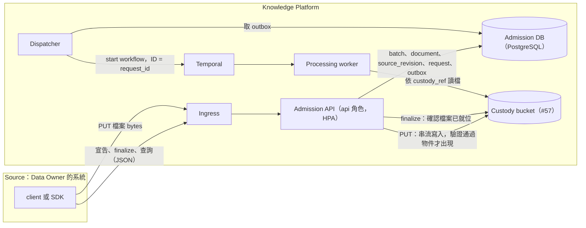
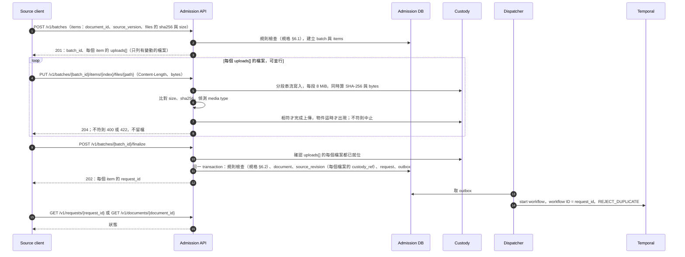

# Knowledge Platform 檔案上傳：論述與設計

**狀態：** 2026-11-07 定案方向與契約；實作票 [#96](https://github.com/davidlinnnn/data-ingestion/issues/96)。

本文是「Source 如何把檔案交給平台」這個題目的完整論述：背景與限制、比較過的選項與決定、系統架構、流程圖、給 Source 開發者的使用指南、部署與維運需求。正式契約只有一份，在 [admission 規格](knowledge-platform-admission-spec.md) §5（§5.2 是上傳端點）；本文引用它，不另立契約。歷史決策的問答編號（Q4、Q5 等）見 [admission 設計筆記](knowledge-platform-admission.md)。術語依 `CONTEXT.md`。

## 1. 背景與限制

### 1.1 誰上傳、上傳什麼

- 上傳者是 Data Owner 的系統（`CONTEXT.md` 的 **Source**），用平台核發的 Source credential 呼叫 API；人只是觸發者，平台不以人的身分授權這個操作（設計筆記 2026-10-18 的 client 釐清）。
- 一次提交是一個 **Batch**，最多 50 個 item；每個 item 是一份 Document 的一個版本，含一個 `main` 檔與零到多個附件，每個檔案宣告 `sha256`、`size`、`media_type`。
- pilot 支援的主檔格式是 PDF、Markdown、PPTX；pilot 實際只收論文 PDF。

### 1.2 不變的邊界

這些在政策變更前後都成立，是本文所有選項的共同前提（「上傳直接就位」一列在 2026-11-11 取代了原本的「staging 與 custody 分開」）：

| 邊界 | 內容 | 出處 |
|---|---|---|
| 三步驟提交 | 宣告 → 上傳 → 明確 finalize；finalize 才做耐久受理並回 `202` | 規格 §5、設計筆記 Q4 |
| 固定輸入先於受理 | 檔案內容在受理前固定，SHA-256 由平台驗證；任何後續寫入都不能改變已 finalize 的輸入 | [ADR-0004](../adr/0004-fixed-capture-custody-before-admission.md) |
| 上傳直接就位 | 檔案驗證通過後，直接寫到它在 custody bucket 的 key；finalize 不寫 storage；沒被受理的檔案由 admission 清除 | 規格 §5.2、§6.2、§10；[ADR-0012](../adr/0012-uploads-written-at-custody-key.md) |
| 受理即派送 | finalize 的同一個 transaction 寫入 request 與 outbox，dispatcher 再啟動 Temporal workflow | 規格 §9 |
| 處理端不碰 client | processing 用平台憑證依 `custody_ref` 讀檔，不對 client 發任何 URL | [#129](https://github.com/davidlinnnn/data-ingestion/issues/129) |

### 1.3 公司政策（2026-10-30）

主管確認：公司政策禁止 client 以 presigned URL 上傳檔案。SAS 是同類的、由 storage 簽發的 bearer URL，轉達時一併視為排除。這條政策讓 2026-10-20 定下的上傳 grant 形式（storage 原生 presigned URL 或 SAS，設計筆記 Q5）失效。紀錄：[#95 的轉達](https://github.com/davidlinnnn/data-ingestion/issues/95#issuecomment-6518076869)、[#96 的轉達](https://github.com/davidlinnnn/data-ingestion/issues/96#issuecomment-6658212404)、[資料安全文件](knowledge-platform-data-security.md) §2。

**政策範圍（使用者 2026-11-07 確認）**：政策只排除 presigned URL 這種 bearer URL 機制，不限定傳輸管道；經 admission API 上傳可行。這是本文決定的唯一前提，已成立。

### 1.4 規模

PROD 負載規格（[#88](https://github.com/davidlinnnn/data-ingestion/issues/88#issuecomment-6633160435)，2026-11-04）：

| 項目 | 數值 |
|---|---|
| 尖峰 | 每分鐘 50 份 PDF，持續 10 分鐘；一次 burst 500 份 |
| 檔案大小 | 平均 20 MB，硬上限 50 MB |
| 換算 | 約 1 GB／分鐘，即 17 MB/s；一次 burst 約 10 GB |
| 同時上傳數 | 每條連線 100 Mbps 時，一份 20 MB 約 1.6 秒傳完，平均同時 1 到 2 個上傳 |

換算與同時上傳數是估算，不是量測。

## 2. 選項與決定

### 2.1 最初的五個方案（#53 Q9，2026-10-02 至 10-03）

| # | 方案 | 誰搬檔案 | 當時的結論 | 政策下的狀態 |
|---|---|---|---|---|
| 1 | 平台發上傳授權，client 直接 PUT 到 storage（presigned URL） | client | 選為通用入口 | 被排除 |
| 2 | Source 發 signed GET，平台去抓檔 | 平台 | 保留為選用的匯入路徑 | 也是 presigned URL，只是方向相反；不採用 |
| 3 | 長期委派的 connector（暫時憑證、聯邦身分） | 平台 | 只給需要持續同步的來源 | 不受影響，但建置成本最高 |
| 4 | 預先註冊 Source 的 storage，平台用自己的身分去讀，client 只送檔案位置 | 平台 | 最早的 pilot 提案；每個 Source 都要設定 endpoint 與 token，改為方案 1 | 不受影響 |
| 5 | 檔案內容直接放在 ingestion API 的 request 裡 | client → API | 影像、影片不該經過 API；pilot 不提供 | 不受影響 |

出處：[Q9 最終建議](https://github.com/davidlinnnn/data-ingestion/issues/53#issuecomment-5966660481)、[Q9 確認](https://github.com/davidlinnnn/data-ingestion/issues/53#issuecomment-5966721936)、[雲端實務研究](../research/attachment-handoff-cloud-practices-2026-10-02.md)。

### 2.2 push 對 pull

push：client 把檔案送進平台。pull：平台去 Source 的 storage 讀檔。

| 面向 | Push | Pull |
|---|---|---|
| client 要做的事 | 實作上傳與失敗重傳 | 只送檔案位置與 sha256 |
| 平台要做的事 | 收檔、驗證 | 多一個抓檔元件，負責重試、限速、逾時 |
| 每個來源的上線成本 | 發一組 credential | 逐一談定 storage 位置、讀取權限、防火牆 |
| 網路方向 | client 連平台，平台不必對外連線 | 平台要能連到每個來源的 storage |
| 憑證風險 | 平台不持有來源的憑證 | 平台持有所有來源的讀取權限，被入侵時影響面大 |
| 檔案固定性 | 檔案一到就算 SHA-256、立即固定 | 宣告到抓檔之間檔案可能被改或刪，要綁版本並處理失敗 |
| 回應時機 | finalize 當下就知道檔案齊不齊 | 多一個非同步的「抓檔中」階段與對應的錯誤狀態 |
| 流量控制 | client 決定何時送，burst 直接打到平台，靠限流擋 | 平台自己排隊抓，可以把 burst 攤平 |
| 適用的來源 | 任何能呼叫 HTTP 的系統 | 只有檔案已放在相容 storage 的系統；其他系統要各寫 connector |
| 越權風險 | 小：只能寫自己被指定的位置 | 要防 A 來源藉平台的身分讀到 B 來源的檔案 |
| 對規格的改動 | 小：三步驟流程與規則不變 | 大：上傳步驟換成抓檔階段，狀態與錯誤碼要重定 |
| 公司政策 | 經平台端點多半合規 | 沒有 client 上傳；但平台讀其他團隊的 storage 需要另外核准 |

兩種方式搬的資料量一樣（burst 時約 1 GB／分鐘），檔案最後都要在 custody 存一份，所以 pull 不省儲存空間。pull 的價值只在「檔案本來就放在公司核准的 storage」的來源，這也是 Q9 當時「已在核准 custody 的檔案不必再傳一次」的結論；pilot 目前沒有這種來源。

### 2.3 經平台 API 對 client 直接寫 storage

presigned URL 本來就是「讓 client 不拿 storage 憑證也能直接寫」的機制。它被禁之後，client 要直接寫 storage 就必須持有 storage 的憑證，等於在 Source credential 之外再多一套身分系統。

| 面向 | 經 API 上傳 | client 直接寫 storage |
|---|---|---|
| 資料路徑 | client → API pod → storage，多一跳 | client → storage |
| client 持有的憑證 | 只有 Source credential | 另外一組 storage 憑證：長期金鑰，或 STS 暫時憑證（MinIO：15 分鐘至 365 天，預設 1 小時） |
| 每個 Source 上線 | 發 credential 即可 | 還要在 storage 建身分、綁定只能寫自己 prefix 的 policy |
| 網路 | storage 留在內部，只有平台連得到 | storage 要開放給所有 client 的網段 |
| 檔案落地前的檢查 | 傳輸中就能擋下大小、型別、未知 batch、超出配額，並同時算 SHA-256 | policy 能限制 prefix，但文件裡沒有可限制上傳大小的條件；只能等 finalize 才發現並清掉 |
| client 的開發 | 一般的 HTTP PUT | S3 SDK 與 endpoint 設定 |
| 與 storage 產品的耦合 | client 看不到 storage；#57 尚未選定產品，之後怎麼選都不影響 client | client 綁定 S3 API 與該產品的憑證機制 |
| 稽核 | 上傳紀錄集中在平台 | 分散在 storage 與平台兩邊 |
| 公司政策 | 多半合規 | 風險最高：發給 client 的暫時憑證比 presigned URL 權限更大，很可能遇到同樣的反對 |

多一跳 API 的代價以目前的規模很小：17 MB/s、平均同時 1 到 2 個上傳，而 admission 的 `api` 本來就是水平擴充的角色。檔案到 GB 等級，或流量高一到兩個數量級時，直接寫 storage 才划算。

### 2.4 決定（2026-11-07）

- **方向：push，經平台上傳端點。** client 以 Source credential 把每個檔案 `PUT` 到 admission 的上傳端點，admission 串流寫入 storage（2026-11-11 起直接寫到 custody 的 key，見第 3 節）。
- **契約採最小形式**（規格 §5.2）：上傳端點直接以 Source credential 驗證，不另發 grant token；每個檔案一個 `PUT`；宣告回應的 `uploads[]` 列出平台端點；原本的 grant 重發端點與一小時效期刪除。理由：少一套 token 的簽發、過期與重發；上傳的授權本來就在 finalize 再檢查一次；Source credential 是每次呼叫都要帶的東西。
- **不做的事**：分段或續傳（50 MB 以下整個重傳即可）、inline 內容、pull 路徑（等有具體來源再開）。
- **對 Valet Key 原則的影響**：client 不再持有任何對 storage 的委派權限，設計筆記裡「以 Valet Key 模式授予 client 有限的 storage 存取」改為歷史。平台先驗證提交者的授權、再接受資料傳輸，這個順序沒有變。

## 3. 系統架構



### 3.1 元件職責

| 元件 | 職責 | 出處 |
|---|---|---|
| client 或 SDK | 算 SHA-256、宣告、上傳、finalize、查詢；失敗時重送 | 規格 §5、設計筆記 Q4 |
| Ingress | TLS 終止、轉送；上傳路徑要放寬 body 上限與 timeout | 第 6 節，#78 |
| Admission API | 驗證 Source credential、套用 §6 規則、串流收檔並驗證、finalize、狀態查詢 | 規格 §5、§6 |
| Admission DB | batch、document、source_revision、request、outbox 等紀錄 | 規格 §3 |
| Custody bucket | 上傳的檔案；受理後成為固定輸入，processing 依 `custody_ref` 讀取；沒被受理的由 admission 清除 | 規格 §6.2、§10，#57 |
| Dispatcher、Temporal | 受理後的派送與處理，與上傳方式無關 | 規格 §9、§10 |

### 3.2 憑證與信任邊界

| 誰 | 持有什麼 | 能做什麼 |
|---|---|---|
| client | Source credential | 對自己的 Source 宣告、上傳、finalize、查詢；寫不到 storage |
| Admission API | custody bucket 的寫入與刪除憑證、DB 連線 | 代 client 把檔案寫進 custody bucket；清除沒被受理的檔案 |
| Processing worker | custody 的讀取憑證 | 依 `custody_ref` 讀固定輸入 |

storage 的憑證只存在平台內；client 的網段只需要連到 Ingress。

## 4. 流程

### 4.1 正常流程



### 4.2 失敗與重試

| 情境 | 結果 | client 該做的事 |
|---|---|---|
| 上傳中斷線 | 該檔沒有 `204`，不留檔 | 重送整個 `PUT` |
| `Content-Length` 或實際 bytes 不等於宣告的 `size` | `400 SIZE_MISMATCH` | 檢查檔案與宣告；檔案真的變了就重新宣告 |
| SHA-256 不等於宣告 | `422 DIGEST_MISMATCH` | 同上 |
| 偵測到的 media type 不等於宣告 | `422 MEDIA_TYPE_MISMATCH` | 修正宣告或檔案，重新宣告 |
| `PUT` 到 `carried_over` 或未宣告的 path | `404` | 該檔不需要上傳 |
| 同一個檔案 `PUT` 兩次 | 沒有變化：已就位的檔案就是宣告的內容 | 無 |
| 檔案沒上傳完就 finalize | 該 item `FILES_MISSING` 被拒，其他 item 照常受理 | 該 item 重新宣告 |
| batch 開啟 24 小時未 finalize | `409 BATCH_EXPIRED`；已上傳的檔案由清理刪除 | 重新宣告 |
| finalize 時 storage 無法回應 | `503 UNAVAILABLE`；batch 維持 open，什麼都不變 | 依 `Retry-After` 重試 finalize |
| finalize 在 commit 之前中斷（pod 被終止、資料庫切換） | 連線中斷或 `503`；batch 維持 open，檔案都在 | 重試 finalize |
| finalize 已 commit，但 `202` 沒送到 | 已受理 | 重試 finalize，拿到同一份結果 |
| 文件在宣告之後被另一個 batch 建立 | 該 item `STALE_DECLARATION` 被拒，其他 item 照常受理 | 該 item 重新宣告 |
| finalize 之後再 `PUT` | `409 BATCH_FINALIZED` | 新版本要重新宣告 |
| finalize 重複呼叫 | 回同一份結果 | 可安全重試 |
| `429` 或 `503` | 帶 `Retry-After` | 依 `Retry-After` 重試；`ADMISSION_PAUSED` 只擋宣告，不擋上傳與 finalize |
| API pod 在上傳中被終止 | 連線中斷，物件不會出現；未完成的分段由清理中止 | 重送整個 `PUT` |

## 5. 使用指南：給 Source 開發者

### 5.1 前置

- 向平台取得 `source_id` 與 Source credential（pilot 是平台核發的 service-account token）。
- 建立或指定 Document 要放入的 Resource；v1 只能放進自己的 Source 建立的 Resource（#55）。
- base URL 由部署提供，下面以 `https://kp.example` 代表。

### 5.2 三個呼叫

**1. 宣告**

```sh
curl -X POST https://kp.example/v1/batches \
  -H "Authorization: Bearer $KP_TOKEN" \
  -H "Idempotency-Key: 7c9e4b1a-…" \
  -H "Content-Type: application/json" \
  --data @declare.json
```

`declare.json`：

```json
{
  "items": [
    {
      "document_id": "hr/leave-policy",
      "source_version": "3",
      "title": "Leave policy",
      "source_url": "https://km.example/hr/leave-policy",
      "resources": ["res_hr_all"],
      "uploaded_by": "tsso:alice",
      "files": [
        { "path": "policy.pdf", "role": "main", "sha256": "9f2c…", "size": 18342, "media_type": "application/pdf" },
        { "path": "assets/flow.png", "role": "attachment", "sha256": "1ab0…", "size": 220114, "media_type": "image/png" }
      ]
    }
  ]
}
```

回應 `201` 的每個 item 帶 `status`；`declared` 的 item 帶 `uploads[]`，只列與上一版不同的檔案，其餘列在 `carried_over`，不必再傳。`unchanged`、`queued`、`rejected` 的 item 已經結束，沒有上傳步驟。

**2. 上傳**：對 `uploads[]` 的每個檔案發一次 `PUT`，可以並行。

```sh
curl -X PUT "https://kp.example/v1/batches/bat_01J…/items/0/files/assets/flow.png" \
  -H "Authorization: Bearer $KP_TOKEN" \
  -H "Content-Type: image/png" \
  --data-binary @assets/flow.png
```

`curl` 會自動帶 `Content-Length`；自寫 client 時必須帶，且等於宣告的 `size`。成功回 `204`，沒有 body。

**3. finalize**

```sh
curl -X POST https://kp.example/v1/batches/bat_01J…/finalize \
  -H "Authorization: Bearer $KP_TOKEN"
```

回應 `202`，每個受理的 item 帶 `request_id` 與 `source_revision_id`。

**之後：查詢**

```sh
curl https://kp.example/v1/requests/req_01J… -H "Authorization: Bearer $KP_TOKEN"
curl https://kp.example/v1/documents/hr%2Fleave-policy -H "Authorization: Bearer $KP_TOKEN"
```

request 的 `succeeded` 只代表處理完成；文件是否可被讀到，看 `GET /v1/documents/{document_id}` 的 `readiness`（規格 §7.1）。

### 5.3 錯誤與重試

| 回應 | 意思 | 處理 |
|---|---|---|
| `401`、`403` | credential 無效，或沒有 `submit` 權限 | 修正 credential；不要重試 |
| `404` | batch、item 或 path 不存在，或不在這個 Source 的可見範圍 | 檢查 `uploads[]`；不要重試 |
| `400 SIZE_MISMATCH`、`411 LENGTH_REQUIRED` | 長度不符或缺 `Content-Length` | 修正後重送 |
| `422 DIGEST_MISMATCH`、`422 MEDIA_TYPE_MISMATCH` | 內容與宣告不符 | 檢查檔案；需要時重新宣告 |
| `409 BATCH_EXPIRED`、`409 BATCH_FINALIZED` | batch 已結束 | 重新宣告 |
| `429`、`503` | 限流、暫停或暫時不可用 | 依 `Retry-After` 重試 |
| 連線錯誤、逾時 | 傳輸中斷 | 重送整個 `PUT`；finalize 可重複呼叫 |

錯誤 body 的格式見規格 §4。

### 5.4 限制

| 項目 | 值 | 出處 |
|---|---|---|
| 每次宣告的 item 數 | 50（暫定） | 規格 §11 |
| 每個 Source 的進件配額 | 每分鐘 50 個宣告 item（暫定） | 規格 §11 |
| 單檔大小上限 | 50 MB，部署可調 | 規格 §11、#88 |
| 上傳方式 | 每檔一個 `PUT`，單一 request；無分段、無續傳 | 規格 §5.2 |
| batch 有效期 | 建立後 24 小時 | 規格 §11 |
| `Idempotency-Key` | 24 小時內同一 key 回同一結果 | 規格 §11 |

### 5.5 SDK 與實務建議

- 規格 Q4 要求 SDK 把三個呼叫包成一個操作；#96 的 I2 範圍含最小的 Python SDK。SDK 出來之前照上面三個呼叫整合。
- 宣告前先算好每個檔案的 SHA-256 與大小；宣告後只傳 `uploads[]` 列出的檔案。
- 多個檔案並行上傳；全部收到 `204` 再 finalize。
- 宣告的重試用同一個 `Idempotency-Key`；上傳與 finalize 本身可重複，不需要 key。
- 大量提交時依 50 item／分鐘的配額排程；收到 `429` 就依 `Retry-After` 等待。
- 不要在 log 裡記 credential；上傳失敗的診斷資訊用回應裡的 `trace_id`。

## 6. 部署與維運需求

### 6.1 Admission API

- 上傳端點串流處理：每收到一段（8 MiB，boto3 的 multipart 預設）就寫入 storage，同時累計 SHA-256 與 bytes；超過宣告大小立即中斷。每個上傳佔用的記憶體是一段的大小，與檔案大小無關；同時 20 個上傳約 160 MiB。
- 上傳與控制 API 同一個 `api` 角色、同一個 image，靠 HPA 擴充；server 用 async 框架，慢連線不阻塞其他 request。之後若要隔離上傳流量，把上傳路徑拆成獨立 Deployment，契約不變。

### 6.2 Ingress

ingress-nginx 的預設值是為小 request 設的，上傳路徑要另外設定；公司的 ingress 不一定是 nginx，但同類設定都有，由 #78 定值。

| 設定 | ingress-nginx 預設 | 上傳路徑需要 |
|---|---|---|
| `proxy-body-size` | 1m | 不小於單檔上限（50 MB），或對上傳路徑不設限 |
| `proxy-request-buffering` | on | off：直接轉送，不先把整個 body 收在 ingress |
| `proxy-read-timeout`、`proxy-send-timeout` | 60 秒 | 放寬到幾分鐘；50 MB 在 10 Mbps 約需 40 秒 |

### 6.3 未受理的檔案與清理

- 每小時的 CronJob 清除兩種殘留（規格 §6.2、§13）：沒建立 Source Revision 的 item 所上傳的物件（被拒、過期，或 finalize 時內容和最新版相同），以及沒完成的分段上傳。已受理 item 的物件不刪。
- 只處理 finalize 或過期已滿 1 小時的 batch，讓當時還在傳的上傳先結束；目標是 batch 結束後 2 小時內清完（規格 §11，未量測）。
- 清理用資料庫紀錄算出完整的 key，逐一刪除與中止，不靠 storage 的 lifecycle 規則，也不靠列出前綴：AIStor 不支援中止未完成上傳的 lifecycle 動作，列出未完成的上傳時要給完整的物件名稱（[AIStor S3 API compatibility](https://docs.min.io/aistor/developers/s3-api-compatibility/)）。
- 容量估算：未受理的檔案和已受理的在同一個 bucket，最多保存到過期後 2 小時，一次 burst 最多約 10 GB。

### 6.4 指標與告警

- 上傳 request 數與結果分布（`204`、`400`、`422`、`409`、中斷）、bytes、上傳時長分布、同時上傳數。
- 等待清理的 batch 數與清理數；上傳失敗率與等待清理的 batch 數設告警。
- 這些併入 #78 的可觀測性清單；量測在 #99。

### 6.5 安全

- 只走 TLS；credential 與上傳 body 不進 log（資料安全文件 D3）。
- 檔案型別以平台偵測為準，不信任宣告與副檔名。
- 文件內容的惡意 payload 與有害內容篩檢屬 #107、#108 的範圍，在受理後的 workflow 裡做，不在上傳端點。

### 6.6 驗證

#99 的叢集層驗證加上：PROD burst 經上傳路徑；上傳進行中殺掉 API pod，client 重送後無殘留、無重複；ingress 設定在單檔上限與慢線路下成立。

### 6.7 Storage 行為的依據（#184，2026-11-11）

設計依賴的行為都列在「必要」；公司的 storage 用 [`storage_probe.py`](../validation/184/storage_probe.py) 重跑，缺一項就不能用（#137）。本機實測的三套是 RustFS 1.0.4、MinIO 社群版 RELEASE.2025-09-07、SeaweedFS 4.50。

| | 行為 | 官方文件 | RustFS | MinIO | SeaweedFS |
|---|---|---|---|---|---|
| 必要 | 分段上傳在完成之前，物件查不到也列不出來 | — | 是 | 是 | 是 |
| 必要 | 未完成的上傳用完整的 key 列得出來 | [ListMultipartUploads](https://docs.aws.amazon.com/AmazonS3/latest/API/API_ListMultipartUploads.html) | 是 | 是 | 是 |
| 必要 | 中止的上傳不能再完成，也不留物件 | — | 是 | 是 | 是 |
| 必要 | 刪除不存在的 key 回成功 | — | 是 | 是 | 是 |
| 不依賴 | 未完成的上傳用資料夾前綴列得出來 | [AIStor](https://docs.min.io/aistor/developers/s3-api-compatibility/)：要給完整的物件名稱 | 是 | 否 | 是 |
| 不依賴 | 完成分段上傳時帶 `If-None-Match: *`，key 已存在就回 `412` | [AWS conditional writes](https://docs.aws.amazon.com/AmazonS3/latest/userguide/conditional-writes.html) | 是 | 是 | 是 |
| 不依賴 | `CopyObject` 帶 `If-None-Match: *`，目的 key 已存在就回 `412` | [CopyObject](https://docs.aws.amazon.com/AmazonS3/latest/API/API_CopyObject.html)（AWS 自 [2025-10-29](https://aws.amazon.com/about-aws/whats-new/2025/10/amazon-s3-conditional-write-functionality-copy-operations/) 起）；AIStor 列為支援 | 是 | 否：回 `200` 並覆蓋 | 是 |

- 儲存端複製和「不覆蓋既有物件」能不能同時成立，要看產品和版本；不支援的實作不報錯，直接覆蓋。這是上傳改成直接就位、finalize 不複製的原因之一（[ADR-0012](../adr/0012-uploads-written-at-custody-key.md)）。
- 一般 bucket 沒有原子的搬移，搬移就是先複製再刪除（[AWS：複製、搬移、改名物件](https://docs.aws.amazon.com/AmazonS3/latest/userguide/copy-object.html)）。
- 未完成的分段會一直佔空間，到期規則刪不掉，AWS 建議用 lifecycle 規則中止（[AWS](https://docs.aws.amazon.com/AmazonS3/latest/userguide/mpu-abort-incomplete-mpu-lifecycle-config.html)）；AIStor 不支援這個 lifecycle 動作，所以由第 6.3 節的 CronJob 中止。

## 7. 未決事項與變更紀錄

### 7.1 未決

| 事項 | 影響 | 負責 |
|---|---|---|
| pull 路徑 | 等有「檔案已在公司核准 storage」的具體來源再開 | #96 之後另開票 |
| 分段上傳 | GB 級檔案才需要；契約形狀相容（OpenAI Uploads 的 create、add parts、complete 同形） | 不在第一版 |
| 公司的 ingress 產品與設定值 | 第 6.2 節的數值 | #78 |

### 7.2 變更紀錄

| 日期 | 事件 |
|---|---|
| 2026-10-03 | #53 Q9：通用入口為平台發授權的直接上傳；signed GET 與 connector 為選用 |
| 2026-10-20 | #31 Q5：上傳 grant 為 storage 原生 presigned URL 或 SAS，一小時效期 |
| 2026-10-30 | 主管確認公司政策禁止 client 以 presigned URL 上傳；轉達 #95 |
| 2026-11-05 | 規格與設計筆記加上 superseded 註記；轉達補到 #96 |
| 2026-11-07 | 決定 push、經平台上傳端點；契約寫入規格 §5.2；本文建立 |
| 2026-11-07 | 使用者確認政策只排除 presigned URL，不限定傳輸管道；本決定的前提成立，未決事項移除 |
| 2026-11-11 | #184：上傳直接寫到 custody 的 key，不設 staging，finalize 不寫 storage（[ADR-0012](../adr/0012-uploads-written-at-custody-key.md)）；第 1.2、3、4、6.3、6.4 節改寫，新增第 6.7 節 |

## 來源

- [admission 規格](knowledge-platform-admission-spec.md)、[admission 設計筆記](knowledge-platform-admission.md)、[Source handoff 設計](knowledge-platform-source-handoff.md)、[資料安全文件](knowledge-platform-data-security.md)
- [雲端實務研究](../research/attachment-handoff-cloud-practices-2026-10-02.md)、[inline 與 reference ingestion 研究](../research/document-inline-reference-ingestion-2026-10-18.md)、[CSP admission 實務研究](../research/admission-authorization-csp-practices-2026-10-20.md) §7、§8
- MinIO 官方文件：[STS](https://docs.min.io/enterprise/aistor-object-store/developers/security-token-service/)、[存取控制](https://docs.min.io/enterprise/aistor-object-store/administration/iam/access/)（頁面描述的是企業版 AIStor，公司使用的版本可能有差異）
- [ingress-nginx ConfigMap](https://kubernetes.github.io/ingress-nginx/user-guide/nginx-configuration/configmap/)、[boto3 S3 transfer](https://docs.aws.amazon.com/boto3/latest/reference/customizations/s3.html)、[OpenAI Uploads API](https://developers.openai.com/api/docs/api-reference/uploads)
