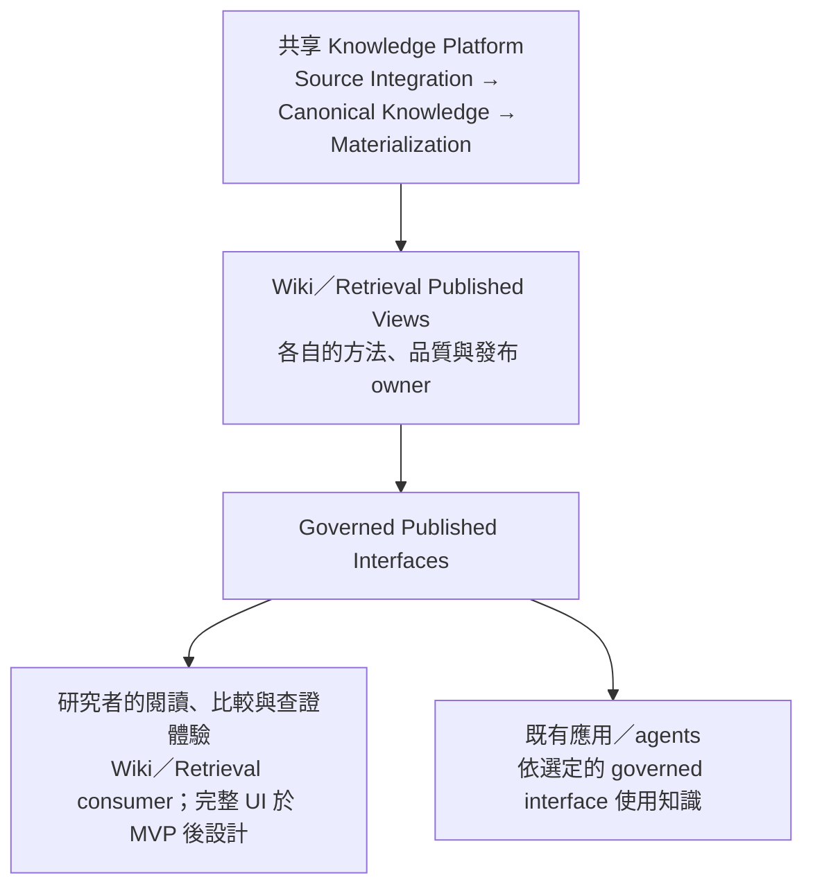

# Atlan survey 與 Knowledge Platform 產品化方向

**研究日期：2026-10-17（Asia/Taipei）**  
**狀態：競品研究與產品假設；不是已採納 roadmap、交付承諾或採購建議。**  
**對照基準（依使用者更正）：** GitHub 正在進行的 [wayfinder map #52](https://github.com/davidlinnnn/data-ingestion/issues/52)、native children 的已確認決策／最新交接與相關實作驗證議題。Local HLD／Architecture Baseline 已過時，不作為目前設計的 authority；本機產品簡介與 WBS 也不作為已確認範圍、進度或 milestone 的依據。

**後續產品共識：** 使用者已選擇長期公司內部共用產品，由部門／主題知識負責人主導整理、驗證與發布，供人與 agents 共用；合格更新自動發布。人類以瀏覽／搜尋／閱讀與來源查證為主，不預設內建問答。收斂後的功能與開發交接方案見[內部產品策略與功能規劃](../design/knowledge-platform-internal-product-strategy.md)。下文外部商業化／定價與研究產品定位保留為當時比較假設，不作為目前產品目標。

## 0. 目前設計的權威來源與進度

2026-10-17 透過 `gh` 重新讀取 #52 與 native sub-issues；比較依據是各 owner 的結案決策與後續明確修訂，而非把 open issue 一概解讀成設計未開始，也不把 closed design 解讀成已實作。Map 本身的工作是完成可交接的系統設計；實作、部署與 runtime qualification 有各自範圍。

| 設計／工作 | 當日可確認的狀態 | 本次比較的解讀 |
|---|---|---|
| [整體邏輯設計 #58](https://github.com/davidlinnnn/data-ingestion/issues/58#issuecomment-5862945216) | 已確認並結案 | 責任邊界、狀態所有權與後續詳細設計交接已有共識；不是只停在 HLD 提案 |
| [來源身分與授權交接 #53](https://github.com/davidlinnnn/data-ingestion/issues/53#issuecomment-5994746983) | 已確認並結案 | 固定完整 capture、來源／附件身分、custody、policy authority 與後續 enforcement owners 已有決策 |
| [Canonical representation／acceptance／lifecycle #32](https://github.com/davidlinnnn/data-ingestion/issues/32#issuecomment-6096650145) | 已確認並結案 | 已定完整候選接受、共用 typed representation、證據／版本與生命週期，含三格式案例與 V01–V11 驗證交接；不等於 mapper／runtime 合格 |
| [首次採用與 operating envelope #54](https://github.com/davidlinnnn/data-ingestion/issues/54#issuecomment-6106396809) | 已確認並結案 | 研究團隊 pilot、workload／freshness／recovery／retention 目標、V01–V08 與缺證 gates 已定；高頻工作量數字仍待 #84 的後續交接 |
| [Processing profile #72](https://github.com/davidlinnnn/data-ingestion/issues/72#issuecomment-6124692207) → [擴大第一版需求 #84](https://github.com/davidlinnnn/data-ingestion/issues/84) | #72 是已結案的限定範圍決策；#84 open，需求共識後進行候選與驗證 | #84 已重開較廣功能選擇，不能拿 #72 的舊排除條件限制新目標；方法、正式 profile、資源／效能與 #80–#83 範圍同步仍未全數完成 |
| [Admission #31](https://github.com/davidlinnnn/data-ingestion/issues/31)、[Publication #55](https://github.com/davidlinnnn/data-ingestion/issues/55) | Open，native blockers 為 0 | 各有已確認輸入／約束，詳細機制尚待設計結案；這是可進行的設計工作，不代表已通過實作驗收 |
| [Serving #76](https://github.com/davidlinnnn/data-ingestion/issues/76)、[Governance #56](https://github.com/davidlinnnn/data-ingestion/issues/56)、[Persistence #57](https://github.com/davidlinnnn/data-ingestion/issues/57)、[Topology #78](https://github.com/davidlinnnn/data-ingestion/issues/78) | Open，依 native prerequisites 推進 | consumer access、授權／撤權一致性、DB／custody、部署／營運機制仍由具名議題承接；#78 已另確認 MVP 最低可用 observability |
| [PDF core #33](https://github.com/davidlinnnn/data-ingestion/issues/33)、[#80–#83 交接](https://github.com/davidlinnnn/data-ingestion/issues/72#issuecomment-6124692207) | #33 限定核心已結案；#80、#81、#82、#83 仍 open | 區分限定核心證據、剩餘整合／驗證及 #84 新要求；不能由 open 狀態推定每個 owner 的實際 build 進度 |
| [完整 human UI #79](https://github.com/davidlinnnn/data-ingestion/issues/79) | Map 外的 post-MVP follow-up | 已確認需要 UI；實際 MVP 實作並接受之後才開始該設計，不是未曾討論使用者入口 |

Map 的 native children 也包含已完成的 Docling／WeKnora／paper-PDF 研究 #70、#73、#77；它們是特定版本與範圍的證據，不能取代後續 owner 的採用決策。上述表格是查閱日快照；跨版本衝突回到 owner 的明確決策與後續修訂，不按 issue 號碼或結案狀態自動推定覆蓋。

## 1. 結論與建議

1. **Atlan 已經在賣與我們願景重疊的產品。** 現在的定位是 enterprise AI 的 context layer；data catalog、lineage、governance 是其基礎，再向 AI context 的建置、測試與交付延伸。不能把它當成只管 database metadata 的舊式 catalog。[官網](https://atlan.com/)、[CES 概念](https://docs.atlan.com/product/capabilities/governance/context-engineering-studio/concepts/what-is-context-engineering-studio)
2. **它賣得清楚的部分是工作成果與採用流程。** 使用者能找資料、理解定義與責任、改善 metadata，或為特定 AI 用例準備經測試的 context；平台底層的 graph、workflow 和 storage 支撐這些工作。[Marketplace](https://atlan.com/data-marketplace/)、[CES 操作入口](https://docs.atlan.com/product/capabilities/governance/context-engineering-studio)
3. **我們不是完全沒談產品，而是產品策略尚不完整。** 已選 research team、AI-agent 論文、Wiki＋Retrieval pilot，也已有 post-MVP UI 議題；仍缺買方與預算、可持續使用的理由、替代方案、商業包裝、成本與擴張路徑。[#54 決策](https://github.com/davidlinnnn/data-ingestion/issues/54#issuecomment-6106396809)、[#79](https://github.com/davidlinnnn/data-ingestion/issues/79)
4. **建議以「可查證的研究知識產品」作為第一個價值驗證。** 對外的第一句話可以是：「讓研究團隊更快比較文件中的主張，並回到正確版本的原文核對。」Canonical Knowledge、獨立投影與治理是實現方式。這是由既有 pilot 推出的定位假設，尚未證明有外部市場。
5. **可能的差異在文件證據與生命週期的實際品質。** 多模態文件、表格／公式／程式碼、來源位置、版本與撤權能否端到端可靠交付，才可能形成購買理由。我方已有已確認的 Canonical／source 契約，不宜只稱為願景；但 #84 擴大 PDF 能力仍有未通過項目，不能先宣稱較 Atlan 完整或可靠。[Canonical 決策](https://github.com/davidlinnnn/data-ingestion/issues/32#issuecomment-6096650145)、[#84](https://github.com/davidlinnnn/data-ingestion/issues/84)、[限定 PDF core #33](https://github.com/davidlinnnn/data-ingestion/issues/33)

## 2. Atlan 主打什麼功能

以下是官方公開能力的整理，不是登入 tenant 後的實測。更完整的來源與狀態衝突見[官方來源調查](atlan-official-source-survey-2026-10-17.md)。

| 產品面向 | 使用者在做的事 | 商業價值與可用性解讀 |
|---|---|---|
| Enterprise Data Graph／catalog | 搜尋 tables、columns、dashboards 等資產，查看 owners、glossary、lineage、quality | 讓人理解資料、找到責任人、判斷影響；核心 catalog 能力已有 GA 文件 |
| Governance／Data Marketplace | 按 domain／purpose 找 data products，了解其描述、責任與發布狀態 | 把分散資料包成可被發現與使用的產品；catalog 的認證不代表資料事實已被全面驗真 |
| Context Agents Studio | 對資產集合產生 descriptions、README、SQL Intelligence | 降低整理 context 的人工工作；collection enrichment 與讀外部文件的 agent templates 是不同路徑 |
| Context Engineering Studio（CES） | 為一個用例組合 context repo，模擬問題、改善定義，再交付給目標引擎 | 把 context 做成有測試與部署流程的工作單位；成熟度表列 2026-09-09 GA，需 account team enablement |
| Context／Metadata Lakehouse | 用 SQL／Iceberg 讀取 metadata，做報表或供其他系統使用 | 提供可程式化的 context 基礎；不是把整個企業業務資料倉庫搬進 Atlan |
| Knowledge Files／Sources | 上傳文件，或讓 agent 讀 GitHub、Confluence、其他 MCP sources，產生帶引用的術語與規則 | 已與我們的文件知識方向交集；部分路徑為 private preview，不能視為所有租戶已具備完整文件平台 |

來源：[成熟度表](https://docs.atlan.com/get-started/references/feature-maturity-matrix)、[Context Agents](https://docs.atlan.com/product/capabilities/governance/context-agents-studio)、[CES](https://docs.atlan.com/product/capabilities/governance/context-engineering-studio)、[Lakehouse gold namespace](https://docs.atlan.com/platform/lakehouse/concepts/what-is-gold-layer)、[Knowledge Sources](https://docs.atlan.com/apps/knowledge-sources)。

### 必須分開看的三組能力

**文件讀取已存在，但不等於通用文件知識產品已成熟。** Knowledge Folders 文件列出 PDF、Markdown、YAML、JSON、TXT，單檔上限 10 MB；PDF 背景讀取包含圖表與圖像，搜尋仍只匹配抽出的文字。這已超過單純 metadata catalog，但沒有提供我們所需論文表格、行內公式與程式碼保真的比較成績。[Knowledge Folders FAQ](https://docs.atlan.com/product/capabilities/governance/knowledge-folders/faq/knowledge-folders-faq)

**引用與完整 Evidence Lineage 有差別。** 官方 extraction 文件說明，現有文件 agent 可以產生帶來源引用的 glossary terms，但尚未在 knowledge file lineage 記錄哪個 agent 讀了檔案、哪些 terms 由此衍生；skills 生成也尚未可用。這是這條文件路徑的限制，不能推廣為 Atlan 所有 lineage 都不完整。[Extraction pipeline](https://docs.atlan.com/product/capabilities/governance/knowledge-folders/concepts/extraction-pipeline)

**人類審核要看具體流程。** CES 有組合、測試、改善、部署的 review checkpoints；agent template 的 sample run 不發布，但 full run 會把結果直接發布到 glossary。不能把官網「專家認證 context」解讀為每種 AI enrichment 都已具備發布前逐筆審核。[CES 概念](https://docs.atlan.com/product/capabilities/governance/context-engineering-studio/concepts/what-is-context-engineering-studio)、[Agent templates](https://docs.atlan.com/product/capabilities/governance/context-agents-studio/concepts/agent-templates)

### 官方文件本身存在版本落差

成熟度表的 unstructured ingestion 列仍停在 2026-07-08 的 roadmap／experimental；較具體的 Knowledge Sources、Knowledge Folders 和 agent-template 文件已描述可操作路徑，其中 sources／templates 明標 private preview。因此本研究採「有具體操作文件，部分限量開放，GA／租戶授權待確認」，不採「完全沒有」或「已全面交付」兩種過度結論。Hosted MCP 也有成熟度表與較新說明不同步的問題。[成熟度表](https://docs.atlan.com/get-started/references/feature-maturity-matrix)、[Knowledge Sources](https://docs.atlan.com/apps/knowledge-sources)

## 3. 架構：哪些能確認，哪些不能類比

官方 current architecture 描述三個部署區：客戶來源環境、獨立租戶的 Atlan SaaS、共享 control planes。來源網路封閉時，可在客戶端跑 Self-Deployed Runtime；這不等於整個 Atlan 都能自行部署。

| 架構責任 | 官方公開組件與角色 |
|---|---|
| API／identity | Kong、Heracles、Keycloak；Heka 為 SQL gateway |
| Metadata 與搜尋 | Apache Atlas、Cassandra、Elasticsearch |
| 長工作編排 | Temporal 為主要引擎；部分 Argo Workflows 為遷移中的 legacy |
| AI | AI Gateway、TurboPuffer；分區域的 AI control plane |
| Metadata Lakehouse | Iceberg、Polaris、object storage |
| 運行環境 | AWS／Azure／GCP 的 Kubernetes；每租戶 dedicated compute／storage |

以上來自[官方架構](https://docs.atlan.com/platform/references/atlan-architecture)。其底層 Kubernetes control plane 共享，搭配 virtual clusters 與專屬 nodes／storage，不能解讀為每客戶一套完全獨立的 Kubernetes cluster。[Resource isolation](https://docs.atlan.com/platform/references/how-are-resources-isolated)

這是一個商業產品的公開組件圖，並未證明其所有服務都共用一種版本、發布、權限或刪除協定；也不構成我們應採同一組資料庫的理由。

對照我們的責任鏈：

| 我們的概念 | Atlan 最接近的責任 | 不能直接畫等號的地方 |
|---|---|---|
| Source Integration | Connectors、SDR、Knowledge Sources | 我方 #53 已確認 registered Source、固定完整 Capture Package、身分／提交權限／政策與 custody 交接；Atlan Knowledge Source 則是 agent 執行時讀取，不單憑連線建立 catalog assets |
| Canonicalization／Enrichment | Metadata enrichment、PDF 背景讀取、文件 agents | 我方 #32 已要求來源／生成理解可歸責、必要意義與證據可檢查；同叫 enrichment 不表示有相同接受契約 |
| Canonical Knowledge | Catalog／Enterprise Data Graph 的受治理資產 | 我方已確認跨 PDF／SOP Markdown／PPTX 設計案例的 typed content／relations、enrichment、evidence 與 coverage／limits；CES context repo 偏用例語意模型，不等於這份共用契約 |
| Materialization／Published Views | Data products、CES repositories 與各 target 格式 | 我方已定固定實際輸入、產品獨立 coherent publication 的方向；#55 承接具體 input／switch／reader／reconciliation 機制。Atlan 沒有據此證明相同版本語意 |
| Knowledge Serving | REST、SDK、SQL、MCP | 我方 #76 承接共同 consumer contract、selected client 與 adapter 比較；MCP／plugin／hosted answering 及直接 Canonical by-ID access 尚未定案，不能沿舊 HLD 排除或視為已採用 |
| Future Canonical Experience | 官網的 evals／traces／feedback 敘事 | 評估與改善有操作文件；未據此確認通用 Canonical Agent Trajectory 或自動學習系統 |

我方依據：[邏輯設計 #58](https://github.com/davidlinnnn/data-ingestion/issues/58#issuecomment-5862945216)、[來源決策 #53](https://github.com/davidlinnnn/data-ingestion/issues/53#issuecomment-5994746983)、[Canonical 決策 #32](https://github.com/davidlinnnn/data-ingestion/issues/32#issuecomment-6096650145)、[Publication #55](https://github.com/davidlinnnn/data-ingestion/issues/55)、[Serving #76](https://github.com/davidlinnnn/data-ingestion/issues/76)。Atlan 依據：[Knowledge Sources](https://docs.atlan.com/apps/knowledge-sources)、[CES 可攜目標](https://docs.atlan.com/product/capabilities/governance/context-engineering-studio/references/portability-targets)。CES 對 Snowflake／Databricks 有直接部署；dbt 是產出格式供使用者帶走；一般 MCP clients 是讀 context，CES 並不因此代管 agent。

我方引用也已有具體設計：exact Canonical Revision＋local ref，並連回固定來源版本；PDF 實體頁、Markdown 原始行、PPTX slide 由 1 起算，更細位置只在可靠取得時提供。Source／method 更新、候選接受、current selection 與目前 eligibility 是分開的事實；歷史接受不能授予現在存取。這些是應拿來與 Atlan 同題驗證的已確認契約，不是待發想的特色，也不是已實現的保證。[定位決策](https://github.com/davidlinnnn/data-ingestion/issues/32#issuecomment-6076312345)、[Canonical 結案](https://github.com/davidlinnnn/data-ingestion/issues/32#issuecomment-6096650145)

**治理比較要落到特定介面。** Atlan Knowledge Folders 現行文件明示沒有 folder-level ACL，能看 knowledge assets 的人可看該 tenant 的全部 knowledge folders/files；外部 Knowledge Sources 則以管理者提供的 credential 為讀取邊界。我方 #53 已確認 trusted GAM／compatible-service、來源政策權威、背景工作與使用者委派的界線；#56 承接目前授權、存在性／引用／快取保護、撤權一致性與執行證據的詳細選擇。這份已確認要求與 Atlan 上述文件路徑不等價，但不表示整個 Atlan 沒有權限，或我方 enforcement 已合格。[Knowledge Files access control](https://docs.atlan.com/product/capabilities/governance/knowledge-folders/concepts/knowledge-folders-and-files)、[Knowledge Sources access](https://docs.atlan.com/apps/knowledge-sources)、[已確認信任／授權交接](https://github.com/davidlinnnn/data-ingestion/issues/53#issuecomment-5991845520)、[Governance #56](https://github.com/davidlinnnn/data-ingestion/issues/56)

## 4. 我們目前真正的差距

| 比較面向 | Atlan 公開證據 | 我們目前狀態 | 產品意義 |
|---|---|---|---|
| 使用者與任務 | Analyst、data engineer、steward、domain expert 的 catalog／context 工作流程 | 已選 research team 與論文研究任務 | 從現有使用者深化，避免從「所有企業知識」開始 |
| 人可以直接使用 | Catalog、Marketplace、Studio 的操作文件 | #76 已承接 pilot 人類／agent 入口、共同 consumer contract 與 client 比較，詳細選擇未結案；#79 完整 UI 在 MVP 後 | 已有使用者入口的設計工作，應區分其完成度與完整 frontend 交付 |
| 文件理解 | PDF 背景讀取、文件引用與術語抽取 | 有 bounded PDF core；擴大表格／公式／code 等能力未全部合格 | 差異必須靠共同案例實測，不能靠功能名稱 |
| 品質與驗證 | CES 有 business-question simulations；catalog 有認證與品質資訊 | #32 已確認完整候選 acceptance、證據／版本／生命週期契約與 V01–V11；#54 有任務與 V01–V08；runtime 尚待驗證 | 我方不缺接受契約的設計；仍須證明端到端品質及實際研究收益 |
| 企業採用 | 商業 SaaS、租戶部署與多種整合的操作文件 | #31、#56、#57、#78 承接詳細機制；#78 已確認基本 metrics、跨階段 correlation 與 failure/retry 驗收要求；整合驗證仍 open | 營運與 observability 已納入當前設計，不能列為完全未考慮的缺口 |
| 收費與銷售 | Demo／workshop／sprint；asset entitlement 與 AI credits | #52 的目的為系統設計與規格交接，未承接外部 buyer／定價／銷售驗證；#54 是內部首次採用決策 | 需另做商業假設驗證；這是 map 的範圍界線，不是由本機 HLD 缺章推論的設計缺失 |

我方狀態來源為 §0 的 map／owner 決策。[#78 的最低可用 observability](https://github.com/davidlinnnn/data-ingestion/issues/78#user-confirmed-mvp-observability--2026-10-15) 已列入當前 MVP 要求。設計結案、剩餘實作、限定 runtime 證據與完整產品驗收分開報告，不以本機 WBS 的 milestones 或一個完成度百分比代替。

### 已經有產品方向，但還缺哪些決策

[#54](https://github.com/davidlinnnn/data-ingestion/issues/54#issuecomment-6106396809) 已確認一個 team、兩週、20 篇起點／最多 50 篇有效論文，以及使用與營運目標；這是採用與驗證範圍，不是外部市場證據。[#79](https://github.com/davidlinnnn/data-ingestion/issues/79) 已明確決定完整 human UI 的設計在 **實際 MVP 實作並接受之後**，不是 design map 結案後就開始。

因此現在可以做買方／使用者訪談、價值主張與商業假設整理；本報告不啟動 #79 UI 設計，不選畫面、框架或編輯機制，也不改現行 MVP gate。以下 user-facing 描述是訪談與未來驗收的候選任務。

| 缺口 | 現在應蒐集的證據 |
|---|---|
| 使用者與買方是否同一人 | 研究者怎麼做事；研究主管／AI platform owner 誰有預算、誰接受成果 |
| 痛點的頻率與代價 | 每週比較與查證次數、目前耗時、錯誤導致的返工；觀察真實工作，不只問喜不喜歡 |
| 替代方案 | 現有人工閱讀、PDF／wiki／search／既有 AI 工具在同一任務的表現與成本 |
| 為何願意持續使用 | 首次整理後，新增文件、版本變動、重複查證是否仍產生價值 |
| 必買條件 | 哪些來源、品質、部署、權限與流程要求會阻止採用；哪些只是展示好看 |
| 誰負責上線後的內容 | Source Owner、Published View Owner、研究驗收人、平台營運人，誰修哪種錯 |

## 5. 第一個 user-facing 產品應賣什麼

**定位假設：給需要查證複雜文件的研究團隊，一個可以跨文件理解、比較並回到來源核對的知識工作流程。** 初期沿用 AI-agent 論文研究；SOP／policy 是另一個待訪談的用例，不能直接從論文 pilot 推論同樣適合。

| 角色／待確認的買方 | 候選任務與可感知成果 | 付款／內部資助理由假設 |
|---|---|---|
| 研究者 | 比較不同 paper 的 trigger、skill／memory 變更、成效條件；點回正確來源；缺證時知道不能下結論 | 減少找文與反覆核對，保留可交接的研究成果 |
| 研究主管 | 確認團隊的比較有根據、可複用，且知道尚未支援的比較 | 提升研究產出與交接效率；是否有獨立預算仍待訪談 |
| AI application／platform team | 同一批已接受知識供 Wiki 與 Retrieval 使用，替換消費方法後可重新產出 | 減少每個應用重建資料準備的投入 |
| 資料／知識責任人 | 看懂哪些內容被使用、哪裡出錯，將修正送到適當 owner | 降低維護、版本混用與錯誤傳播的成本 |

日後的端到端展示應能走完：「帶入獲准文件 → 處理與品質結果可解釋 → 研究問題有帶引用的結果 → 回到原文核對 → 來源或處理變更後能看懂差異 → 撤回後停止披露」。這是產品結果的敘事，實際能力仍須逐項驗收；不能只展示一個成功問答。

沿用已確認的 source-based gates，不因產品 demo 簡化而把 #84 必含功能降為可選。既有 pilot 的數值目標是待驗證目標，不是對客戶保證。[#72 的 restricted-use handoff](https://github.com/davidlinnnn/data-ingestion/issues/72#issuecomment-6124692207) 描述較早的限定支援；[#84](https://github.com/davidlinnnn/data-ingestion/issues/84) 已明確重開較廣功能選擇，並於 Q53 確認需求共識。新目標不能被舊排除條件否決，也不能因需求已選定就當成已有可用方法。正式 profile／方法與 #80–#83 的對應範圍仍須依 owner 決策同步，再驗證完整成效比較。

產品責任可以這樣對齊 #58／#55／#76 的責任分工，而不預設額外服務；圖只畫目前 projection 消費路徑，直接 Canonical by-ID access 的 disposition 仍由 #76 決定：

同一團隊可以交付平台與 consumer；projection-native operations 與應用層 context assembly 的分界依 #58／#55／#76 決策，hosted answering 尚是需明確取捨的選項。內容修正仍遵循 source／projection／processing 各自生命週期，不因交付一個人類入口而取得改寫 Canonical Knowledge 的權限。

## 6. 產品路線圖：以證據決定下一步

這是產品假設的成果順序，沒有工期、預算或具名 owner 承諾，也不是替代現行 wayfinder frontier 的工程排程。P1 依 #52 的已確認決策、open owners 與實作／驗證交接推進；不以本機 WBS 的 milestones 當作已核定 gates。

| 階段 | 使用者／買方看到的成果 | 擴張前的證據關卡 | 邊界與既有承接 |
|---|---|---|---|
| P0：現在的產品發現 | 說清楚一個 team 的高頻任務、既有做法與痛點；取得願意提供資料和驗收的 sponsor | 記錄實際任務與基線；確認使用人、驗收人、資源／預算窗口與必買條件 | 與架構／處理工作並行；不開始 #79 完整 UI 設計 |
| P1：已選 research pilot | 同一 Canonical inputs 支援 Wiki＋Retrieval；能查證，更新與撤回有可觀察結果 | 完成依賴的詳細設計與實作／整合驗證；研究任務有收益且關鍵錯誤不被總分掩蓋；成本／營運有人承接 | #52／#54 及 #31、#55、#76、#56、#57、#78；#84 的新要求與 #80–#83 同步；保留手動受控來源 |
| P2：MVP 後的人類產品 | 非工程使用者可以在限定 reading／management 任務內完成工作 | 先連結實際 MVP 接受證據，再與使用者確定第一 UI release；驗證可用性、權限與更新／編輯語意 | 依 #79 的先後順序開始設計；不以 map 結案代替 MVP |
| P3：可重複導入與銷售 | 第二個具名 team／客戶，不靠每次重寫 pipeline 也能導入；有界方案與支援責任 | 導入時間、可重用程度、每次任務／每批成本、持續使用／續約意願；跨 team access 與撤權通過 | 只做具名採用者需要的 live connector／adapter；正式 workload／SLO 與安全要求另驗 |
| P4：使用證據帶動改善 | 可以辨認失敗來自來源、處理、投影或 agent，交由對應 owner 改善 | 有合法可用的 traces／outcomes、可歸因的改善收益與 owner 接受 | 才評估 future Canonical Experience；不把自動學習、memory／skill 自動更新當目前承諾 |

**Graph、完整企業 ontology、通用 agent runtime、一次支援所有來源，不是預設路線圖。** 只有當具名用例證明既有 Wiki／Retrieval 無法完成任務，才為其補能力。多團隊拓展可以晚做；目前範圍內必要的授權、撤權、證據與保留要求不能晚補。

### 每階段要看的產品指標

| 指標 | 量測方式與限制 |
|---|---|
| 有來源支持的任務完成率 | 固定真實問題、來源版本、驗收人與分母；分開記錄成功、錯誤、不足以回答，避免只算「有答案」 |
| 完成比較與查證的時間 | 同一任務比較現行做法與 pilot；包含打開引用、發現缺證與必要返工的時間 |
| 引用／重要內容保真 | 問題是否得到正確來源支持；重要表格關聯、公式或程式碼錯誤另外呈現，不以平均分沖淡 |
| 首次價值與導入負擔 | 從獲准提交資料到完成第一個可接受任務，並記錄平台與 domain experts 的投入 |
| 持續使用與擴張 | 實際重複任務、第二位使用者／第二個 consumer 的採用；pilot 後是否願意繼續投入資源 |
| 單位成本與可營運性 | 處理／重處理／查詢／儲存／人工審核／支援的完整成本；獨立呈現未達品質與故障成本 |

產品數值門檻應由 sponsor 與基線共同決定；本研究不憑空承諾省一半時間或準確率增加多少。既有 #54 latency／freshness targets 仍照原 workload 驗證。

## 7. Atlan 怎麼賣，以及我們可以借鏡什麼

**已查證的商業機制：** Atlan 官網以 demo、Context Workshop、四週 Context Sprint 建立用例與基線，再展示 agent／accuracy 成果。這是其對外銷售敘事，不是我們可照抄的交付時程，也不是對每位客戶都已實現的獨立證據。[官方導入說明](https://atlan.com/)

官方 Flexi Credits 文件將 **asset entitlement** 與 **AI 使用量** 分開：AI enrichment／conversational AI 使用 credits；essential MCP 工具不耗 Flexi Credits，使用 Atlan AI 的 advanced MCP 工具才依對應能力計費。公開 rate card 例如 description 每 asset 10 credits、README 50、Quick answer 10、Deep answer 30。這些是 credits，不是美元價格，也不代表基本訂閱或資料存取無成本。[Credits 機制](https://docs.atlan.com/get-started/concepts/how-credits-work)、[Rate card](https://docs.atlan.com/get-started/references/credits-rate-card)

本次未確認可據以計算真實成交價的完整公開價目；實際訂閱、模組、credit 換算、部署與支援條件需報價。官方 customer stories 可作商業採用訊號，不能直接當成新 CES／文件能力全部 GA 或我們能重現相同 ROI 的證據。[Customer stories](https://atlan.com/customers/)

對我們的包裝建議是以下待驗證假設，而非現在建立計費系統：

| 對象／階段 | 候選包裝 | 要先問清楚的採用理由 |
|---|---|---|
| 內部 research sponsor | 有界 knowledge pilot：指定文件／問題、受治理的 Wiki＋Retrieval、證據與限制報告 | 是否願意提供窗口、資料與持續資源；衡量採用成本與任務收益，不虛構內部收入 |
| 外部 design partner | 有界付費試辦：共同固定用例、資料責任、驗收及退出條件 | 是否願意付費驗證、誰採購、替代方案為何不足；費用與時程需資源估算後談 |
| 任務價值已證實的客戶 | 一個 workspace／use case 的產品方案，含明確容量、更新／支援範圍；昂貴 AI 工作另有用量界線 | 哪個單位最符合買方預算與可預測成本；不能因 Atlan 按 assets／credits 就照用 |
| 第二個以上應用 | 共用 knowledge foundation 與 selected interfaces 的平台方案 | 是否真的降低新 consumer 的接入與重處理成本；用量增加後維護成本是否合理 |

第一輪銷售展示可採「同一研究任務的前後比較＋來源核對＋更新／撤回演練」，並附實測限制與成本。第一份材料應能回答：誰遇到什麼問題、目前怎麼做、這次改善什麼、如何驗證、能交付到哪裡。Kubernetes／Temporal／Iceberg 留作架構與企業技術評估的佐證。

## 8. 自建、採購或互補

| 條件 | 值得走的路 | 下一個可判斷的證據 |
|---|---|---|
| 主要需求是 warehouse／BI discovery、glossary、lineage、NL-to-SQL context | 評估 Atlan 採購／整合 | 用自己的資料與權限案例 demo；確認 modules、availability、總導入成本 |
| 核心任務是複雜文件比較，且精確證據／版本／撤權決定是否可用 | 繼續有界自建驗證，同時與 Atlan 同題比較 | 比較已授權的原始文件、相同任務與拒答／撤權案例；計入支援與人工成本 |
| 企業已部署 Atlan，但特定文件處理不足 | 評估互補：我方處理／Published Views，Atlan 登錄發現或交換允許的 metadata | 確認 identifiers、links、policy、lifecycle 與資料流向；不能為了 catalog visibility 複製受保護內容或授權 |

目前資料不足以做 vendor 選擇，也不足以承諾一個 Atlan connector。應先驗證需求與 fit，再比較買產品、與既有產品整合、自建的總成本。

## 9. 下一輪最值得解的問題

1. 第一個任務是否仍是既有 research pilot？若是，找出三個最常重做的實際比較／查證工作，取得現行時間與失敗基線。
2. Research sponsor、Wiki／Retrieval owners、營運／資源窗口各是誰？誰接受產品有用，誰接受平台能運行，誰能持續投入資源？
3. 在完整 UI 延後的既有順序下，pilot 的選定 consumer entry point 是否足以讓研究者評價價值？若需要改順序，明確交回使用者決策；研究報告不自行改 #79。
4. 用相同文件／問題詢問 Atlan：哪些 features 在目標 tenant 可用、有哪些 ACL／來源版本／引用精度／品質界線、怎麼計價；將未確認處記為未知。
5. 到 pilot 驗收時，除了品質與治理，是否有足夠任務收益與持續採用意願支撐下一階段？若沒有，先修正用例／定位，不先擴大全平台功能。

**研究限制：** 未登入 Atlan tenant、未取得實際報價或獨立客戶訪談，未做同資料 benchmark；公開文件的時點／可用性存在落差。我方已重新核對 map、全部 native children 的狀態與相關 owner 決策／交接；這不是重新審批整張設計圖，也未驗證各 owner 的實際 build 進度。新產品假設尚未由買方驗證。本次更正研究比較的依據與實質內容，不改程式、已確認需求、tracker、依賴或架構權責。
