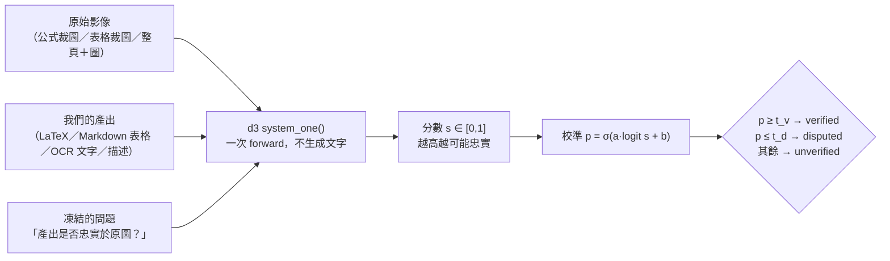
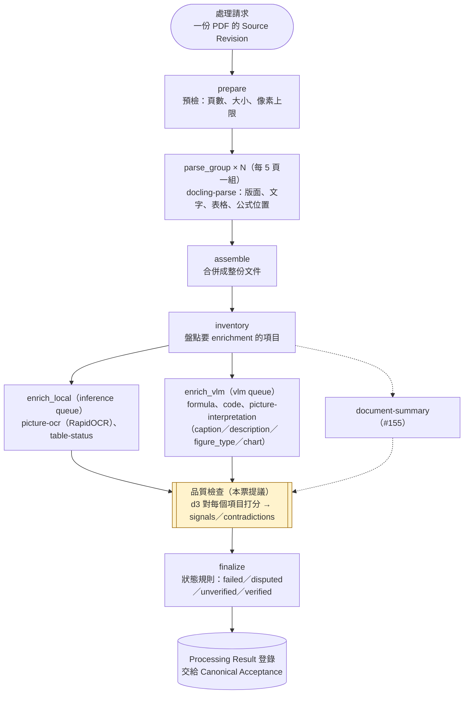
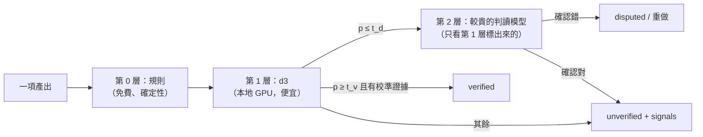
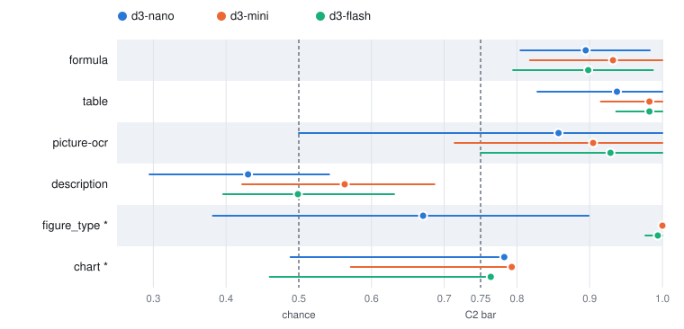

# d3 品質檢查：技術報告（#153）

| 項目 | 內容 |
|---|---|
| 票 | #153（#80 的子票，擋 #135） |
| 量測日期 | 2026-11-02（事前登錄）至 2026-11-04（test 與評分） |
| 狀態 | 量測完成；2026-11-04 使用者裁定（§11）：formula、table 強訊號，picture-ocr 弱訊號，模型 d3-mini |
| 受測模型 | `vllm-sr/d3-nano`、`d3-mini`、`d3-flash`（Decision 3.0，固定 revision，見 §5.1） |
| 事前登錄 | `freeze.md`、`freeze.json`（輸入檔 SHA-256 與修正紀錄） |

## 摘要

我們要回答的是：一個小型的判斷模型（d3），能不能替 PDF 處理流程產出的每一個公式、表格和圖片解讀**打上品質標記**，而且準確到可以自動標成「有爭議」（`disputed`），甚至直接「放行」（`verified`）。

| 類別 | 最佳 test AUROC | 抓錯（disputed）的表現 | 裁定等級（§11） |
|---|---|---|---|
| formula | 0.932（mini） | 標 24、22 個是真錯；抓到 29 個錯中的 22 個；規則漏掉的 5 個錯補抓到 4 個，0 誤標 | 強訊號 |
| table | 0.982（mini、flash） | 標 13、13 個是真錯；抓到 14 個錯中的 13 個 | 強訊號 |
| picture-ocr | 0.929（flash） | 標 6、6 個是真錯；抓到 7 個錯中的 6 個；但 test 只有 13 項 | 弱訊號 |
| description | 0.563（mini） | 幾乎抓不到 | 不用 |
| figure_type | 1.000（mini） | 錯誤率只有 1.5%，test 只有 3 個錯 | 不用 |
| chart 數值 | 0.793（mini） | 36 個錯點全在同一頁 | 不用（證據不足） |
| caption | 不可評 | 錯誤率只有 0.9% | 不用 |
| verified（所有類別） | — | 最好的情況是放行 19 項、0 錯，但風險上界 16.8%，目標是 ≤ 2% | 本票不開放，交 #83 |

結論：d3 可以當 formula 和 table 的第一層品質檢查。它便宜、在本機就能跑，標出來的錯大多是真的。picture-ocr 可以先記分數。圖片解讀類的 description，d3 判斷不了，需要別的方法，例如之後接更強、也更貴的判讀模型。

---

## 1. 品質檢查在做什麼

### 1.1 問題

PDF 處理流程（`paper-pdf@1`）會從論文中抽出公式、表格、圖中文字，並用 VLM 產生圖說、圖意描述、圖片類型和圖表數值。這些產出都可能出錯，例如把 `θ′_t` 讀成 `θ_t`、把表格的欄位錯位、把「系統」讀成「系统」。

下游使用者（檢索、問答、agent）需要知道每一項產出能不能信。平台用 **Enrichment Status** 回答這件事。每一項產出在處理結束時都會得到下列四種狀態之一，加上原因碼與 `signals`：

| 狀態 | 意思 | 消費端該怎麼做 |
|---|---|---|
| `failed` | 方法沒有產出 | 不能用 |
| `disputed` | 有證據顯示可能錯了 | 不要直接引用；送複查或重做 |
| `unverified` | 沒有證據顯示錯，也沒有證據顯示對 | 可以用，但要自己判斷 |
| `verified` | 有校準過的證據顯示對 | 可以直接用 |

目前的狀態規則（v1，`src/kp_processing/status_rules/v1.py`）只靠**規則比對**產生 `disputed`，而且從不給 `verified`：

- **formula**：`FORMULA_NATIVE_MISMATCH` 拿 PDF 字層的字元和 LaTeX 比對。但只有帶字層的公式能比，而且大小寫、上下標、重音等錯誤在字層裡看不出來。#152 的量測顯示，12 個錯只抓到 5 個。
- **table**：`table-status` 規則。
- **其他類別**：大多沒有任何訊號，一律是 `unverified`。

所以現況是：大部分產出都標 `unverified`，消費端拿不到有用的資訊。

### 1.2 d3 品質檢查的做法

d3 是 vllm-sr 發布的判斷模型（Decision 3.0）。它的用法是：給它「原始影像」、「我們的產出」和「一個問題」，它回一個機率，不會生成任何文字（`output_tokens` = 0）。

本報告量測的正是這條鏈的每一段：分數能不能把對的和錯的分開（AUROC）、校準後的機率準不準（ECE），以及兩條門檻切下去時，抓到多少錯、誤傷多少對的。

### 1.3 在 PDF workflow 裡的位置

`paper-pdf@1` 是一個 Temporal workflow（`PaperPdfWorkflow`，`src/kp_processing/workflow.py`）。各階段分派到不同的 task queue，由能跑該工作的 worker 執行：

- **現況**：每個 enrichment 方法在產出時，就把規則找到的矛盾寫進 `contradictions`（例如 `FORMULA_NATIVE_MISMATCH`）。finalize 再依 profile 指定的狀態規則（`status_rule: v1`）轉成狀態。換規則只需要重跑 finalize。
- **d3 的位置**：放在 enrichment 之後、finalize 之前，對每一個項目打分：
  - 分數一律寫進 `signals`（弱訊號）；
  - 被採用為強訊號的類別，校準後 p ≤ t_d 時加一筆 contradiction，finalize 就會給 `disputed`。
- **runtime**：d3 是 GPU 推論，要新增一個 d3 推論服務（新的 queue 或外部服務），不能和 docling 擠同一個 worker。

### 1.4 目標：每一項產出都有品質標記

長期目標是 `paper-pdf` 抽出或生成的**每一項**產出（formula、table、OCR、圖片解讀、摘要）都有一個有根據的品質標記，而且判讀是分層的：

- **為什麼分層**：第 2 層的模型準但貴。如果第 1 層能把可疑的挑出來，第 2 層只要看一小部分。以本次 test 為例：mini 只把 formula 的 22%（24/110）和 table 的 43%（13/30）送上去，而這些送上去的大多是真錯。
- **本票的角色**：驗證第 1 層，也就是 d3 能覆蓋哪些類別。d3 判不了的類別（description），只能讓第 2 層直接判，或抽樣人審。
- **PROD 限制**：依公司的資料分類規定，PROD 資料須在地端處理，所以 PROD 的第 2 層判讀模型必須是公司地端部署的模型（同 #155 的做法）。

### 1.5 本票的判定等級

| 等級 | 意思 | 對狀態的影響 | 採用的程序 |
|---|---|---|---|
| 不用 | 排序能力不足 | 無 | — |
| 弱訊號 | 分數寫進 `signals`，供排序與人工抽查 | 不改狀態 | 在 #129 頂端加一則實作修正 |
| 強訊號 | 校準後 p ≤ t_d 就標 `disputed` | 改狀態規則的語意 | 推翻 workflow v2 §7「弱訊號只記錄、不改狀態」，要先寫 ADR，再改 #129 |
| verified 候選 | 放行的項目裡改義率 ≤ 2% | 開放 `verified` | 依 #83 的條件：每類 ≥ 300 項校準集。本票只看有沒有希望 |

---

## 2. 資料蒐集

### 2.1 原則

- **只用真實的錯**：負例（改了意思的回答）都來自真實模型或方法的輸出，不用人工擾動，例如刻意改一個符號。人工擾動做的錯太乾淨，會高估檢查器。
- **沒有產出不算錯**：方法沒有輸出時，狀態是 `failed`，不屬於 d3 要判的對象。
- **盲評**：評審只看原圖和一份回答，看不到產生它的模型、輪次、舊標籤或其他評審的意見。

### 2.2 各類別的資料來源

| 類別 | 判定單位 | 來源 | 產生者 |
|---|---|---|---|
| formula | 一個顯示公式的 LaTeX | #84 W4b 的 W3 公式 50 個；#80 T4 accuracy 五輪不重複的回答 170 個 | CodeFormulaV2、gpt-6-luna、Claude Opus |
| description | 一段圖意描述 | W4b 28；T4 的 Luna r1／r2、Opus、Sol 共 99；B1 的 324 張圖 | gpt-6-luna、Opus、Sol |
| table | 一張表的格線（Markdown） | #84 的表格比對資料：59 張 | docling TableFormer |
| picture-ocr | 一張圖的 OCR 文字 | #84 round-4 local OCR：29 張圖 | RapidOCR |
| figure_type | 一個類型標籤 | B1 的 324 張圖 | gpt-6-luna |
| chart 數值 | 一個數值點（series, x, y） | W4b 101 點；T4 四張圖的點 | gpt-6-luna、Opus、Sol |
| caption（生成的） | 一則 caption | B1 的 324 張圖 | gpt-6-luna |

**B1** 是本票補的資料：
- 144 份未判過的 Luna fixture 回答，每份判 caption、description、figure_type 三欄；
- 另外用 t4 第 1 輪較弱的 prompt 重答同樣的圖，共 164 份，用來增加錯例。報告把這一組錯例的來源標出來（§8）。

**不在範圍內**：
- W4b R5 的 28 個公式：它們的裁圖是段落，對應的是行內數學，而 `paper-pdf@1` 不重建行內數學；
- code、閱讀順序：不評；
- 文件摘要：移交 #155。

### 2.3 標籤怎麼來

1. **評審**：Claude Opus 5.5 子代理，effort high。判定規則在第一個裁決之前就凍結在 `judging-rules.md`，每類一條：
   - formula：運算元、識別字、上下標、正負號、分組、條件或列，有任何不同或缺漏就是 FAIL。calligraphic、blackboard、粗體、大小寫不同都算不同符號；`\text`／`\mathrm`、空白、句尾標點、`a/b` 對 `\frac{a}{b}` 視為等價。
   - table：任何格子的值，或它所在的行、列位置不同（含表頭跨欄），就是 FAIL。
   - picture-ocr：任何可辨識的字、數字或標籤漏掉或讀錯，就是 FAIL；順序和換行不計。
   - description：圖中的元件、箭頭（含方向和標籤）、條件或關係說錯，或描述了圖和頁面上沒有的東西，就是 FAIL。單純省略細節不算。
   - caption：提到圖和頁面不支持的實體、關係、數量或主張，就是 FAIL。
   - figure_type：評審先自己判類型（chart／diagram／photo／screenshot／table／other）；回答的類型不同、而且圖也不可能算那一類時，才是 FAIL。
2. **規模**：27 批，1,138 筆有效裁決，每個要判的項目恰好一筆（`merge_verdicts.py` 檢查）。
3. **三種結果**：PASS → `correct`；PASS 但只差非實質的排版 → `minor`；FAIL → `meaning_changed`。UNKNOWN 有 2 筆 description，排除。
4. **舊標籤**：#84 來源的舊標籤全部重判（B4，194 筆），盲評時不看舊標籤。和舊標籤不一致的，全部交使用者裁定。
5. **使用者裁定**（`judging/overrides.json`，規則本文不改）：
   - **R1**：公式只差粗體的 11 筆改為 `minor`，和 T4 gold 與 #152 規則用同一把尺。
   - **R2**：其餘 25 筆不一致採用新裁決。
   - **R3**：B1 抽查 20 筆，由 Fable 5.1 代為複核；17 筆同意，3 筆 description 改為 PASS。
   - **R4**：caption 只有 3 個錯，報為不可評。
6. **打包程式的兩個錯誤**（已修正並重判）：
   - round-1 prompt 那組有 164 筆，裁圖和整頁的角色互換了；
   - 因此同一頁的圖被併成一個 task，有 25 個 task 的圖和回答對不上，41 張圖沒有送評。
   - 修正後重新打包 66 個 task 並重判。合併時用「送評的圖必須等於項目的圖」這條檢查，丟掉 75 筆無效裁決。

### 2.4 最終資料量

| 類別 | 正確（含 minor） | 改了意思 | 錯所在的頁數 | 錯誤率 |
|---|---:|---:|---:|---:|
| formula | 162 | 58 | 31 | 26.4% |
| description | 414 | 37 | 28 | 8.2% |
| table | 30 | 29 | 24 | 49.2% |
| picture-ocr | 15 | 14 | 10 | 48.3% |
| figure_type | 319 | 5 | 5 | 1.5% |
| chart 數值 | 506 | 36 | **1** | 6.6% |
| caption | 321 | 3 | 2 | 0.9% |
| **合計** | **1,787** | **182** | | |

- 錯誤率是這份資料集的錯誤率，不是正式流程的錯誤率。formula、table、OCR 的資料是刻意挑過錯例的，正式流程的錯誤率會低很多。
- 合計 1,949 項，其中 dev 787、test 1,162。

---

## 3. 抽樣與切分

### 3.1 dev／test 切分

- **原則**：dev 用來選問法、做校準、定門檻；test 只在最後用一次，回答「這套設定在沒看過的資料上表現如何」。
- **以來源頁為單位**：同一頁上的產出彼此相關，例如同一張圖的多個回答、同一個公式的多個版本。所以同一類別裡，同一頁的所有項目都放在同一邊（`build_split.py`，seed 153）。已檢查：沒有任何「頁 × 類別」同時出現在兩邊。
- **沿用 W4b**：W4b 判過的 266 項保留原本的切分。不過 W4b 的切分只約束 W4b 在該頁判過的那個類別，同一頁的其他類別自由分配。
- **其餘的頁**：貪婪分配到能讓每類 dev 和 test 的錯例數最接近的那一邊，其次看項目數；比例約 1:1。W4b 是 3:7，這次改成 1:1，是因為 dev 的錯例最缺。

| 類別 | dev 項目數／錯 | test 項目數／錯 | 可評性（C1） |
|---|---|---|---|
| formula | 110／29 | 110／29 | 設門檻 |
| description | 186／18 | 265／19 | 設門檻 |
| table | 29／15 | 30／14 | 設門檻 |
| picture-ocr | 16／7 | 13／7 | 設門檻 |
| figure_type | 162／2 | 162／3 | 只報 AUROC |
| chart | 122／0 | 420／36 | 只報 AUROC（dev 沒有錯例，問法依規則取 Q2，不校準） |
| caption | 162／1 | 162／2 | 不可評 |

### 3.2 其他抽樣

| 抽樣 | 做法 | 用途 |
|---|---|---|
| B1 抽查 | 從 B1 的裁決中，以 seed 153 隨機抽 10 筆 FAIL 和 10 筆 PASS | 檢查評審品質（R3） |
| B4 不一致 | 全部，不抽樣 | 和舊標籤不一致的都交使用者 |
| 按頁 bootstrap | 以來源頁為單位重抽 2,000 次，seed 153（§5.6） | AUROC 的信賴區間 |
| 圖片縮放 | 長寬等比例縮到 ≤ 1.6 MP（LANCZOS）；444 張圖中 131 張縮過 | 符合 d3 的輸入上限 |

### 3.3 防止資料洩漏

1. 問題、選擇規則、校準與門檻的演算法，在看到任何 d3 輸出之前就凍結（`freeze.json`：`d3_outputs_seen: 0`）。
2. 三個模型的 dev 選擇全部寫定後，才跑任何 test。`test-launch.json` 記下選擇檔、dev rows、程式和 test 錯例數的 SHA-256，以及 `test_outputs_seen: 0`。
3. test 每個模型只跑一次。`run_d3.py` 發現已有結果就拒絕啟動。
4. **已知的重疊**（`freeze.md` §2）：
   - T4 的 46 個公式曾用來調整 #152 的規則，所以規則這一側的成績偏樂觀；
   - round-2 的 description prompt 是看過 round-1 的失敗後才寫的；
   - 我看過 W4b 的 test 錯例，所以問法只沿用 W4b 的原文，加上一句 t4 判定規則裡本來就有的通用規則，不為個案改寫。

---

## 4. 各 modality 的驗證方式

每一類都問兩種問法：
- **Q1**：四選一的 `choice`，選項是 faithful、minor_difference、meaning_changed、cannot_determine。
- **Q2**：是非題 `noul`，問「是否忠實保義」。

前導句和選項定義沿用 #84 W4b 的 `questions.json`。全文由 `make_questions.py` 產生，存成 `questions.json`。

state（送給 d3 的文字）只放兩個欄位：
- `category`：該類的名稱，例如 `formula LaTeX`、`table grid (Markdown)`；
- `reconstruction`：我們的產出。

不放 gold、理由或定位提示。

| modality | 送給 d3 的圖 | 判定單位 | 「改了意思」的定義（摘要） | 本次驗證到的 |
|---|---|---|---|---|
| formula | 公式裁圖 | 一個顯示公式 | 任何運算元、識別字、上下標、正負號、分組或條件不同；字母樣式不同算不同符號 | test 110 項、29 個錯；另和現行規則合併（§6.3） |
| table | 表格裁圖 | 一張表的格線 | 任何格子的值或位置不同，含表頭跨欄 | test 30 項、14 個錯 |
| picture-ocr | 目標圖 | 一張圖的全部文字 | 任何可辨識的字、數字或標籤漏掉或讀錯 | test 13 項、7 個錯 |
| description | 整頁＋目標圖 | 一段描述 | 元件、箭頭、條件或關係說錯，或描述了不存在的東西 | test 265 項、19 個錯 |
| figure_type | 整頁＋目標圖 | 一個類型 | 圖不可能屬於回答的類型 | test 162 項、3 個錯 |
| chart 數值 | 目標圖 | 一個數值點 | 該點的值不對 | test 420 點、36 個錯（同一頁） |
| caption | 整頁＋目標圖 | 一則 caption | 提到圖不支持的實體、關係或主張 | 不可評 |

description、caption、figure_type 送「整頁＋目標圖」，是因為我們的方法本身就同時送這兩張圖給 VLM。W4b 只送裁圖。

formula 的問法沿用 W4b 原文，另加一句 t4 的判定規則：calligraphic、blackboard 或大小寫不同算不同符號，並列出視為等價的寫法。這樣問題才和 gold 用的是同一個標準。新加的四類（ocr、caption、table、figure_type）的問法原文見 `freeze.md` §3。

---

## 5. 評分方法與公式

評分程式是 `score.py`：`select` 處理 dev，`evaluate` 處理 test。

### 5.1 模型與執行環境

| 模型 | 固定 revision | 權重驗證 |
|---|---|---|
| d3-nano | `462efc366229ea268cf4eed3738b3fc4415e4817` | `weights-d3-nano.json`：25 個檔案對 Hub 檔案樹全部相符 |
| d3-mini | `bd0090dd758d32ba59ef5c749910a8e87fc4391f` | `weights-d3-mini.json`：27 個檔案全部相符 |
| d3-flash | `67e03e1bc157961c582ee7c6a35d9b15fada3dec` | `weights-d3-flash.json`：31 個檔案全部相符 |

- **用法**：照官方模型卡，`AutoModel.from_pretrained(..., trust_remote_code=True)`，再呼叫 `model.system_one(state, questions, images)`。不改 runtime、權重或 prompt renderer。
- **精度**：BF16 backbone，FP32 readout，batch 1，在 MPS 上跑。
- **版本**：transformers 5.17.0（模型卡驗證的版本），torch 2.14.0。
- **隔離**：推論期間 HF 設為離線，並擋住 socket；網路嘗試次數為 0。
- **重現性**：用 nano 重跑 W4b 的 81 筆 dev，Q1 和 Q2 的分數和 W4b 存下的完全相同，最大差 0。

### 5.2 原始分數

每個項目 $i$ 會得到原始分數 $s_i \in [0,1]$，越高代表 d3 越認為回答忠實：

$$
s_i = \begin{cases}
P(\texttt{faithful}) & \text{Q1：choice 的 probabilities} \\
\texttt{noul} & \text{Q2：是非題回答 yes 的機率}
\end{cases}
$$

不讀 `confidence`：HF 套件的 confidence 是 $1 -$ normalized entropy，不是被選選項的機率（`document-content-screening-methods-2026-10-23/d3-probe/part-a.md`）。

### 5.3 AUROC（排序能力）

正例 $\mathcal{P}$ 是 `correct`，負例 $\mathcal{N}$ 是 `meaning_changed`，`minor` 不計：

$$
\mathrm{AUROC} = \frac{1}{|\mathcal{P}|\,|\mathcal{N}|} \sum_{i \in \mathcal{P}} \sum_{j \in \mathcal{N}} \Big( \mathbb{1}[s_i > s_j] + \tfrac{1}{2}\,\mathbb{1}[s_i = s_j] \Big)
$$

意思是：隨機抽一個正確回答和一個錯誤回答，正確那個分數比較高的機率。1.0 代表完全分得開，0.5 等於丟銅板。

實作上用平均名次計算：$\mathrm{AUROC} = \dfrac{R_{\mathcal{P}} - |\mathcal{P}|(|\mathcal{P}|+1)/2}{|\mathcal{P}|\,|\mathcal{N}|}$，其中 $R_{\mathcal{P}}$ 是正例的名次和。

### 5.4 選問法（dev）

$$
q^\star = \begin{cases} \text{Q1} & \mathrm{AUROC}_{\text{dev}}(\text{Q1}) > \mathrm{AUROC}_{\text{dev}}(\text{Q2}) \\ \text{Q2} & \text{其他情況（含平手、或其中一個算不出來）} \end{cases}
$$

### 5.5 校準：單調、正則化的 Platt scaling（dev）

原始分數不是準確的機率，所以要校準。令 $y_i = 1$ 代表項目不是 `meaning_changed`（`minor` 算 1），並令

$$
x_i = \operatorname{logit}\big(\operatorname{clip}(s_i,\,10^{-6},\,1-10^{-6})\big), \qquad
p_i = \sigma(a\,x_i + b) = \frac{1}{1 + e^{-(a x_i + b)}}
$$

在 dev 上解

$$
\min_{a \ge 0,\; b} \;\; \sum_i \Big[ \log\big(1 + e^{a x_i + b}\big) - y_i\,(a x_i + b) \Big] \;+\; \tfrac{1}{2} a^2
$$

- 第一項是 log loss。
- $a \ge 0$ 保證校準是單調的，不會改變排序，所以校準不影響 AUROC。
- $\tfrac12 a^2$ 是固定的 L2 懲罰（λ = 1），不搜尋超參數；$b$ 不懲罰。
- 解法：L-BFGS-B，初始值 $(a, b) = (1, \operatorname{logit}\bar{y})$。
- dev 只有單一類別時不擬合（`UNFITTABLE_SINGLE_CLASS`），例如 chart。

### 5.6 兩條門檻（dev）

在 dev 的校準機率 $p_i$ 上，對所有候選值 $t \in \{p_i\}$ 求：

**放行門檻 t_v**：在「放行的項目裡改義率 ≤ 2%」的條件下，取覆蓋最多的；覆蓋相同時取較大的 $t$。

$$
t_v = \arg\max_{t} \;\big|\{i : p_i \ge t\}\big| \quad \text{s.t.} \quad \frac{\big|\{i : p_i \ge t,\; i \in \mathcal{N}\}\big|}{\big|\{i : p_i \ge t\}\big|} \le 0.02
$$

**爭議門檻 t_d**：在「被標的項目裡真錯的比例 ≥ 0.80」的條件下，取抓到錯最多的；抓到的數目相同時取較小的 $t$。

$$
t_d = \arg\max_{t} \;\big|\{i \in \mathcal{N} : p_i \le t\}\big| \quad \text{s.t.} \quad \frac{\big|\{i \in \mathcal{N} : p_i \le t\}\big|}{\big|\{i : p_i \le t\}\big|} \ge 0.80
$$

0.80 和現行 formula 規則的精確率（6 標 5 中）是同一水準。沒有任何 $t$ 滿足條件時，該門檻記為無（N/A）。

**分類**（test 上使用凍結的 $a, b, t_v, t_d$，不重擬合）：

$$
\text{status}_i = \begin{cases}
\texttt{failed} & \text{沒有 d3 輸出} \\
\texttt{verified} & p_i \ge t_v \\
\texttt{disputed} & p_i \le t_d \\
\texttt{unverified} & \text{其餘}
\end{cases}
$$

### 5.7 test 上的指標

令 $N$ 是該類的項目數，$V$、$D$ 分別是 verified 和 disputed 的集合，$n_{\mathcal{N}}$ 是錯例數：

| 指標 | 公式 | 意思 |
|---|---|---|
| 覆蓋率 | $\lvert V\rvert / N$ | 放行了多少 |
| 放行風險 | $\lvert V \cap \mathcal{N}\rvert / \lvert V\rvert$ | 放行的項目裡改了意思的比例 |
| 精確率 | $\lvert D \cap \mathcal{N}\rvert / \lvert D\rvert$ | 被標的項目裡真錯的比例 |
| 召回率 | $\lvert D \cap \mathcal{N}\rvert / n_{\mathcal{N}}$ | 所有錯裡被標到的比例 |
| 誤標率 | $(\lvert D\rvert - \lvert D \cap \mathcal{N}\rvert) / (N - n_{\mathcal{N}})$ | 正確（含 minor）被標的比例 |

比例都附 **Wilson 95% 區間**（$z = 1.95996$，$\hat p = k/n$）：

$$
\frac{\hat p + \frac{z^2}{2n} \;\pm\; z\sqrt{\frac{\hat p(1-\hat p)}{n} + \frac{z^2}{4n^2}}}{1 + \frac{z^2}{n}}
$$

放行風險報的是 Wilson **上界**。例如 0 錯／19 放行，上界是 16.8%。0/0 記為 N/A，不記成 0%。

**ECE**（校準誤差，10 個等寬 bin $B_b$）：

$$
\mathrm{ECE} = \frac{1}{N} \sum_{b=1}^{10} \Big| \sum_{i \in B_b} p_i - \sum_{i \in B_b} y_i \Big|
$$

### 5.8 AUROC 的信賴區間：按來源頁 bootstrap

同一頁的項目彼此相關，所以不能逐項重抽。做法如下：

1. 令 $G$ 是來源頁的集合，只含有效、非 minor 的項目。
2. 每一次抽樣：從 $G$ 中有放回地抽 $|G|$ 頁，把這些頁的項目合起來，算一次 AUROC。抽到的資料缺正例或負例時，該次不計，但要記錄跳過的次數。
3. 重複 2,000 次（`numpy.random.default_rng(153)`），取第 2.5 和第 97.5 百分位（線性內插）。

### 5.9 可評性（C1）與弱訊號條件（C2）

**C1**（樣本下限），依 dev 和 test 的錯例數：

$$
\text{C1} = \begin{cases}
\text{設門檻} & n_{\mathcal{N}}^{\text{dev}} \ge 5 \text{ 且 } n_{\mathcal{N}}^{\text{test}} \ge 5 \\
\text{只報 AUROC} & n_{\mathcal{N}}^{\text{dev}} + n_{\mathcal{N}}^{\text{test}} \ge 5 \\
\text{不可評} & \text{其他}
\end{cases}
$$

**C2**（有用訊號）：$\mathrm{AUROC}_{\text{test}} \ge 0.75$，而且按頁 bootstrap 的 95% 下界 $> 0.5$。

### 5.10 formula 與現行規則合併

只用有原生字層的 T4 公式。令 $r_i$ 是規則 `FORMULA_NATIVE_MISMATCH` 的標記（`rule_flags.py` 用 `formula.mismatch` 重算），$d_i = \mathbb{1}[p_i \le t_d]$ 是 d3 的標記：

| 指標 | 公式 |
|---|---|
| 規則漏掉、d3 補抓 | $\lvert\{i \in \mathcal{N} : \neg r_i \wedge d_i\}\rvert \,/\, \lvert\{i \in \mathcal{N} : \neg r_i\}\rvert$ |
| 正確被「任一方」標記 | $\lvert\{i \in \mathcal{P} : r_i \vee d_i\}\rvert \,/\, \lvert\mathcal{P}\rvert$ |
| 正確被「兩方都」標記 | $\lvert\{i \in \mathcal{P} : r_i \wedge d_i\}\rvert \,/\, \lvert\mathcal{P}\rvert$ |

`rule_flags.py` 的檢查：重算出來的規則標記，和 46 個 t4 targets 已出貨的狀態完全一致（46/46）。

### 5.11 程式驗證

- **`score.py`**：由 Codex 撰寫，過 plan gate，主線驗證：
  - 98 個測試通過；
  - `reproduce_w4b.py` 從 W4b 的原始輸出重算，494 項全精度數字全部相符（最大誤差 8.5e-17）。
- **`recheck_test.py`**：主線另外寫的獨立重算，不 import `score.py`：
  - AUROC、verified 和 disputed 的計數，以及 formula 和規則的合併結果，三個模型逐類都和 `score.py` 完全一致；
  - bootstrap 下界的差距 ≤ 0.007，差異來自不同的亂數產生器。

### 5.12 凍結後的修正

三筆修正都只影響執行，不影響任何分數，記在 `freeze.json` 的 `amendments`：

| # | 修正 | 原因 |
|---|---|---|
| 1 | `run_d3.py --resume` | 記憶體保護觸發後，只跑還沒有結果的項目；項目彼此獨立，runtime 是確定性的 |
| 2 | 記憶體保護線 8 → 6 GiB | 當時 Docker 佔用記憶體 |
| 3 | MPS 記憶體上限比例 0.45 → 0.65 | flash 的 BF16 權重 16.8 GB 放不下；這只是分配上限 |

---

## 6. 結果

### 6.1 test AUROC 與 95% 信賴區間

- 虛線 0.5 是丟銅板，虛線 0.75 是 C2 門檻。圖由 `make_figure.py` 從 `metrics/` 產生。
- \* figure_type 的 test 只有 3 個錯例。chart 的 36 個錯點都在同一頁，2,000 次抽樣中有 526 次抽不到錯例，所以區間的上界就等於點估計。

### 6.2 test：每個「類別 × 模型」

| 類別（錯／總數） | 模型 | 問法 | AUROC | 95% 區間 | C2 | 標記數 | 精確 | 抓到 | 誤標 | 放行 | 放行中的錯 | 放行風險上界 |
|---|---|---|---|---|---|---:|---|---|---|---:|---:|---|
| formula（29／110） | nano | Q1 | 0.895 | 0.805–0.983 | ✅ | 17 | 14/17 | 14/29 | 3/81 | 0 | — | — |
| | mini | Q2 | **0.932** | 0.818–1.000 | ✅ | 24 | **22/24** | **22/29** | 2/81 | 4 | 0 | 49.0% |
| | flash | Q2 | 0.898 | 0.795–0.987 | ✅ | 24 | 18/24 | 18/29 | 6/81 | 19 | 0 | 16.8% |
| table（14／30） | nano | Q2 | 0.938 | 0.828–1.000 | ✅ | 13 | 12/13 | 12/14 | 1/16 | 14 | **1** | 31.5% |
| | mini | Q2 | **0.982** | 0.915–1.000 | ✅ | 13 | **13/13** | **13/14** | 0/16 | 6 | 0 | 39.0% |
| | flash | Q2 | **0.982** | 0.937–1.000 | ✅ | 13 | **13/13** | **13/14** | 0/16 | 10 | 0 | 27.8% |
| picture-ocr（7／13） | nano | Q1 | 0.857 | 0.500–1.000 | ❌ | 5 | 4/5 | 4/7 | 1/6 | 0 | — | — |
| | mini | Q2 | 0.905 | 0.714–1.000 | ✅ | 2 | 2/2 | 2/7 | 0/6 | 1 | 0 | 79.3% |
| | flash | Q2 | **0.929** | 0.750–1.000 | ✅ | 6 | **6/6** | **6/7** | 0/6 | 3 | 0 | 56.1% |
| description（19／265） | nano | Q2 | 0.430 | 0.295–0.542 | ❌ | 0 | N/A | 0/19 | 0/246 | 25 | **1** | 19.5% |
| | mini | Q2 | 0.563 | 0.422–0.687 | ❌ | 0 | N/A | 0/19 | 0/246 | 18 | 0 | 17.6% |
| | flash | Q2 | 0.499 | 0.396–0.631 | ❌ | 4 | 1/4 | 1/19 | 3/246 | 29 | **1** | 17.2% |
| figure_type（3／162） | nano | Q1 | 0.671 | 0.382–0.899 | 只報 AUROC | | | | | | | |
| | mini | Q2 | 1.000 | 1.000–1.000 | 只報 AUROC | | | | | | | |
| | flash | Q2 | 0.994 | 0.977–1.000 | 只報 AUROC | | | | | | | |
| chart（36／420） | nano | Q2 | 0.783 | 0.489–0.783 | 不判定 | | | | | | | |
| | mini | Q2 | 0.793 | 0.572–0.793 | 不判定 | | | | | | | |
| | flash | Q2 | 0.764 | 0.460–0.764 | 不判定 | | | | | | | |
| caption（2／162） | 三者 | — | 不可評 | | | | | | | | | |

**精確率的 Wilson 95% 區間**：

| 類別 | nano | mini | flash |
|---|---|---|---|
| formula | 0.59–0.94 | 0.74–0.98 | 0.55–0.88 |
| table | 0.67–0.99 | 0.77–1.00 | 0.77–1.00 |
| picture-ocr | 0.38–0.96 | 0.34–1.00 | 0.61–1.00 |

**放行覆蓋率**：

| 類別 | nano | mini | flash |
|---|---|---|---|
| formula | 0/110 | 4/110 | 19/110 |
| table | 14/30 | 6/30 | 10/30 |
| picture-ocr | 0/13 | 1/13 | 3/13 |
| description | 25/265 | 18/265 | 29/265 |

### 6.3 formula：d3 和現行規則合併

test 中有原生字層的 T4 公式有 75 個：64 個正確、11 個改了意思。W4b 的 35 個 CodeFormulaV2 公式沒有字層，不納入這一項。

| | nano | mini | flash |
|---|---|---|---|
| 規則標記 6 個，全部是真錯 | — | — | — |
| 規則漏掉的 5 個錯，d3 補抓到 | 2/5 | **4/5** | 3/5 |
| 正確公式被「規則或 d3」標記 | 0/64 | 0/64 | 0/64 |
| 正確公式被「規則且 d3」標記 | 0/64 | 0/64 | 0/64 |

規則加上 mini，抓到 11 個錯中的 10 個，沒有誤標。規則這一側偏樂觀（§3.3）；d3 沒有用這批資料調整過。

### 6.4 dev 選擇（在 test 前凍結）

| 類別 | nano | mini | flash |
|---|---|---|---|
| formula | Q1 0.713；t_d 0.473；無 t_v | Q2 0.865；t_v 0.988，t_d 0.445 | Q2 0.763；t_v 0.912，t_d 0.566 |
| table | Q2 1.000；t_v 0.669，t_d 0.274 | Q2 1.000；t_v 0.837，t_d 0.306 | Q2 1.000；t_v 0.830，t_d 0.321 |
| picture-ocr | Q1 0.730；t_v 0.960，t_d 0.469 | Q2 0.714；t_v 0.791，t_d 0.400 | Q2 0.746；t_v 0.796，t_d 0.446 |
| description | Q2 0.553；t_v 0.933，t_d 0.586 | Q2 0.600；t_v 0.951，t_d 0.454 | Q2 0.698；t_v 0.944，t_d 0.566 |
| figure_type | Q1 0.963（只報 AUROC） | Q2 0.931 | Q2 0.959 |
| chart | Q2（dev 沒有錯例，不校準） | 同左 | 同左 |
| caption | 不可評 | 不可評 | 不可評 |

- 數字是 dev AUROC；問法後面是凍結的門檻。完整的選擇紀錄（含 Platt 參數 $a, b$）在 `selection/`。
- dev 和 test 差距很大，例如 nano 的 formula 從 0.713 變成 0.895，flash 的 description 從 0.698 變成 0.499。每類只有 7–29 個錯例，這是樣本小造成的擺動。選擇在 test 前就寫定，有 hash 為證，所以不是資料洩漏。

### 6.5 校準（ECE：校準前 → 校準後）

| 類別 | nano | mini | flash |
|---|---|---|---|
| formula | 0.101 → 0.094 | 0.106 → 0.088 | 0.095 → 0.078 |
| table | 0.156 → 0.131 | 0.176 → 0.151 | 0.130 → 0.105 |
| picture-ocr | 0.249 → 0.191 | 0.196 → 0.240 | 0.274 → 0.178 |
| description | 0.067 → 0.030 | 0.038 → 0.033 | 0.033 → 0.045 |

校準後仍有 0.08–0.24 的誤差，所以門檻應當當作「排序上的切點」使用，不要把它讀成精確的機率。description 的 ECE 低，是因為錯例只佔約 7%，不代表它的排序能力好。

### 6.6 例子：flash 在 picture-ocr dev 上漏掉的錯

| 項目 | 錯誤 | 校準後 p | 結果 |
|---|---|---|---|
| ocr84/15 | `skills/` 讀成 `ski11s/`，還多了重音符號 | 0.380 | 標為 disputed ✅ |
| ocr84/18 | `Accuracy` 讀成 `Acrcy` | 0.385 | 標為 disputed ✅ |
| ocr84/20 | 數學標籤 τ⁺、A⁻ 漏讀 | 0.469 | 沒標到 |
| ocr84/16 | x 軸標籤和刻度漏讀 | 0.634 | 沒標到 |
| ocr84/28 | 繁體「系統、連結」讀成簡體「系统、連结」 | 0.783 | 沒標到，差一點就放行（t_v 0.796） |

d3 抓得到「讀錯成怪字」，但抓不到「漏讀」和「簡繁混淆」。

---

## 7. 成本

### 7.1 本機量測（Apple M5 Pro，48 GiB，MPS，batch 1）

| 模型 | 權重（BF16） | test：每項 p50／p95 | test 整批（1,162 項） | dev：每項 p50／p95（問兩題） | 峰值 MPS 記憶體 | 峰值 RSS |
|---|---|---|---|---|---|---|
| nano | ≈ 4 GB | 1.78／2.24 s | 23.6 分 | 3.62／4.72 s | 6.2 GiB | 5.5 GiB |
| mini | ≈ 8.4 GB | 3.82／5.11 s | 51.8 分 | 8.02／10.72 s | 11.5 GiB | 13.2 GiB |
| flash | ≈ 16.8 GB | 4.95／6.55 s | 65.9 分 | 10.32／13.54 s | 18.7 GiB | 6.8 GiB |

- **整批時間**：從第一個結果算到最後一個結果。模型載入只要 1–4 秒。
- **每類耗時**：送「整頁＋目標圖」的類別（description、caption、figure_type），每項比只送裁圖的類別慢 3–5 倍，因為影像 token 多。
- **kernel**：本機缺 `flash-linear-attention`，模型的 linear attention 層使用 PyTorch 的參考實作。它是 Triton kernel，不支援 MPS。結果正確，但比較慢。

### 7.2 公司 GPU（只引用官方數字）

出處是 d3-flash 模型卡，在一張 AMD Instinct MI325X 上量測：

| 項目 | 數字 |
|---|---|
| AutoModel 一次一個請求、帶一張圖（1.6 MP）的中位數延遲 | 166 ms |
| AutoModel 峰值 GPU 記憶體 | 23.8 GiB |
| vLLM Semantic Router Engine mode，開 batching | 95 req/s，p99 < 1 s |

官方說明：開 batching 時，少數接近平手的判定會改變。

### 7.3 花費

- 判定和補資料的 DEV 花費約 US$2.07（上限 US$5）。
- d3 推論在本機執行，沒有 API 費用。

---

## 8. 限制

1. **錯例少**：test 的錯例只有 formula 29、table 14、ocr 7。點估計很好，但精確率的區間下界在 0.55–0.77 之間。
2. **門檻不能直接搬到別的 runtime**：門檻是在 MPS 上、用參考 kernel 校準的。部署到 GPU 時 BF16 的數值會有小幅差異，開 batching 也會改變少數判定。上線前要在部署硬體上重跑 dev 分數，有偏移就重新校準。
3. **標籤來自 AI 評審**：評審是 Claude Opus 5.5。使用者抽查的 20 筆中，由 Fable 5.1 代為複核（R3），獨立性低於人審。
4. **語料**：以公開 AI 論文為主，類型單一。
5. **description 的錯例**：有一部分來自較弱的 round-1 prompt，錯誤的型態可能和正式 prompt 不同。
6. **資料集的錯誤率**：formula、table、OCR 的資料刻意挑過錯例，正式流程的錯誤率較低。精確率在低錯誤率下會下降，因為誤標的絕對數會相對變多。上線後要用實際流量重估。

---

## 9. 建議等級與對目標的覆蓋

### 9.1 建議（2026-11-04 已裁定，見 §11）

| 類別 | 建議等級 | 建議模型 | 理由 | 採用時要改的地方 |
|---|---|---|---|---|
| formula | **強訊號** | mini | AUROC 0.932；精確 22/24；補抓規則漏掉的 4/5 個錯，0 誤標 | 先寫 ADR，推翻 workflow v2 §7；#129 狀態規則加一條：p ≤ t_d → `disputed`（新原因碼）；`signals` 加入 d3 分數；新增 d3 推論服務 |
| table | **強訊號** | mini（和 flash 並列） | AUROC 0.982；13/13；0 誤標 | 同上，接在 `table-status` 之後 |
| picture-ocr | **弱訊號** | flash 或 mini | 有訊號，但只有 13 項，精確率下界 0.61 | 只寫 `signals`；#129 頂端加一則實作修正 |
| description | 不用 | — | AUROC ≤ 0.56 | 無 |
| figure_type | 不用 | — | 錯誤率 1.5% | 無 |
| chart | 不用（證據不足） | — | 36 個錯集中在一頁 | 無 |
| caption | 不用 | — | 錯誤率 0.9% | 無 |
| verified | 本票不開放 | — | 風險上界 ≥ 16.8% | 交給 #83 |

建議只用一個模型 mini：formula 它最好，table 和 flash 並列；記憶體約是 flash 的 60%，速度約快 1.3 倍。如果 OCR 也統一用 mini，代價是 OCR 的抓錯從 6/7 降到 2/7。

### 9.2 離「每一項產出都有品質標記」還差什麼

| 產出 | 現有規則（第 0 層） | d3（第 1 層，依本報告建議） | 缺口與下一步 |
|---|---|---|---|
| formula（有字層） | `FORMULA_NATIVE_MISMATCH` | 強訊號 | 被標的送第 2 層確認或重做（後續候選 3） |
| formula（無字層） | 無 | 強訊號 | 同上 |
| table | `table-status` | 強訊號 | 同上 |
| picture-ocr | `NO_TEXT` | 弱訊號 | 補資料再評（後續候選 1） |
| description | 無 | 無 | **需要第 2 層判讀模型**，或抽樣人審 |
| figure_type、caption | 無 | 無（錯誤率低） | 維持 `unverified`；必要時由第 2 層抽樣 |
| chart 數值 | 無 | 無（證據不足） | 需要多頁的錯例再評 |
| code | 原生字層優先，VLM 只在沒有字層時用 | 未評 | 沿用 W4b 結果 |
| 文件摘要 | #155 的逐句 verify（DEV 用 Sonnet 5.5） | 候選判讀器 | 由 #155 評估 |
| 閱讀順序 | profile 宣告的限制 | 未評 | — |

---

## 10. 後續候選（未開票）

1. **只補 OCR 的新一輪**：從新頁面產生 OCR 回答，評審後開一輪只有 OCR 的新 freeze（新的 dev／test）。大約一個 session 的工作量；費用取決於 OCR 的錯誤率，DEV 預算還剩約 US$2.9。
2. **verified 的大規模校準**：要證明改義率 ≤ 2%，Wilson 上界需要約 150 項放行而且全對；以約 17% 的覆蓋率回推，每類約 900 項。屬於 #83 V5 的範圍。
3. **第 2 層判讀**：`disputed` 之後重打 VLM 修正，或接較貴的判讀模型確認。這一層也是 description 唯一的出路。
4. **#159**：CodeFormulaV2 和 VLM 的公平比較，對 formula 結論的影響。
5. **部署硬體上的門檻重驗**：上線前必須做（§8 第 2 點）。

## 11. 裁定（2026-11-04）

| # | 問題 | 裁定 | 後果 |
|---|---|---|---|
| 1 | formula 等級 | 強訊號 | 校準後 p ≤ t_d → `disputed`（新原因碼），分數寫進 `signals`；先寫 ADR 推翻 workflow v2 §7，再改 #129 |
| 2 | table 等級 | 強訊號 | 同上，接在 `table-status` 之後；與 formula 共用 ADR 與 API |
| 3 | picture-ocr 等級 | 弱訊號 | 分數只寫進 `signals`，狀態不變；後續候選 2 補樣本後再評估強訊號 |
| 4 | description、figure_type、chart、caption；`verified` | 不用；`verified` 本票不開放 | 補測資後再評估；`verified` 交 #83 |
| 5 | 模型 | d3-mini | 只能部署一種，以 API 存取。OCR 為弱訊號，只用分數排序，不受 t_d 抓錯率差異影響 |
| 6 | t_d | 先用 dev 值：formula 0.445、table 0.306 | 綁定執行環境（模型 revision、BF16、batch 1、不開 batching）。上線前在部署 GPU 重跑 formula、table 的 dev＋test：`disputed` 集合與 AUROC 一致就沿用，否則用同一支 `score.py` 在 GPU 上重校 dev，再跑一次 test |
| 7 | runtime | 接受新增 d3 推論服務；故障時降級 | 服務由 LLM／d3 provider team 維運，我們負責申請與使用。重試仍失敗時，該項只看規則判定，`signals` 記錄 d3 未執行並告警；之後只需重跑 finalize 補上 |

**容量估算（申請用，未在 GPU 實測）**：每篇平均約 28 個請求（formula 11、table 8、picture-ocr 8，依 20 篇語料）；pilot 尖峰約 0.23 req/s。mini 預估峰值 13–16 GiB，需要 20 GB 等級的 GPU 切片；1 個 pod 即足夠，要高可用就開 2 個。

**未定、交給其他票**：消費端如何處理 `disputed` 的公式與表格（#127、E1 負責人）；第 2 層複查（較貴的地端判讀模型，或以更強的 VLM 重做被標出的項目）尚無設計，列為後續候選。

## 12. 重現

| 步驟 | 程式 | 產物 |
|---|---|---|
| 標籤與切分 | `merge_verdicts.py`、`build_split.py` | labels、`split.json` |
| 問題與輸入 | `make_questions.py`、`prepare_inputs.py` | `questions.json`、model-inputs、test-counts |
| 權重驗證 | `weights_manifest.py` | `weights-d3-*.json` |
| 凍結 | `freeze.py` | `freeze.json` |
| 推論 | `run_d3.py`（MPS，在 sandbox 外跑） | 每項一個 result 檔 |
| 轉成評分列 | `to_rows.py`、`rule_flags.py` | rows、rule-flags |
| dev 選擇 | `score.py select` | `selection/d3-*.json` |
| 啟動 test 前的紀錄 | — | `test-launch.json` |
| test 評分 | `score.py evaluate` | `metrics/d3-*.json` |
| 獨立重算 | `recheck_test.py` | 與 `metrics/` 逐項比對 |
| 圖 | `make_figure.py` | `auroc-test.svg` |

裁圖、論文文字、權重和 d3 原始輸出都不進 git，只保留 hash manifest。
