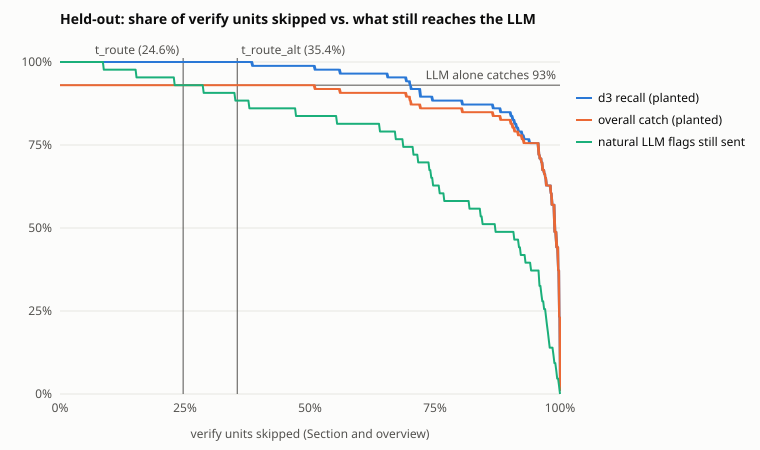

# #166 報告：d3-flash 當 summary verify 的 router

**建議：(c) 兩者都不做。** router 不放進 summary method，`t_d` 也不交給 #161 當事後類別。理由有四點：

- **(a) 省得少**：held-out 上省下 summary 總 token 的 11%（verify 的 19%）。
- **(a) 有品質代價**：LLM 在真實輸出裡抓到的錯，有 7% 會因此不再送到 LLM（43 句中 3 句），這 3 句都是真錯。
- **(a) 門檻不穩**：門檻落在分數的最頂端，同一個門檻在 dev 跳過 17% 的單位、在 test 跳過 25%。換 runtime 或換格式都要重新校準。
- **(b) 沒達到自己的標準**：`t_d` 在已交付的句子上標了 24%，其中只有 20% 是真錯，遠低於選它時要求的 80% 精確率。

d3 本身的判讀能力不是問題：它確實讀了證據，植入錯誤的 AUROC 是 0.975。問題在「錯句很少、門檻得壓在最高處」這個用法上。

登錄與方法見 [freeze.md](freeze.md)。test 只跑了一次（905 個請求，沒有中途停止）。數字來源：[metrics.json](metrics.json)、[selection.json](selection.json)、[blind-check.json](blind-check.json)。

**2026-11-06 重新驗證過**（§2.6、§2.7）：

- 獨立重算的全部數字都和檔案一致。
- 重送 dev 項目，分數逐位元相同。
- 對照官方 model card，讀分數的方式正確。

這次驗證修正了兩處解釋：

- held-out 的延遲被機器負載拖慢，已改用乾淨速率重估（§2.5）。
- 「一個單位一個請求可以降低 d3 負載」不成立，因為每題各自一次 forward（§3）。

兩處修正都不影響建議。

**2026-11-07 補做盲評對照組**（§2.4，事後分析，不在登錄裡）：

- 已交付但沒被 `t_d` 標的句子，盲評判為不受支撐的是 3/60 = 5%；被標的是 20%，約 4 倍（Fisher p = 0.025）。
- 推估 held-out 交付的句子約 8.6%（4.1–18.0%）不受支撐，而且都已通過 LLM verify。
- (b) 的結論不變：20% 仍遠低於登錄要求的 80%。d3 的標記雖然集中在殘留錯誤上，但只集中了約一半，所以「d3 當第二道檢查」也不建議（§3）。

## 1. 量了什麼

- 用 #155 frozen-1 的 20 篇論文。
- 每個 summary 句子配上它被驗證的 Section 文字，經 `POST /v1/systemone` 交給 d3-flash 判斷（`d3_server.py --device mps`）。
- 標註來自 t5b：原句當「正」，gpt-6-luna 植入的有效錯誤當「錯」。
- verify 單位是 frozen-1 裡每一次第一次 verify 呼叫：一個 Section，或一句 overview 句子。
- router 規則：單位裡任一句分數 ≤ `t` 就整個單位送 LLM，否則跳過。
- dev 5 篇用來選問法和門檻，held-out 15 篇只跑一次。

## 2. 結果

### 2.1 判別力

| | dev | held-out |
|---|---|---|
| 選中的問法 | Q2（noul：每個主張都有支撐嗎） | 同左 |
| AUROC（原句對有效植入） | 0.936（Q1 為 0.932） | **0.975**（95% bootstrap，按單位分群：0.957–0.990） |
| 負對照 AUROC（原句配對的 Section 對配錯的 Section） | 1.000（中位數 0.985 對 0.007） | 只在 dev 跑 |
| ECE（10 bin），校準前 → 校準後 | | 0.249 → 0.081 |

d3 確實讀了證據：同一句子換成同篇論文的另一個 Section，分數從約 0.98 掉到約 0.01。

### 2.2 router 在兩個門檻上的表現

held-out 共 536 個單位（436 個 Section、100 句 overview）、86 個有效植入、100 句原句，以及 43 句 frozen-1 裡被 LLM 標過的自然句子。區間都是 Wilson 95%。

| | `t_route` = 0.9864（A1 選項 1） | `t_route_alt` = 0.9828（只報告） |
|---|---|---|
| 跳過的單位 | **132/536 = 24.6%**（21.2–28.4%） | 190/536 = 35.4%（31.5–39.6%） |
| 其中 Section | 121/436 = 27.8% | 168/436 = 38.5% |
| 其中 overview | 11/100 = 11.0% | 22/100 = 22.0% |
| d3 recall（植入句被標） | 86/86 = 100%（95.7–100%） | 86/86 = 100% |
| 整體抓錯率（植入句被標且 LLM 判錯） | 80/86 = 93.0% | 80/86 = 93.0% |
| 只用 LLM 的抓錯率 | 80/86 = 93.0% | 80/86 = 93.0% |
| 誤刪原句：有 router／只用 LLM | 1/100／1/100 | 1/100／1/100 |
| **LLM 標過的自然句子，仍送到 LLM** | **40/43 = 93.0%**（81.4–97.6%） | 38/43 = 88.4%（75.5–94.9%） |
| 省下的 token（第一次 verify＋放棄的 repair/重驗） | 175,044 + 7,963 = 183,007 | 270,823 + 14,637 = 285,460 |
| 佔 summary 總 token（1,650,175） | **11.1%** | 17.3% |
| 佔 verify token（986,342） | 18.6% | 28.9% |

省下的 token 是估算值，算法如下：

- **分子**：frozen-1 只記錄每篇論文各步驟的 token 總量，沒有每次呼叫的數字。所以用 20 篇論文的總量做最小平方擬合（freeze §5），得到每次呼叫的估算：
  - verify prompt ≈ 327／次 + 0.337／證據字元；
  - verify completion ≈ 69／次 + 73／判的句子；
  - repair 同理。
  - 這個模型對每篇論文 verify prompt 的誤差最多 4.9%，completion 最多 23%；15 篇合計，估算的 verify＋repair 和實際只差 0.05%。
- 被跳過的 132 個單位：第一次 verify 估 175,044 token，之後的 repair 與重驗估 7,963 token。
- **分母**：15 篇 test 論文 summary 實際花的 token（map、verify、repair、reduce 的 prompt＋completion 合計）。
- prompt 和 completion token 直接相加，沒有按價格加權；USD 的換算見 §3。d3 自己的負載沒有扣掉，另見 §3 第 4 點。

dev 在 `t_route` 上的對照數字：

- 跳過 28/167 = 16.8%；
- 整體抓錯 41/45，和只用 LLM 相同；
- 自然 LLM 標記仍送到 LLM 的有 23/24；
- 第一次 verify 省 35,066/366,499 token。

圖：held-out 上每個分數都當一次門檻。橫軸是跳過的單位比例，縱軸由上而下三條線：

| 線 | 意義 | 圖上的行為 |
|---|---|---|
| 藍 | d3 對植入句的 recall | 跳過 38% 以前都維持 100% |
| 橙 | 整體抓錯率 | 跳過 50% 以前都等於只用 LLM 的 93% |
| 綠 | 自然 LLM 標記中仍送到 LLM 的比例 | 跳過 9% 就開始下降 |

綠線是 `figure.py` 事後依同一批分數算的，登錄只要求在兩個門檻上報這個數。

### 2.3 router 放過的自然錯誤

`t_route` 下，held-out 有 3 句被 LLM 標過的句子落在被跳過的單位裡。frozen-1 對這 3 句的處理是 2 句改寫、1 句刪除。我逐句對照了 Section，三句都是真錯：

- 一句把原文只並列陳述的兩件事寫成因果（加了「因為」）。
- 一句把原文限定的適用範圍擴大成一般情形。
- 一句加了原文沒有的「只」。

三句的 d3 分數是 0.987–0.992，都高於 `t_route`。它們正是 D4 要抓的「加了原文沒寫的因果、範圍、限定」。

植入錯誤（改數字、改主體、改比較）d3 幾乎全抓到；但這類細微錯誤，d3 給的分數和正確句子一樣高。

所以只看植入句的結果，會低估 router 的代價：植入句的整體抓錯率完全沒掉，自然錯誤卻掉了 7%。dev 掉了 1/24，兩個切分合計 4/67 = 6.0%（2.3–14.4%）。

### 2.4 `t_d`（給 #161 的事後類別）與盲評

`t_d` = 0.734（校準後機率，Platt a = 1.606、b = −4.536）。

- **標註集**（held-out）：
  - 標了 103 句，精確率 83/103 = 0.806（0.719–0.871）；
  - recall 83/86 = 0.965；
  - 正確原句被標 20/100。
  - 標註集裡錯句約佔 46%，所以這個精確率偏樂觀（freeze §5）。
- **已交付的句子**：held-out 論文交付的 776 句中，`t_d` 標了 **184 句（23.7%）**。
- **盲評**（freeze §6）：
  - 以 seed 166 從 184 句抽 60 句，分成 4 包，交給 4 個 Claude Opus 5.5 子代理（effort high）。
  - 子代理只看標題、Section 文字和句子，套用 D4 verify 的規則原文。
  - 結果：**12/60 = 20% 不受支撐**（11.8–31.8%）。其中 Section 句 9/44，overview 句 3/16。

照這個比例，184 個標記裡約 37 個（22–58 個）是真錯，其餘約 80% 是誤報。`t_d` 的門檻本來就是按「被標的項目中真錯 ≥ 80%」選的，到了錯句稀少的實際輸出上，精確率只剩 20%。一個五次有四次標錯的類別，讀者很快就會學會忽略它。

附帶發現：盲評判為不受支撐的 12 句，都通過了 frozen-1 的 LLM verify（DEV 是 claude-sonnet-5-5）。錯誤類型和 §2.3 相同：

- 把「例如」寫成全部；
- 把「若適用」寫成必須；
- 加了「只」；
- 把整體的性質歸給某個元件。

所以已交付的摘要裡仍有細微的錯誤殘留。這屬於 #155 的品質問題，與 router 無關；比例見下面的對照組。

**對照組（2026-11-07 補做，事後分析）**：從 held-out 已交付、`t_d` 沒標的 592 句中，以 seed 166 抽 60 句，用同一份 prompt、同樣的模型和 effort 盲評。抽樣程式在派出評審前 commit（46af1ef）；重跑被標組的抽樣與統計，結果和原本逐位元相同。

| | 被 `t_d` 標的 | 沒被標的 |
|---|---|---|
| 母體 | 184 句 | 592 句 |
| 不受支撐 | 12/60 = 20%（11.8–31.8%） | **3/60 = 5%（1.7–13.7%）** |
| 其中 Section 句 | 9/44 | 3/54 |
| 其中 overview 句 | 3/16 | 0/6 |

- 兩組差約 4 倍，Fisher 雙尾 p = 0.025；只看 Section 句是 p = 0.032。
- 按母體加權，held-out 交付的 776 句約 **8.6%** 不受支撐（兩組 Wilson 上下限加權組合：4.1–18.0%）。
- 這些錯句約 55% 落在 `t_d` 標的句子裡（點估計 37 句對 30 句，區間很寬）。
- 對照組 3 句的錯誤類型和被標組相同：把有限定的排名寫成一般情形、漏掉限定條件、把「可能」寫成必然。

解讀：

- d3 的標記有鑑別力：被標的句子不受支撐的比例約是沒被標的 4 倍。
- 當 (b) 仍不合格：精確率 20%，標記率 24%。
- 8.6% 是 #155 的品質數字。評審是 Claude Opus 5.5，套 D4 規則原文，可能比 DEV 的 Sonnet verify 嚴；沒有人工複核，所以這是「Opus 判為不受支撐」的比例，不等於人判的錯誤率。

限制：

- 事後補做，不在 freeze.md。
- 兩組組成不同：對照組 overview 只有 6 句（被標組 16 句），每包的 Section 證據也比較短（約 35k 對 55k 字元）。只看 Section 句，結論不變。
- 每組只有 60 句，區間寬。

### 2.5 延遲與 #88 的換算

d3_server 在 MPS 上、batch 1，client 端量到的每個請求：

| | n | p50 | p95 | 最大 | input tokens p50／p95／最大 |
|---|---|---|---|---|---|
| dev（一次帶兩題） | 404 | 4.46 s | 11.7 s | 25.2 s | 2,103／5,383／11,550 |
| held-out（一次帶一題） | 905 | 4.31 s | 11.3 s | 31.3 s | 792／1,819／4,289 |

**held-out 這一列被機器負載拖慢了，不能直接用。**

- 每個 input token 花的時間：dev 全程穩定在 2.1 ms；held-out 前 10% 的請求是 3.3 ms，後半段升到 5.6–6.0 ms。
- dev 一次帶兩題，每題各跑一次 forward（§2.7），所以 dev 一個請求的時間約是單題的兩倍。dev 的 2.1 ms/token 是兩題 token 加總後算的。
- 2026-11-06 在同一台機器上重送 15 個 dev 項目、只帶一題（§2.6），量到 0.07 s + 2.06 ms/token，和 dev 的速率相同。
- 用這個速率估 held-out 的 779 句單位句子：每個請求 **p50 約 1.7 s、p95 約 3.8 s、最大約 8.9 s**；一篇論文依序送完約 104 s。
- held-out 當時為什麼變慢，現在查不出來。
- 重送的是 dev 項目，不是 held-out 項目；test 項目照登錄只送一次。重送分數逐位元相同，代表這個 runtime 的分數可以重現。所以負載只拖慢速度，不會改變計算結果。這是推論，held-out 本身沒有重送驗證。
- 這些都是 MPS 的數字，不能當 PROD sizing（ADR-0011）。

**換算給 #88：**

- 每篇約 53.6 個 d3 請求（20 篇共 1,072 句單位句子）。
- 50 PDF/min 等於約 2,680 req/min，也就是 **約 45 req/s**。每個請求平均約 940 input tokens，合計約 42k tokens/s。
- model card 在 MI325X 上量的是「約 330 tokens 的 support ticket」：單題文字請求 19.2 ms，Engine batching 時 95 req/s（p99 < 1 s）。我們的請求平均長約 3 倍，所以 95 req/s 不能直接套用，要在 PROD 硬體上重量（#137）。
- 照目前的建議 (c)，summary 不會產生 d3 負載，這組數字只留給 #88 參考。

### 2.6 重現與獨立重算（2026-11-06）

- **重送 15 個 dev 項目**：
  - 以 seed 166 抽樣，同樣用 `d3_server.py --device mps --batch-size 1`，只帶 Q2，在 heavy-lock 下執行。
  - 結果：Q2 分數和 dev run（Q1、Q2 同一請求）**逐位元相同（|Δ| = 0）**。
  - 這表示 d3 在這個 runtime 上是確定性的，同一請求裡的其他題也不影響分數。
  - 只送 dev 項目；test 項目仍然只送過一次。結果在 [recheck-dev.json](recheck-dev.json)。
- **獨立重算**：一個沒看過本報告的子代理只拿 freeze.md 和原始資料，自己寫腳本（不 import `router.py`、`build_inputs.py`），重算了以下全部數字，結果和 commit 的檔案**全部一致**，沒有找到會改變任何數字的 bug：
  - 輸入、標註、單位重建；
  - dev 的問法選擇、`t_route`、`t_route_alt`、Platt、`t_d`、負對照；
  - test 的 AUROC 和 bootstrap、兩個門檻上的所有指標、token 模型、曲線、`curve.svg`（逐位元相同）；
  - 盲評抽樣與統計。
- **原始輸出的檢查**：
  - 每個項目恰好一個結果，server log 也顯示 404／905 次 POST 全部回 200，沒有重送。
  - 所有分數互不相同，沒有大量重複值。
  - input tokens 和證據長度成線性關係（r = 0.97／0.98），沒有截斷跡象。
  - 分數和證據長度無關（等級相關 0.03／−0.09）。
- 子代理指出的解釋差異都不改變數字，列在 §4。

### 2.7 對照官方用法

依據：[d3-flash model card](https://huggingface.co/vllm-sr/d3-flash) 與它連到的 vLLM-SR 文件（[quickstart](https://github.com/vllm-project/semantic-router/blob/main/website/docs/model-runtime/quickstart.md)、[reference](https://github.com/vllm-project/semantic-router/blob/main/website/docs/model-runtime/reference.md)），再加上本機套件的 `d3_format.py`、`d3_runtime.py`。

| 我們的做法 | 官方說法 | 結論 |
|---|---|---|
| 讀 Q2 的 `noul` 當 P(yes) | quickstart：noul 的答案是「the probability that the answer is yes」；`d3_format.py` 回傳的是「Yes / true」選項的機率 | 正確 |
| 不用 `confidence` | reference：「A Noul has none: its `noul` already says how sure it is」；choice 的 confidence 是 `(p_max − 1/n)/(1 − 1/n)`，描述的是最高選項 | 正確 |
| state 用 JSON 物件，不送圖 | card：「Text or JSON, plus images and videos」；套件把 JSON 轉成一行字串放進 prompt。`max_length` 是 null，超長會報錯，不會截斷 | 合規。但 JSON 和純文字哪種分數比較好，官方沒說，本研究也沒量 |
| 一請求帶兩題（只在 dev） | card：「answered together, each from its own forward pass over the input」 | 兩題互不影響（§2.6 已驗證）；但 freeze §1 寫的「每個請求一次 forward」不精確，見 §4 |
| 門檻用 dev 自己選 | card 和文件都沒有校準或門檻建議 | 只能這樣做 |
| 拿 d3 判「句子是否被原文支撐」 | card 的評測（Jev Decision Index、視覺 benchmark、safeagents-judge-bench）都不是文字對文字的 grounding 或驗證任務 | 這個用途沒有官方評測，本研究是唯一證據 |

還有一條 card 上的事實和本題相關：PROD 的 Engine batching 會讓「接近平手」的判斷改變（card 的樣本上是 0.075%）。我們的門檻剛好落在分數最密的地方，見 §3 第 3 點。

### 2.8 vLLM-SR 本體的介面確認：未執行

freeze §7 的前提是 Docker VM 記憶體 ≥ 44 GiB（flash 的 FP32 權重約 34 GB），這台機器的 Docker VM 是 23.4 GiB，所以未執行。

替代的證據是 #161 用 d3-mini 做的同一介面確認：vLLM-SR 0.5.0.dev，CPU float32，分數與 #153 MPS 的差 ≤ 0.0011。這只證明介面相同；flash 經 vLLM-SR 的分數沒有量。

即使當時跑了，freeze §7 登錄的容許差 |Δ| ≤ 0.02 也太寬，證明不了門檻能搬到另一個 runtime：門檻下移 0.02 時，test 跳過的單位會從 132 個變成 368 個；上移 0.005 就只剩 55 個。

## 3. 建議與理由

**(c) 兩者都不做。**

1. **省得少。**
   - 每篇論文省約 12.2k 個 LLM token（每篇總共約 110k）。
   - DEV 上換算：held-out 15 篇的 summary 共花 USD 4.84，11% 約 USD 0.53，約每篇 USD 0.035。
   - 要省到 17%，得改用 `t_route_alt`，代價是 5/43 的自然錯誤不再送到 LLM。
2. **有品質代價，而且植入測試看不出來。**
   - 自然錯誤掉了 7%（3/43，區間 2.4–18.6%），三句都是真錯，也都是 D4 規則要抓的類型。
   - router 的前提是「d3 放行的句子不必 LLM 判」，但 d3 對細微的限定詞、因果、範圍錯誤給高分。
3. **門檻不穩。**
   - `t_route` = 0.986，幾乎就是 dev 正確原句的中位數（0.985）。分數一點點漂移，跳過率就大幅改變：同一個門檻，dev 17%、test 25%。
   - test 的單位句子分數擠在 0.98–0.998 之間，16% 落在 `t_route` ±0.002 以內。門檻只要動 ±0.002，跳過率就在 18.8% 到 31.3% 之間擺盪。
   - PROD 的 batching 本來就會改變接近平手的判斷（§2.7），門檻落在這麼密的地方，影響會被放大。
   - 換 PROD runtime（ADR-0011）、換格式（Markdown、PPTX 的投影片短句）都要重新校準；#166 把「門檻改變等於 method 版本升級」列為待決事項，若採用，每次校準都要升版。
4. **d3 自己的負載不小。**
   - router 每篇要送約 52 個 d3 請求、約 49k input tokens，比它省下的 12.2k LLM token 多四倍，也接近 verify prompt 本身（每篇約 59k）。
   - 原因是 d3 一句一個請求，Section 文字每句都重送一次；LLM verify 則是一個 Section 一次。
   - 實際淨省多少 GPU，要看 PROD LLM 和 d3-flash 的相對成本（#137），這裡沒量。
5. **(b) 沒達到自己的標準**：見 §2.4。在實際輸出上精確率 20%，標記比例 24%。對照組顯示標記有鑑別力（被標 20% 對沒被標 5%），但五個標記有四個是誤報，不能當給讀者看的類別。

**為什麼不是 (a) 的變形**（例如只對 overview 或只對 Section 用 router）：overview 只跳過 11%；Section 的 3 句漏網全在 Section。兩種切法都沒有改變上面的結論。

**什麼情況下值得重開：**

- #88 的負載測試顯示 summary verify 是 50 PDF/min 的瓶頸。
- 而且第 4 點的負載能降下來。改成「一個單位一個請求、每句一題」降不了：官方說每題各自對整個 input 做一次 forward，d3 讀的 token 一樣多。只有支援 state 只讀一次的套件才可能降，文件點名的是 d3-turbo，不是 d3-flash。

即使負載降下來，第 2、3 點（細微錯誤、門檻位置）也不會改變；重開時要用自然錯誤（不只植入）重新驗。

**d3 放在 LLM verify 之後當第二道檢查，不值得另開票**（2026-11-07 與使用者討論後的結論）：

- d3 自己救不回 LLM 放過的錯：它不改判，只能決定哪些句子交給另一個更強的檢查。真正抓錯的是那個檢查，例如盲評用的 Opus。
- 這個篩選會漏：對照組顯示 d3 的標記只集中了約一半的殘留錯誤（§2.4），另一半在沒被標的句子裡。
- 更直接的做法是加強 verify 本身：換更強的模型，或在規則裡強調限定詞、範圍、語氣。殘留錯誤的類型很一致，這是 #155 的品質問題。
- d3 的篩選只有在第二道檢查很貴時（例如人審）才有意義；50 PDF/min 下沒有這種檢查。

## 4. 限制

- 錯誤是植入的，比例也不是自然比例。§2.3 已經顯示植入錯誤比自然錯誤容易抓。
- 原句一律標「正」（freeze §9）。
- 盲評者是 Claude，獨立性低於人審；未被標句子的對照組是 2026-11-07 事後補做的（§2.4）。
- §2.3 的三句是我自己讀的，沒有登錄。
- MPS 的門檻和延遲不能帶到 PROD（ADR-0011）。
- 只量了論文。Markdown 和 PPTX 的 Section 文字分布可能不同。
- 下列程式寫於 freeze 之後、不在 `freeze.json` 的 hash 裡，都不影響選擇：
  - `figure.py`（曲線上的綠線）；
  - `blind.py`（抽樣與統計，2026-11-07 加上對照組）；給盲評者的 prompt 另存在 [blind-prompt.md](blind-prompt.md)；
  - `recheck.py`（§2.6）。
- 獨立重算指出的登錄文字與解釋差異，都不改變任何報告的數字：
  - freeze §1 寫「每個請求各自一次 forward」。實際上 test 請求是一次 forward，dev 請求帶兩題，是兩次。
  - router 的誤刪率按 A2 的單位規則算：同單位有任一句被標，整個單位送 LLM，原句就會被 LLM 刪掉。若只看原句自己的分數，dev 會是 0/50 而不是 1/50；test 兩種算法都是 1/100。
  - 曲線的門檻集合沒有包含 40 個改寫後最終句的分數。這些句子不影響跳過率、recall 與抓錯率，所以曲線不變。
  - 盲評包把 Section 重新編號為 S1..Sk，和 LLM 當時看到的編號不同。這只影響外觀。
  - freeze §7 的容許差太寬（§2.8）。
- server log 顯示 transformers 在 MPS 上退回參考 PyTorch kernel（causal_conv1d、gated delta rule）。這只會變慢，不影響分數。

## 5. 檔案

| 檔案 | 內容 |
|---|---|
| [freeze.md](freeze.md)、[freeze.json](freeze.json) | 事前登錄與輸入的 hash |
| [selection.json](selection.json)、[test-launch.json](test-launch.json) | dev 上的選擇；test 啟動前 commit |
| [metrics.json](metrics.json) | held-out 的全部指標與曲線 |
| [blind-check.json](blind-check.json)、[blind-unmarked.json](blind-unmarked.json)、[blind-prompt.md](blind-prompt.md) | 盲評計數（被標組、對照組與兩組比較）與給盲評者的 prompt |
| [recheck-dev.json](recheck-dev.json) | 15 個 dev 項目的重送結果（只有分數、秒數、token 數） |
| [curve.svg](curve.svg) | 本報告的圖 |
| `build_inputs.py`、`run_d3.py`、`router.py`、`blind.py`、`figure.py`、`recheck.py`、`test_router.py` | 程式 |

論文文字、d3 的逐句輸出和盲評理由在 `~/archive/research/166-d3-router/`，不進 git。
