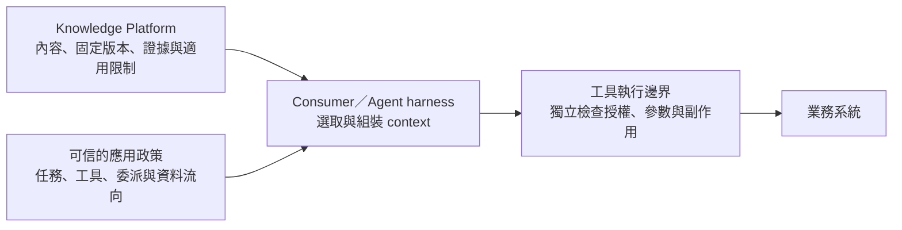

# Knowledge Platform 作為 Agent Context Layer 的治理研究

**研究日期：2026-10-17（Asia/Taipei）。狀態：官方來源調查與產品建議，尚未採納為新增 MVP 範圍。**

**後續修正：**[責任 retro 與 bounded spike](knowledge-governance-retro-spike-2026-10-17.md)收斂本研究的範圍：以下為候選面向，需按 selected pilot／資料流判定適用性，不是首次 agent 接入的整包新增 gate。模型已執行；使用者已補明 tSSO＋GAM／GAM-compatible 公司要求與內建 AA 預期能力，具體能力／相容範圍及 client 尚待驗證／選定，不能宣稱整合 qualified。

Knowledge governance 要讓公司能回答：**哪些知識在什麼條件下可以被依賴、可以如何再利用，出錯時如何停止影響、修正並追究責任。** Access control 是必要基礎；知識的來源權威、適用情境、品質、版本、用途與 agent 行為邊界也要受到治理。

本研究以目前 [wayfinder map #52](https://github.com/davidlinnnn/data-ingestion/issues/52)、[Governance #56](https://github.com/davidlinnnn/data-ingestion/issues/56) 與[已確認的內部產品方向](../design/knowledge-platform-internal-product-strategy.md)為基準。保留主題 owner 維護、合格更新自動發布、人類 browse／search／read／查證、既有 agents 共用知識的方向；local HLD 不作為現況依據。

## 調查結果與來源效力

| 來源類型 | 查到的重點 | 解讀界線 |
|---|---|---|
| NIST AI RMF 與 GenAI Profile | 用途、責任、驗證、provenance、持續監測、incident 與第三方風險均屬治理 | 自願風險管理指引，不是產品認證；AI RMF 1.0 查閱時正修訂中 |
| OWASP RAG 與 Agent 指引 | 文件／retrieval／memory 可被污染；context 不能取得指令或工具權限；需要跨 pipeline 的防護與追查 | 安全指引，不保證套用後可消除 injection，也不直接決定本平台的實作 |
| W3C PROV 與 ODRL | 可表達生成／責任鏈，以及許可、用途、禁止與義務 | 語彙與資訊模型；不會自行驗真、授權或執行政策，不要求本產品改用 RDF |
| Atlan、Microsoft、Databricks 官方文件 | 真實產品已區分來源權威、AI 可處理範圍、traces、lineage、eval 與安全控制 | 每個模組、入口、租戶與版本的覆蓋不同；不能由單一功能外推整個產品 |

來源：[NIST Framework](https://www.nist.gov/itl/ai-risk-management-framework)、[GenAI Profile](https://nvlpubs.nist.gov/nistpubs/ai/NIST.AI.600-1.pdf)、[OWASP RAG](https://cheatsheetseries.owasp.org/cheatsheets/RAG_Security_Cheat_Sheet.html)、[OWASP Agent](https://cheatsheetseries.owasp.org/cheatsheets/AI_Agent_Security_Cheat_Sheet.html)、[PROV-O](https://www.w3.org/TR/2013/REC-prov-o-20130430/)、[ODRL](https://www.w3.org/TR/2018/REC-odrl-model-20180215/)。逐項產品證據見下文及[產品來源筆記](knowledge-governance-context-layer-2026-10-17/product-sources.md)。

## 除了 Access Control 的八個治理面向

以下是依調查形成的產品治理模型，不是任何單一標準的逐字 checklist。

| 面向 | 公司要能決定什麼 | 對知識產品的具體要求 |
|---|---|---|
| 來源權威與適用範圍 | 這是正式政策、外部研究、工作草稿，還是生成解讀？對哪個部門／產品／期間有效？ | 顯示來源角色、owner、適用條件與已知衝突；不以最新上傳時間或 popularity 自動決定誰正確 |
| 證據與衍生解讀 | 結論由哪些確切內容與方法產生？引用是否真的支持主張？ | 原文、OCR／重建、生成整理分開歸責；保留固定版本與位置；檢查支持關係，不只檢查連結存在 |
| 品質與任務適用性 | 通過了什麼驗收？可供閱讀，是否也可作數字比較或自動決策依據？ | 合格標記附帶版本、規則、適用用途與限制；必要失敗不能被平均分或「有 citation」掩蓋 |
| 時效與生命週期 | 哪個版本目前適用？何時生效、失效、被替代、撤回？ | 分開處理內容更新、業務有效期、授權資格與 lawful retention；追蹤相關投影及下游副本的責任 |
| 用途與處理限制 | 可以讀，是否也可交給外部模型、寫入 memory、訓練、匯出或再散布？ | 從權責來源取得限制，在實際交付／處理邊界執行；未知或不支援的限制不能默默放寬 |
| Context 完整性與指令邊界 | 內容是否被污染？會不會藉文件改變 agent 的目標或工具行為？ | 可信來源／byte integrity／Canonical Acceptance 不等於無惡意指令；內容與可信操作政策分開 |
| 使用證據與隱私 | 哪個人／agent 在何時取得哪個版本？能否追查而不擴大資料曝露？ | 最小交付紀錄、correlation、受治理的調查讀取與保留；不預設記錄所有原始 prompts／context |
| 變更、例外與事件處理 | 誰能停用錯誤內容、處理衝突、恢復發布？ | 有可授權執行的停供／隔離、依賴影響追查、修正與重測流程；普通合格更新仍自動發布 |

NIST GenAI Profile 的 provenance owner、TEVV 歷史與 sources／citations 核對建議支持上述方向；W3C DQV 也將品質連到具體量測與 fitness for purpose，而非唯一的真實性分數。[NIST AI 600-1，第 3 節](https://nvlpubs.nist.gov/nistpubs/ai/NIST.AI.600-1.pdf)、[DQV](https://www.w3.org/TR/2016/NOTE-vocab-dqv-20161215/)

### 權威與適用性要跟著內容交付

一份公司正式 SOP、一篇外部 paper、根據二者生成的 Wiki 整理，可以都在使用者可讀範圍內，但對特定業務的權威、適用條件與使用限制不同。主題 owner 的工作是讓這些區別可辨識、處理有權責的例外；不能因擁有知識範圍就取得 Source Owner 的來源修改或政策授權。

已知衝突應保留兩方來源及適用域，由對應 owner 決定發布處置及適用說明；研究差異可保留為未解問題，不必選一方為真，也不承諾自動發現所有矛盾。適用時間也不是抓取時間或 publication time。未提供的 metadata 應標示未知；若某個操作必須確認適用期，未知就不能被當成已符合條件。

Atlan Knowledge Files 的公開設計已強調由內容 owner 選擇權威版本，而非無差別複製每個 drive／wiki；但其文件路徑仍有獨立成熟度與治理限制。[Knowledge folders and files](https://docs.atlan.com/product/capabilities/governance/knowledge-folders/concepts/knowledge-folders-and-files)

### 避免一個 Trust Score 蓋過所有問題

建議分開呈現：來源權威／歸責、處理保真、主張支持、適用期、必要 coverage、目前發布／授權資格，以及已知安全問題。某個項目「可信」必須能說明可信的是哪一件事。

例如，digest 一致能支持固定 bytes 未變；無法證明原文為真或沒有 injection。完整 metadata、存在 citation、模型 confidence、已通過文件解析，也不能互相代替其他驗收。品質與安全訊號應有規則、版本與測試範圍，避免讓 agent 把一個 badge 當成無條件行動授權。

## 作為 Agent Context Layer 的四項額外責任

### 知識內容與 Agent 操作權威分開

SOP 的步驟可以是任務參考，但不能因文件寫了某句話，就改變 system policy、取得額外憑證、執行任務外的外送或刪除。即使文件來自正式來源、已通過 Canonical Acceptance，仍須在指令處理上被當成不具操作授權的資料。Injection 也可能濫用原本已允許的工具，而不取得新權限；工具執行邊界還要檢查實際任務、目標、參數、資料流向與適用批准。OWASP 將 retrieved documents、API responses 等列為不可信輸入，並將 tool／execution 控制放在獨立邊界。[OWASP Agent Security](https://cheatsheetseries.owasp.org/cheatsheets/AI_Agent_Security_Cheat_Sheet.html)

圖是責任分工，不是新增服務或 protocol 選型。平台要保護來源／衍生內容與交付；agent harness 要維持內容與控制指令的分離；真正執行操作的系統仍應獨立驗權。文件內容不能覆寫後兩者的控制。

來源檢查、內容掃描、界線標記與測試可以分層使用，但沒有一個「安全 prompt」或 injection detector 能單獨保證安全；掃描也不應默默改寫應保留的原始證據。MCP 官方文章同樣強調 annotations 是風險 hints，其價值取決於 client 的具體動作，並不會讓模型自動抵抗 injection。[MCP annotations](https://blog.modelcontextprotocol.io/posts/2026-03-16-tool-annotations/)

### 可讀不等於可交給任何模型或作任何用途

建議把「內部閱讀」、「供指定應用使用」、「送往核准模型環境」、「寫入持久 memory」、「用於訓練／再散布」視為需分別判定的使用。具體許可來自公司政策、來源條款與有權責 owner；不能由模型自行推測，也不能只憑 caller 傳來的 `purpose` 字串視為已獲授權。

治理責任要到實際 egress／provider／memory／training 邊界。平台無法控制已任意複製離開的 bytes，因此只應對已選、可驗證的 consumer／資料流向承諾 enforcement。ODRL 可借來檢查許可、限制與義務的表示是否清楚，不會代替這些執行點。[ODRL Information Model](https://www.w3.org/TR/2018/REC-odrl-model-20180215/)

Microsoft 的官方 DLP 文件已有「使用者仍可存取，但 Copilot 不處理特定內容」的控制例子；同時明示 sensitivity-label 排除仍可能保留 citation、直接 prompt 上傳檔的內容不受該 DLP 掃描覆蓋。這說明 AI processing policy 與 read ACL 不同，也說明政策要逐入口檢查。[Purview DLP](https://learn.microsoft.com/en-us/purview/dlp-microsoft365-copilot-location-learn-about)

### 有交付紀錄不代表已證明 Agent 實際使用

平台可記錄「對哪個實際 principal／consumer，依哪項政策，在何時選取／釋出哪些 Published View／版本／證據參照」。沒有 client acknowledgement，不把 server 釋出紀錄當成 client 已收到；收到也不等於送入模型。Agent 是否實際放入模型 context、呼叫哪個工具並得到什麼結果，須由 consumer 的可觀測紀錄承接；這些仍不直接證明推理因果。

建議第一版先有可歸責的 delivery record 與 correlation，不直接擴大成完整 Canonical Agent Trajectory 或保存全部 prompt／response。敏感內容、查詢、引用與 identifiers 的調查可見性及保留仍要治理；盡可能以固定參照定位，必要時才授權讀取內容。[OWASP RAG monitoring guidance](https://cheatsheetseries.owasp.org/cheatsheets/RAG_Security_Cheat_Sheet.html#section-12-monitoring-and-incident-response)

Databricks 的 service lineage 文件明示不捕捉 runtime caller 或其存取資料；trace redaction 只改保存的 trace，不會改 agent 實際收到的輸入／輸出。故 catalog lineage、runtime trace、資料外洩控制與實際使用證據必須分開評估。[Service lineage](https://docs.databricks.com/gcp/en/data-governance/unity-catalog/ai-gateway-service-lineage)、[Trace redaction](https://docs.databricks.com/aws/en/mlflow3/genai/tracing/govern-redact)

### 撤回要跨交付路徑 但不能承諾倒帶

來源更新、授權撤銷、確認刪除、知識不再合格與疑似污染，需要各自可辨識的處置。普通更新可保留仍合格且授權的舊版；不合格披露不能等待一般 rebuild。Withdrawal、平台 custody purge、audit retention 與適用保留義務分開處理。

平台應阻止後續不合格交付，處理其所控制的索引、引用、快取與衍生資料；registered consumers 需要承接重新驗權、快取失效及持久化規則。已進入外部模型 context、下游產物或 agent memory 的內容，不能宣稱靠刪除平台原文就已追回。要明示可控範圍、接收方責任、通知與驗證機制；選定的治理要求不允許某種不受控複製時，就不支援該路徑。

此項延續目前 [#56](https://github.com/davidlinnnn/data-ingestion/issues/56) 的撤回／目前資格與 [#57](https://github.com/davidlinnnn/data-ingestion/issues/57) 的 custody 區別，並借鏡 OWASP 對 cache／memory 隔離、失效與保留的建議；不是採用「撤權一律等同立即物理刪除所有歷史」的簡化規則。[OWASP RAG](https://cheatsheetseries.owasp.org/cheatsheets/RAG_Security_Cheat_Sheet.html)、[Agent memory guidance](https://cheatsheetseries.owasp.org/cheatsheets/AI_Agent_Security_Cheat_Sheet.html#3-memory-context-security)

## 建議加入產品的六組治理能力

這些能力補強既有 PF01／PF04／PF05／PF06／PF07／PF08，不要求另外建一個龐大治理系統。以下優先序是研究建議，正式承接由 owner 決定；現有必要品質、授權、保留與撤回要求仍維持。

| 候選能力 | 依已選 pilot／資料流判定的適用範圍 | 後續按風險擴大 |
|---|---|---|
| 知識治理資訊 | 可辨識 owner、來源角色、用途／適用條件、版本與已知限制；原文／生成解讀可區分 | 更細的有效期、source precedence、業務語意與 cross-domain 衝突流程 |
| 發布與 Context 使用資格 | 套用當前政策、產品品質及所宣告用途，支援適用／不適用／未知的可解釋結果 | 更細目的、接收者、處理地點與資料再利用條件；policy change impact |
| Context 安全邊界 | 固定來源與方法歸責、授權寫入、已知問題處置；來源內容不能授予新資格，consumer／tool 在實際操作處維持限制；不保證模型永不受注入影響 | 依實際暴露能力做攻擊測試、污染偵測、隔離與恢復自動化 |
| 可驗證的交付介面 | client 取得所需版本、證據、freshness／coverage、限制與不可用語意；machine-readable 資訊由可信服務提供 | consumer capability／policy 相容性協商與更多 client；不先做通用 policy engine |
| 最小交付審計 | actor／consumer、時間、結果版本與參照、政策決定／原因、correlation；遵循資料最小化 | 必要時與 consumer traces、事件調查及影響分析串接 |
| 停供與事件處理 | 有權限者可停止疑似污染／錯誤版本的後續交付，追查依賴，修正與重測後恢復 | 跨多 consumer 的通知、失效回報與 drill；不預設完整 experience 平台 |

「machine-readable」不等於只在 response 附一段「請勿外傳」。Serving 與 consumer 需要約定哪些資訊可作提示，哪些限制已由 server 執行，哪些限制必須由 consumer／tool runtime 執行；不支援的路徑不能靠模型自律補齊。

## 最小治理驗收案例

以下為候選案例，並非要求第一個 client 實作所有工具／memory／training 能力。先盤點所選路徑實際暴露的能力；bounded read client 不必為此新增或認證付款、刪除等工具批准系統。具體適用性與責任以[retro](knowledge-governance-retro-spike-2026-10-17.md)為準。

| 案例 | 要證明的結果 | 主要驗收責任 |
|---|---|---|
| 正式 SOP 與外部研究都可讀 | 回傳來源角色與適用範圍，不把 paper 或 AI 整理誤標成公司正式政策 | 主題／Source Owner、projection／serving |
| 歷史 SOP 仍合法保留但不適合目前任務 | 歷史查證與當前操作用途能區分；不以「有權讀舊版」推導為可依據執行 | 來源／publication／governance／consumer |
| 合法來源內的已知惡意指令測試資料 | 保留原始證據歸責；依已選規則處理 context，並驗證即使工具已允許，獨立執行控制仍拒絕任務外目標／參數／外送或缺少必要批准的動作；檢查實際副作用，不只看拒答文字 | processing／security、serving、Agent Owner／工具 owner |
| 可閱讀但禁止交給未核准模型 | 實際交付／egress 路徑拒絕該使用；不只顯示 label | governance、consumer／模型服務 owner |
| 兩份定義衝突或引用不支持主張 | 已知限制可見，必要失敗不被自動發布；需要判斷的衝突交 owner | 主題 owner、Canonical／projection quality |
| 撤回後有快取、晚到工作或 restore | 平台及所選 consumer 的宣告範圍不恢復不合格披露，保留與 purge 另有證據 | governance、publication、custody、consumer |
| 事件調查要求重現某次交付 | 能定位交付版本、actor、政策與受影響 consumer；未把「交付」寫成「已實際用於決策」 | platform operations、consumer、incident owner |

自動化程度依具體風險設計：普通合格更新維持自動；未知用途、不支援限制、必要品質失敗與安全事件走明確處置。有責任人不等於每份文件都人工簽核。NIST Appendix C 也明確容許從自主到人工的不同 human-AI configuration。[NIST Appendix C](https://airc.nist.gov/airmf-resources/airmf/appendices/app-c-ai-risk-management-and-human-ai-interaction/)

## 如何承接到目前的 Map

| 已有 owner | 可重用的已確認邊界 | 研究帶來的具體補充問題 |
|---|---|---|
| [Source #53](https://github.com/davidlinnnn/data-ingestion/issues/53)／主題 owner | 身分、來源權威／政策交接與完整 capture | 來源對哪個用途有權威、適用期／限制由誰提供；主題 owner 如何回報與仲裁 |
| [Canonical #32](https://github.com/davidlinnnn/data-ingestion/issues/32)／[PDF #84](https://github.com/davidlinnnn/data-ingestion/issues/84) | 原文／重建／生成歸責、固定版本、必要品質與證據 | 不讓「成功擷取」冒充「對所有任務可信」；安全處置不默默破壞來源證據 |
| [Publication #55](https://github.com/davidlinnnn/data-ingestion/issues/55) | 產品品質、獨立發布、eligible old publication 與變更 | 業務適用性、已知衝突／安全事件如何影響發布；保留合格更新自動化 |
| [Serving #76](https://github.com/davidlinnnn/data-ingestion/issues/76) | 共通知識契約、所選 human／agent client、證據與版本 | context 作資料的界線、用途／限制語意、交付紀錄、consumer cache／persistence 義務 |
| [Governance #56](https://github.com/davidlinnnn/data-ingestion/issues/56) | 目前授權、委派、protected observations、撤回與完成證據 | 支援哪些使用／外送條件、哪些邊界真能執行；不要把 catalog label 當 enforcement |
| [Persistence #57](https://github.com/davidlinnnn/data-ingestion/issues/57)／[Topology #78](https://github.com/davidlinnnn/data-ingestion/issues/78) | custody、保留／purge、還原、最低可用 observability | delivery audit 的最小資料與保留、隔離／恢復、事件影響追查與資源責任 |
| Agent／application／tool owners | context assembly、agent 行為與業務工具不屬於 Knowledge Platform 自動接管的範圍 | 防止 content 提權、egress／memory／工具副作用、實際使用 traces 與 consumer-side 失效 |

Map 中已包含大量治理意圖，不能把上表全部當作新發現，也不能把 #56 的範圍無限擴成所有 agent security。新用途限制、consumer 義務或安全事件處理若超出既有 owner 契約，要明確承接並影響評估；完整 UI 仍依 #79 的既有時序。

## 來源筆記與限制

- [官方標準與指引](knowledge-governance-context-layer-2026-10-17/standards-sources.md)：NIST AI RMF／GenAI Profile、agent identity 工作狀態、PROV／ODRL／DQV。
- [Agent Context 安全](knowledge-governance-context-layer-2026-10-17/security-sources.md)：OWASP、MCP、污染與工具／memory 邊界。
- [企業產品實踐](knowledge-governance-context-layer-2026-10-17/product-sources.md)：Atlan、Microsoft、Databricks 的文件與覆蓋限制。

本次未操作付費 tenant、未做模型或惡意輸入的端到端測試，未判定特定法域或來源合約的適用法律。NIST agent identity initiative／NCCoE 專案仍有進行中工作，不能引用為已頒布的統一 agent standard。上述功能與驗收為研究建議；沒有修改 GitHub 決策、MVP 範圍或技術選型。
